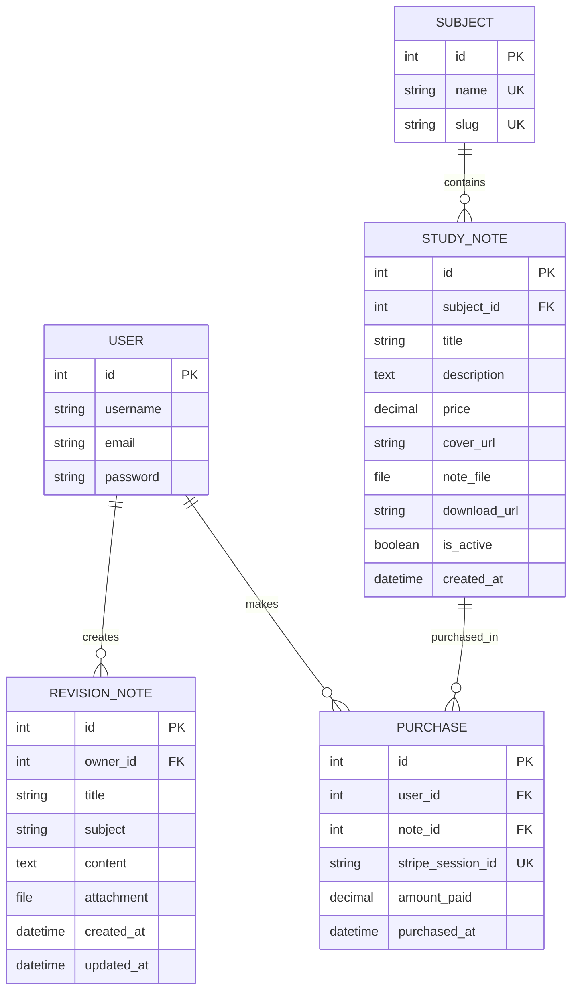

# Architecture and data model

[Back to UniNotes README](../README.md#documentation)

[Django Apps](#jump-django-apps) · [Database Design](#jump-database-design)

---

# In Development Changes

# Django Application Architecture

## Django Project Structure

UniNotes was developed using Django, a Python web framework that provides the tools needed to build a full-stack web application.

I organised the project into separate Django applications to keep different responsibilities manageable and avoid placing all the functionality into one large application.

The main project structure is shown below:

```text
uni-notes-main/
│
├── uninotes/
│   ├── settings.py
│   ├── urls.py
│   ├── asgi.py
│   └── wsgi.py
│
├── notes/
│   ├── models.py
│   ├── views.py
│   ├── forms.py
│   ├── urls.py
│   ├── decorators.py
│   ├── tests.py
│   ├── migrations/
│   ├── fixtures/
│   └── management/
│
├── checkout/
│   ├── models.py
│   ├── views.py
│   ├── urls.py
│   └── tests.py
│
├── templates/
│   ├── base.html
│   ├── notes/
│   ├── checkout/
│   └── registration/
│
├── static/
│   ├── css/
│   ├── js/
│   └── images/
│
├── media/
├── manage.py
├── requirements.txt
├── Procfile
└── runtime.txt
```

Each directory has a particular purpose. The `uninotes` directory contains the main Django configuration, while the `notes` and `checkout` directories contain the application's functionality.

The `templates` directory stores the HTML templates, and the `static` directory contains the CSS, JavaScript and images used throughout the website.

This structure made the project easier to manage during development because I could work on individual features without unnecessarily changing unrelated parts of the application.

<a name="jump-django-apps"></a>

## Django Apps

### App 1 - Notes

The `notes` application handles most of the functionality available to users.

Its responsibilities include:

- Displaying study resources on the home page.
- Searching for study notes using keywords.
- Filtering available study resources by subject.
- Displaying individual study note information.
- Registering new users.
- Displaying purchased resources.
- Allowing users to download purchased study notes.
- Creating personal revision notes.
- Viewing personal revision notes.
- Editing existing revision notes.
- Deleting revision notes.

The application also contains the main database models:

- `Subject`
- `StudyNote`
- `RevisionNote`
- `Purchase`

I used `models.py` to define how the data is stored, `views.py` to process user requests, and `forms.py` to handle registration and revision note forms.

The `urls.py` file connects the relevant URLs to their views.

### App 2 - Checkout

The `checkout` application handles the payment process.

Rather than placing all the Stripe payment logic inside the `notes` application, I separated it into its own Django app.

The checkout application is responsible for:

- Starting a Stripe Checkout session.
- Redirecting users to the Stripe payment page.
- Handling the return from a successful checkout.
- Checking the payment status with Stripe.
- Handling cancelled payments.
- Recording verified purchases using the `Purchase` model from the `notes` application.

The main payment functions are located in `checkout/views.py`.

The application also contains its own `urls.py` file to manage the checkout-related URL patterns.

### Why the Project Was Split Into Multiple Apps

I decided to separate the project into multiple Django applications because the study note features and payment functionality have different responsibilities.

The `notes` application mainly deals with resources, accounts and personal revision notes.

The `checkout` application focuses on processing payments through Stripe.

This approach made it easier to organise the code and locate particular functions when testing or fixing problems.

It also means that changes to the payment process can usually be made without changing the code responsible for displaying study notes.

## Django MVC / MVT Architecture

Django uses the Model-View-Template (MVT) architecture.

This separates the application into three main parts:

- Models
- Views
- Templates

### Models

Models define the structure of the data stored in the database.

In UniNotes, I created models for subjects, study notes, revision notes and purchases.

For example, the `RevisionNote` model stores information about revision notes created by registered users.

Each revision note is linked to its owner using a foreign key.

This relationship allows users to have multiple revision notes while keeping ownership information attached to each record.

### Views

Views contain the Python logic used to process incoming requests.

For example, the `browse_notes` view retrieves active study notes from the database and applies keyword or subject filters when requested.

The revision note views also handle creating, editing and deleting records.

I used Django functions such as `render()`, `redirect()` and `get_object_or_404()` to return the appropriate response.

### Templates

Templates are responsible for displaying information to users.

I used Django templates to connect the backend data with the HTML pages.

For example, the browse page receives the available study notes from its view and displays them as individual resource cards.

Using templates meant I could display database information without manually writing separate HTML for every study resource.

### URLs

URLs determine which Django view is executed when a user visits a particular address.

The main URL configuration is located in `uninotes/urls.py`.

This file includes the URL patterns from the `notes` and `checkout` applications.

Each app has its own `urls.py` file, making the routing easier to organise.

## Separation of Responsibilities

### Model Logic

Model logic is responsible for defining data structures and relationships.

I used Django model fields such as `CharField`, `TextField`, `ForeignKey`, `DecimalField` and `FileField`.

Some models also include methods such as `get_absolute_url()` to return the correct detail page for a database record.

### View / Business Logic

Views are responsible for handling requests and deciding what action should happen.

For example, when a user creates a revision note, the view first checks whether the submitted form is valid.

It then connects the new revision note to the logged-in user before saving it to the database.

The checkout views contain the payment-related logic, including creating Stripe Checkout sessions and checking successful payment details.

### Template Logic

Templates display data and provide the interface that users interact with.

I kept database queries and payment processing out of the HTML templates.

Instead, the views prepare the required information and pass it to the templates through a context dictionary.

The templates then use that information to display the correct content.

## Django Template Syntax

### Template Inheritance

To avoid repeating the same header, navigation and footer on every page, I created a shared `base.html` template.

Other pages extend this template using Django's template inheritance system.

For example:

```django

Browse Notes | UniNotes

    <h1>Browse Notes</h1>

```

This made the website more consistent and reduced the amount of duplicated HTML.

### Template Variables

Template variables allow database information to appear on the page.

For example:

```django
{{ note.title }}
{{ note.price }}
{{ note.subject.name }}
```

These variables are used to display information about individual study notes.

### Template Tags

I used Django template tags to control how information is displayed.

For example, the `` tag generates links using named URL patterns.

The `` tag is used to reference static files such as stylesheets and images.

### Conditional Rendering

Conditional statements allow templates to display different information depending on a particular condition.

For example, the navigation checks whether the user is authenticated.

Registered users can see links to their revision notes and purchases, while anonymous users are shown login and registration options.

### Loops

Django template loops are used to display multiple records from the database.

For example:

```django

    <h2>{{ note.title }}</h2>
    <p>£{{ note.price }}</p>

    <p>No notes found.</p>

```

This avoids manually writing HTML for every study note.

### Reusable Templates / Includes

I created a reusable study note card template called `partials_note_card.html`.

This template is included within pages that need to display study resources.

For example:

```django

```

Using a reusable template made it easier to maintain consistent card designs throughout the website.

## URL Structure

### URL Naming Conventions

I used descriptive names for URL patterns so they could be referenced throughout the project.

For example:

- `notes:home`
- `notes:browse`
- `notes:detail`
- `notes:revision_create`
- `notes:revision_edit`
- `notes:revision_delete`
- `checkout:buy`
- `checkout:success`

This is useful because links can refer to URL names rather than relying on hard-coded paths.

### App URLs

Both Django applications contain their own URL configuration files.

The main URL configuration includes these files using Django's `include()` function.

This separates the routing for study notes from the routing for payments.

### Dynamic URLs

I used dynamic URLs for pages that display or manage individual records.

For example:

```python
path("notes/<int:pk>/", views.note_detail, name="detail")
```

The `<int:pk>` section represents the primary key of a database record.

This allows one view and one template to display different study notes depending on the selected record.

## Custom Python Logic

### Custom Functions

I created Python functions to manage the application's features.

For example:

- `browse_notes()` searches and filters study resources.
- `revision_create()` creates personal revision notes.
- `revision_edit()` updates existing revision notes.
- `revision_delete()` deletes revision notes.
- `download_note()` handles access to purchased study note files.
- `create_checkout_session()` begins the Stripe Checkout process.

These functions are organised into their relevant Django applications.

### Conditional Logic

Conditional statements are used throughout the project.

For example, the application checks whether users are authenticated before allowing them to access personal revision notes.

It also checks whether a submitted form is valid before saving data.

During checkout, the application checks whether a user has already purchased a resource before allowing another checkout session to be created.

### Loops

Loops are used in Django templates to display collections of study notes and revision notes.

The backend retrieves the relevant records and passes them to the templates, which iterate over the data to generate the interface.

### Reusable Backend Logic

I used reusable Django functionality to avoid repeating unnecessary code.

Examples include:

- `@login_required` to restrict pages to authenticated users.
- `get_object_or_404()` to retrieve records safely.
- `get_absolute_url()` to generate detail-page URLs.
- `RevisionNoteForm` for both creating and editing revision notes.
- A custom `anonymous_required` decorator for registration.

This approach helped keep the project organised and made individual features easier to maintain.

## Django Architecture Evaluation

Overall, Django's MVT architecture provided a suitable structure for UniNotes.

Separating models, views and templates made it easier to understand which part of the application was responsible for each task.

Organising the project into `notes` and `checkout` also helped separate the core study-note functionality from payment processing.

One area that could be improved in the future is moving more complex payment operations into dedicated service functions instead of keeping all the Stripe logic directly in the checkout views.

This would improve the separation of responsibilities further and make the payment functionality easier to test and maintain.


<a name="jump-database-design"></a>

### Database Design

#### Database Overview

UniNotes uses Django's Object Relational Mapper (ORM) to manage the information stored in the database.

The ORM allows me to interact with the database using Python rather than writing SQL queries manually.

During local development, the project uses SQLite. The database configuration also supports PostgreSQL when a database connection is supplied through the `DATABASE_URL` environment variable.

I designed the database to support four main features:

- Organising study resources by subject.
- Storing information about study notes available for purchase.
- Allowing registered users to create and manage personal revision notes.
- Recording successfully verified study resource purchases.

The database models are defined in `notes/models.py`.

For user accounts, I used Django's built-in authentication system rather than creating a separate custom user model.

This approach allowed me to use Django's existing authentication functionality while concentrating on the features required for UniNotes.

#### Entity Relationship Diagram (ERD)

I used an Entity Relationship Diagram (ERD) to illustrate how the database models are connected.

The final database contains four custom models alongside Django's existing user model.

The relationships are shown below:



The diagram shows the main relationships between users, study resources, revision notes and purchases.

For example, one user can create multiple revision notes, but each revision note belongs to one user.

Similarly, a single study resource can be purchased by different users, with each purchase being stored as a separate database record.

These relationships help UniNotes identify the correct information when displaying personal notes, purchased resources and study materials.

#### Data Schema

The database schema defines the fields, data types and relationships used by each model.

I used Django model fields to specify what information should be stored and how it should be validated.

The database includes the following models:

| Model | Purpose |
|---|---|
| User | Stores registered user accounts using Django's authentication system. |
| Subject | Stores the available academic subjects. |
| StudyNote | Stores study resources available for purchase. |
| RevisionNote | Stores personal revision notes belonging to registered users. |
| Purchase | Records verified purchases and links users to purchased study resources. |

Each model has a primary key used to identify individual records.

The relationships between models are created using Django's `ForeignKey` field.

#### Database Models

##### Model 1 - Subject

The `Subject` model stores the academic subjects available on UniNotes.

Each subject can be linked to multiple study resources.

The model contains the following fields:

| Field | Data Type | Description |
|---|---|---|
| id | BigAutoField | Automatically generated primary key. |
| name | CharField(80) | Name of the academic subject. |
| slug | SlugField(90) | URL-friendly version of the subject name. |

Both `name` and `slug` have unique constraints.

This prevents duplicate subject names and duplicate slugs from being stored.

For example, a subject may have the name `Computer Science` and the slug `computer-science`.

The model also uses alphabetical ordering so that subjects can be displayed consistently.

##### Model 2 - StudyNote

The `StudyNote` model stores information about the study resources available on UniNotes.

Each study note is connected to one subject through a foreign key.

The model contains the following fields:

| Field | Data Type | Description |
|---|---|---|
| id | BigAutoField | Primary key. |
| subject | ForeignKey | Links the note to a subject. |
| title | CharField(120) | Name of the study resource. |
| description | TextField(1200) | Description of the resource. |
| price | DecimalField(6,2) | Price of the resource. |
| cover_url | URLField | Optional resource cover image URL. |
| note_file | FileField | Optional uploaded PDF file. |
| download_url | URLField | Optional external download link. |
| is_active | BooleanField | Controls whether a resource is available for browsing. |
| created_at | DateTimeField | Date and time the record was created. |

I used `DecimalField` for the price because it is more suitable for storing monetary values than floating-point numbers.

The price field also includes a minimum value validator of £0.50.

The `note_file` field uses a file extension validator that allows PDF files.

The `is_active` field helps control whether a study resource appears in the public browsing area.

The `get_absolute_url()` method generates the URL for an individual study resource.

##### Model 3 - RevisionNote

The `RevisionNote` model stores personal revision notes created by registered users.

This model is important because it provides the main Create, Read, Update and Delete (CRUD) functionality within UniNotes.

The fields are:

| Field | Data Type | Description |
|---|---|---|
| id | BigAutoField | Primary key. |
| owner | ForeignKey | Links the note to its owner. |
| title | CharField(120) | Title of the revision note. |
| subject | CharField(100) | Subject entered by the user. |
| content | TextField(5000) | Main revision note content. |
| attachment | FileField | Optional supporting document. |
| created_at | DateTimeField | Date and time the note was created. |
| updated_at | DateTimeField | Date and time the note was last updated. |

The `owner` field connects each revision note to a registered user.

This relationship is used when retrieving or modifying personal revision notes.

The `attachment` field supports the following file extensions:

- PDF
- DOC
- DOCX
- TXT

The `RevisionNoteForm` also contains validation to reject uploaded files larger than 5 MB.

I included the `created_at` and `updated_at` fields to record when revision notes were created and modified.

Unlike the `StudyNote` model, the `subject` field in `RevisionNote` is a text field rather than a foreign key.

This allows users to enter their own subject names when writing personal revision notes.

##### Model 4 - Purchase

The `Purchase` model records study resources purchased by registered users.

This model connects the user, the purchased study resource and the Stripe Checkout session.

The fields are:

| Field | Data Type | Description |
|---|---|---|
| id | BigAutoField | Primary key. |
| user | ForeignKey | User who purchased the resource. |
| note | ForeignKey | Purchased study resource. |
| stripe_session_id | CharField(255) | Unique Stripe Checkout session identifier. |
| amount_paid | DecimalField(6,2) | Amount paid by the user. |
| purchased_at | DateTimeField | Date and time the purchase was recorded. |

I used foreign keys to connect purchases with the relevant user and study resource.

The model also includes a unique constraint on the combination of `user` and `note`.

This prevents the database from recording more than one purchase for the same study resource by the same user.

The `stripe_session_id` field also has a unique constraint.

These constraints help maintain the integrity of purchase records.

#### Database Fields and Data Types

I selected different field types depending on the information that needed to be stored.

Examples include:

| Django Field | Usage |
|---|---|
| CharField | Names, titles and short text. |
| TextField | Descriptions and revision note content. |
| SlugField | URL-friendly subject identifiers. |
| DecimalField | Resource prices and payment amounts. |
| ForeignKey | Relationships between database models. |
| URLField | Cover image URLs and download URLs. |
| FileField | Uploaded study and revision documents. |
| BooleanField | Active or inactive resource status. |
| DateTimeField | Creation, modification and purchase dates. |

Using suitable data types helped make the database more organised and supported appropriate validation of stored information.

#### Primary Keys and Foreign Keys

Each Django model contains an automatically generated primary key named `id`.

A primary key uniquely identifies each database record.

Foreign keys are used to connect records across different database tables.

The main foreign keys in UniNotes are:

- `StudyNote.subject` connects a study resource to a subject.
- `RevisionNote.owner` connects a personal revision note to its owner.
- `Purchase.user` connects a purchase to a registered user.
- `Purchase.note` connects a purchase to a study resource.

These relationships allow the application to retrieve information from related models using Django's ORM.

#### Database Relationships

##### One-to-One Relationships

UniNotes does not currently use a custom one-to-one relationship between its main application models.

The required features can be supported using one-to-many relationships and a purchase model that connects users with study resources.

##### One-to-Many Relationships

The application uses several one-to-many relationships.

**Subject to StudyNote**

One subject can contain multiple study notes.

However, each study note belongs to one subject.

**User to RevisionNote**

One registered user can create multiple revision notes.

Each revision note belongs to one user.

**User to Purchase**

One user can have multiple purchase records.

Each purchase record belongs to one user.

**StudyNote to Purchase**

One study resource can appear in multiple purchase records belonging to different users.

Each purchase record refers to one study resource.

##### Many-to-Many Relationships

The relationship between users and purchased study resources is conceptually many-to-many.

A user can purchase multiple study resources, and the same study resource can be purchased by multiple users.

Instead of using Django's `ManyToManyField`, I represented this relationship through the `Purchase` model.

This was useful because each purchase also needs to store additional information such as:

- Stripe Checkout session ID.
- Amount paid.
- Purchase date.

The `Purchase` model therefore acts as an intermediary between users and study resources.

#### Relationship Rationale

I chose these database relationships because they reflect how the features of UniNotes work.

For example, linking study notes to subjects allows users to filter resources by academic subject.

Linking revision notes to their owners allows the application to retrieve only the personal notes belonging to the logged-in user.

The Purchase model provides a way to identify which study resources a user has purchased.

These relationships reduce unnecessary duplication and make it easier for the application to retrieve related information.

#### Data Integrity

Data integrity is important because the application stores user-generated content and payment records.

I used several Django model features to help keep the database consistent.

The `Subject` model uses unique constraints to prevent duplicate subject names and slugs.

The `StudyNote` model uses `on_delete=models.PROTECT` for its subject relationship.

This prevents a subject from being deleted while study resources still reference it.

The `RevisionNote` model uses `on_delete=models.CASCADE` for the owner relationship.

This means that deleting a user also deletes the revision notes associated with that user.

The `Purchase` model uses cascading foreign keys for users and study resources.

It also contains a unique constraint for the combination of user and study note.

These constraints help prevent duplicate ownership records and invalid relationships.

#### Data Validation

I used Django validators and forms to check information before it is saved.

For example:

- Study resource prices have a minimum value validator of £0.50.
- Study resource files are restricted to the PDF extension.
- Revision note attachments have an allowed list of file extensions.
- The revision note form rejects files larger than 5 MB.
- Registration uses Django's built-in user creation form.
- Registration also checks whether an email address is already in use.

The application also uses field definitions to limit text lengths and identify required values.

Django model validators are applied during model and form validation; they are not automatically run by every direct ORM save.

Additional checks in forms and views therefore remain important.

#### Database Configuration

The database configuration is located in `uninotes/settings.py`.

I configured the project to use SQLite for local development when no database URL is provided.

The local SQLite database is stored in `db.sqlite3`.

When the `DATABASE_URL` environment variable is supplied, Django uses `dj-database-url` to configure the database connection.

This allows the project to use PostgreSQL in a hosted environment without hard-coding database credentials into the project files.

The configuration also enables persistent database connections and connection health checks when using a supplied database URL.

Database migrations are used to apply changes to the database schema.

The main commands are:

```bash
python manage.py makemigrations
python manage.py migrate
```

I used migrations during development when creating and updating the models.

This helped keep the database structure in sync with the Python model definitions.

#### Data Flow

##### Front-End to Back-End Data Flow

When users interact with UniNotes, their actions are processed by Django views.

For example, when a registered user submits the form to create a revision note:

1. The user enters information into the revision note form.
2. The browser submits the form to the Django application.
3. The relevant URL routes the request to `revision_create()`.
4. The view receives the submitted form data and uploaded files.
5. Django validates the form.
6. The view assigns the current logged-in user as the note owner.
7. The revision note is saved to the database.
8. The user is redirected to the saved revision note.
9. A success message confirms that the revision note was created.

This process connects the HTML form, Django view, form validation and database model.

##### Database Query Flow

Django's ORM is used to retrieve database information.

For example, the following query retrieves active study resources:

```python
notes = StudyNote.objects.filter(is_active=True)
```

The `browse_notes()` view also filters notes using search keywords and selected subjects.

Another example is retrieving the revision notes belonging to the current user:

```python
notes = RevisionNote.objects.filter(owner=request.user)
```

This is important because personal revision notes should only be displayed to their owners.

For queries involving related database records, I used `select_related()` to retrieve related information more efficiently.

##### CRUD Data Flow

The `RevisionNote` model supports the main CRUD operations.

**Create**

Users complete a form, and Django saves a new revision note after validation.

**Read**

Users can view their personal revision notes and open individual records.

**Update**

Users can edit an existing revision note. Django loads the record, validates the updated form and saves the changes.

**Delete**

Users can request to delete a revision note. The application displays a confirmation page before processing the deletion through a POST request.

For viewing, editing and deleting individual revision notes, the application checks the `owner` field against the logged-in user.

This helps prevent users from accessing or modifying revision notes belonging to another account.

#### Data Model Evaluation

Overall, the database structure supports the main requirements of UniNotes.

The four custom models provide a suitable way to organise academic subjects, study resources, user-created revision notes and purchases.

Using Django's built-in user model reduced the need to develop a separate authentication database structure.

Foreign keys helped connect related records, while unique constraints helped prevent duplicate information.

The Purchase model was particularly useful because it stores payment-related information while connecting users to their purchased resources.

One limitation is that personal revision notes store their subject as text rather than linking it to the Subject model.

This provides flexibility, but it can also result in inconsistent subject names entered by users.

Another area for future improvement is file storage. The current configuration uses the local filesystem for uploaded media, which may not be persistent on hosting services with temporary filesystems.

A future version could use a dedicated cloud storage service for study resources and revision note attachments.

Despite these limitations, the database design provides the relationships and functionality required for the current version of UniNotes.
