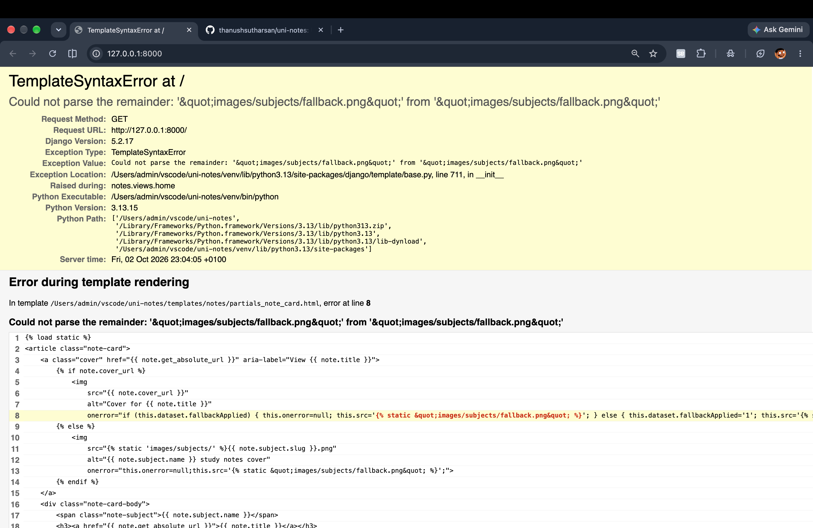
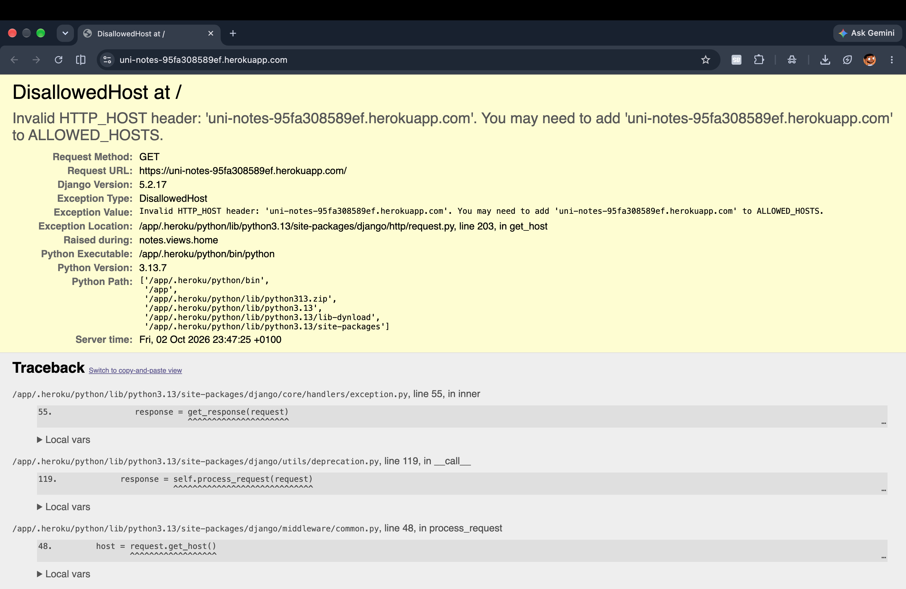
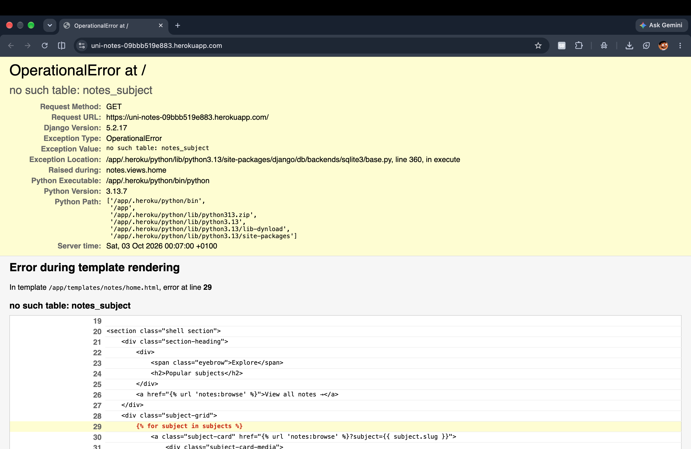
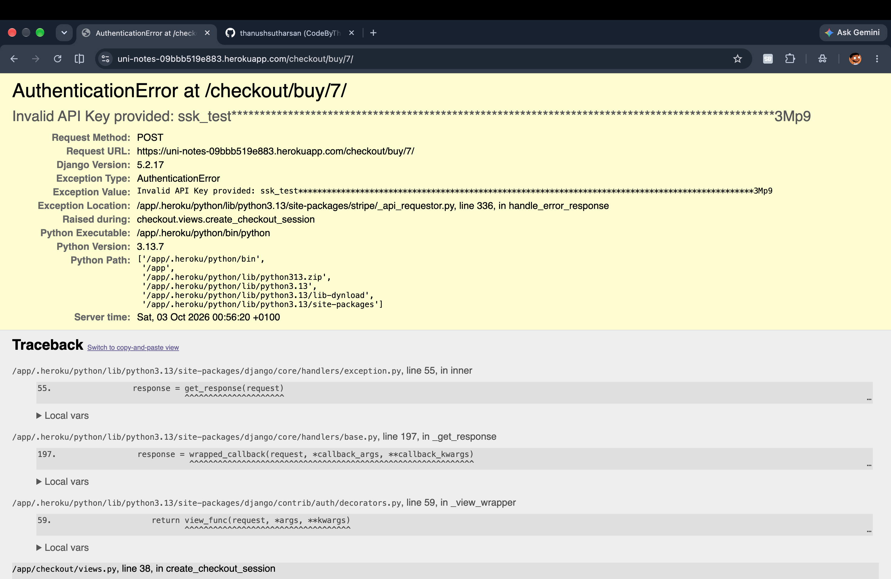

# Bug fixes and deployment

[Back to UniNotes README](../README.md#documentation)

## Contents

- [Bug Fix During Development](#bug-fix-during-development)
  - [Note Card Image Fallback](#note-card-image-fallback)
- [Bugs During Deployment](#jump-bugs-during-deployment)
  - [DisallowedHost Error](#disallowedhost-error)
  - [SQLite Being Used on Heroku](#sqlite-being-used-on-heroku)
  - [Adding Heroku PostgreSQL](#adding-heroku-postgresql)
  - [Running Migrations Against PostgreSQL](#running-migrations-against-postgresql)
  - [Subjects Missing From the Website](#subjects-missing-from-the-website)
  - [Duplicate Subject Fixture](#duplicate-subject-fixture)
  - [Study Notes Still Missing](#study-notes-still-missing)
  - [StudyNote Fixture Not Found](#studynote-fixture-not-found)
  - [PDF Files](#pdf-files)
  - [Media Configuration](#media-configuration)
  - [Production Database Configuration](#production-database-configuration)
  - [Deployment Debugging Summary](#deployment-debugging-summary)
  - [Useful Deployment Commands](#useful-deployment-commands)
  - [Authentication Error](#jump-authentication-error)

---

# Bug Fix During Development

## Note Card Image Fallback

During development, I found an issue with the fallback image used on the note cards. The original code used a complicated `onerror` attribute containing Django static template tags and several quotation marks.

This caused warnings in VS Code and made the image fallback harder to manage.

### Before the Fix

The original implementation attempted to load the subject image first and then the default fallback image if that also failed.

```html
onerror="if (this.dataset.fallbackApplied) { this.onerror=null; this.src=''; } else { this.dataset.fallbackApplied='1'; this.src='{{ note.subject.slug }}.png'; }"
```

The nested Django template tags and quotation marks made the code difficult to read and caused warnings in VS Code.

### Screenshot of the Issue



### Fix

I simplified the fallback image handling by storing the fallback image URL inside a `data-fallback` attribute.

```html

    

    

```

If the original image fails to load, the `onerror` event now reads the fallback image path from the `data-fallback` attribute.

This removed the complicated nested quotation marks and made the code easier to read and maintain.

### After the Fix

After making the change, the note cards displayed the fallback image correctly when an image could not be loaded.

### Screenshot of the Working Fix


<a name="jump-bugs-during-deployment"></a>

# Bugs During Deployment

During the deployment of **UniNotes** to Heroku, I encountered several issues that prevented the application from working correctly in the production environment.

The main deployment problems were related to:

- Django `ALLOWED_HOSTS`
- Heroku environment variables
- Database migrations
- SQLite being used instead of PostgreSQL
- Missing subject data
- Missing study note data
- Duplicate fixtures
- Fixtures not being found on Heroku
- Verifying the production database
- PDF/media file deployment

The following section documents the problems encountered, how I investigated them, and how each issue was resolved.

---

## DisallowedHost Error

### Problem

After initially deploying UniNotes to Heroku, the application failed to load and displayed the following error:

```text
DisallowedHost at /

Invalid HTTP_HOST header:
'uni-notes-09bbb519e883.herokuapp.com'.

You may need to add
'uni-notes-09bbb519e883.herokuapp.com'
to ALLOWED_HOSTS.
```

The deployed application URL was:

```text
https://uni-notes-09bbb519e883.herokuapp.com/
```

### Screenshot



### Cause

The project already used an environment-variable based `ALLOWED_HOSTS` configuration:

```python
ALLOWED_HOSTS = [
    host.strip()
    for host in os.environ.get(
        "ALLOWED_HOSTS",
        "localhost,127.0.0.1",
    ).split(",")
    if host.strip()
]
```

If an `ALLOWED_HOSTS` environment variable is not supplied, the application falls back to:

```text
localhost,127.0.0.1
```

When deployed to Heroku, Django therefore only recognised:

```python
["localhost", "127.0.0.1"]
```

The Heroku hostname was not recognised by Django and was blocked.

### Solution

I kept the existing environment-variable based configuration rather than hard-coding the Heroku domain into `settings.py`.

I added the following Config Var in Heroku:

```text
KEY:
ALLOWED_HOSTS

VALUE:
uni-notes-09bbb519e883.herokuapp.com,localhost,127.0.0.1
```

After adding the Config Var, Django recognised the Heroku domain.

The deployed settings then contained:

```text
[
    "uni-notes-09bbb519e883.herokuapp.com",
    "localhost",
    "127.0.0.1"
]
```

### Result

The `DisallowedHost` error was resolved and the application could process requests from the Heroku domain.

---

## OperationalError - Missing `notes_subject` Table

### Problem

After fixing the `ALLOWED_HOSTS` issue, another error appeared:

```text
OperationalError at /

no such table: notes_subject
```

The error occurred when the homepage attempted to display the popular subjects section.

The template contained:

```django

```

The application attempted to retrieve the subjects from the database, but the required table did not exist in the deployed database.

### Screenshot



### Cause

The Django models existed in the project, but the database migrations had not yet been applied to the Heroku database.

My local database already contained the tables because migrations had previously been run during development.

Heroku uses a separate database environment, so the tables also had to be created there.

### Solution

I ran the Django migrations directly on Heroku:

```bash
heroku run python manage.py migrate -a uni-notes
```

The migration output included:

```text
Operations to perform:
  Apply all migrations: auth, contenttypes, notes, sessions

Running migrations:
  Applying contenttypes.0001_initial... OK
  Applying contenttypes.0002_remove_content_type_name... OK
  Applying auth.0001_initial... OK
  Applying auth.0002_alter_permission_name_max_length... OK
  Applying auth.0003_alter_user_email_max_length... OK
  Applying auth.0004_alter_user_username_opts... OK
  Applying auth.0005_alter_user_last_login_null... OK
  Applying auth.0006_require_contenttypes_0002... OK
  Applying auth.0007_alter_validators_add_error_messages... OK
  Applying auth.0008_alter_user_username_max_length... OK
  Applying auth.0009_alter_user_last_name_max_length... OK
  Applying auth.0010_alter_group_name_max_length... OK
  Applying auth.0011_update_proxy_permissions... OK
  Applying auth.0012_alter_user_first_name_max_length... OK
  Applying notes.0001_initial... OK
  Applying notes.0002_studynote_note_file_alter_studynote_download_url_and_more... OK
  Applying sessions.0001_initial... OK
```

### Result

The required Django tables were created successfully.

---

## SQLite Being Used on Heroku

### Problem

While investigating the missing database table, I noticed that the deployed Django settings showed:

```text
ENGINE:
django.db.backends.sqlite3
```

and:

```text
NAME:
/app/db.sqlite3
```

This showed that Heroku was initially using SQLite.

### Cause

The project was intentionally configured to use SQLite locally and PostgreSQL when a `DATABASE_URL` environment variable was available.

The relevant configuration in `settings.py` was:

```python
database_url = os.environ.get("DATABASE_URL", "").strip()

if database_url:
    if not dj_database_url:
        raise ImportError(
            "DATABASE_URL is set but the "
            "`dj-database-url` package is not installed. "
            "Install it or unset DATABASE_URL."
        )

    DATABASES = {
        "default": dj_database_url.parse(
            database_url,
            conn_max_age=600,
            conn_health_checks=True,
        )
    }
else:
    DATABASES = {
        "default": {
            "ENGINE": "django.db.backends.sqlite3",
            "NAME": BASE_DIR / "db.sqlite3",
        }
    }
```

This configuration means:

```text
Local development -> SQLite
Production/Heroku -> PostgreSQL
```

The project therefore did not require the database configuration to be rewritten.

The issue was with the production environment rather than the Django code.

---

## Adding Heroku PostgreSQL

I checked the add-ons attached to the Heroku application using:

```bash
heroku addons -a uni-notes
```

The output showed:

```text
heroku-postgresql (postgresql-shaped-97220)

Plan:
essential-0

State:
created

Attachment:
DATABASE
```

This confirmed that Heroku PostgreSQL had successfully been attached to the application.

The database was available through Heroku's automatically generated:

```text
DATABASE_URL
```

environment variable.

Because the existing Django settings already checked for `DATABASE_URL`, the application automatically switched from SQLite to PostgreSQL.

---

## Running Migrations Against PostgreSQL

After PostgreSQL had been attached, I ran:

```bash
heroku run python manage.py migrate -a uni-notes
```

The result was:

```text
Operations to perform:
  Apply all migrations: auth, contenttypes, notes, sessions

Running migrations:
  No migrations to apply.
```

This confirmed that the database schema was up to date.

---

## Verifying That Heroku Was Using PostgreSQL

I wanted to verify that the deployed application was definitely using PostgreSQL rather than assuming the configuration had worked.

I attempted to run:

```bash
heroku run python manage.py shell -c "..."
```

However, the Heroku CLI returned:

```text
Error: Nonexistent flag: -c
```

### Cause

The Heroku CLI interpreted:

```text
-c
```

as a Heroku CLI option rather than an argument belonging to:

```text
python manage.py shell
```

### Solution

I added:

```text
--
```

between the Heroku command and the Django command.

This tells Heroku that everything after `--` should be passed directly to the application command.

The working command was:

```bash
heroku run -a uni-notes -- python manage.py shell -c "from django.conf import settings; from notes.models import Subject; print(settings.DATABASES['default']['ENGINE']); print('SUBJECT COUNT:', Subject.objects.count()); print(list(Subject.objects.values_list('name', flat=True)))"
```

The production application returned:

```text
django.db.backends.postgresql

SUBJECT COUNT: 6

['Business',
 'Computer Science',
 'Economics',
 'Law',
 'Mathematics',
 'Psychology']
```

### Result

This confirmed that:

- Heroku was using PostgreSQL
- The production database was accessible
- Six subject records existed in the live database

---

## Subjects Missing From the Website

### Problem

After fixing the database configuration, the website loaded but the subject data from my local development database was missing.

My local database contained:

```text
Business
Computer Science
Law
Mathematics
Psychology
Economics
```

### Cause

Running migrations only creates the database structure.

For example:

```bash
python manage.py migrate
```

creates tables such as:

```text
notes_subject
notes_studynote
```

but it does not automatically copy records from the local SQLite database into the Heroku PostgreSQL database.

The production database therefore needed to be populated separately.

---

## Checking the Local Subject Data

Before exporting anything, I verified that the subject records still existed locally.

I opened the Django shell:

```bash
python manage.py shell
```

Then ran:

```python
from notes.models import Subject
Subject.objects.all()
```

This confirmed that the original subject records had not been lost.

They still existed in the local SQLite database.

---

## Exporting the Subject Data

I exported the local subject data into a Django fixture using:

```bash
python manage.py dumpdata notes.Subject --indent 2 > subjects.json
```

The generated JSON contained six subject records.

An example object was:

```json
{
  "model": "notes.subject",
  "pk": 1,
  "fields": {
    "name": "Business",
    "slug": "business"
  }
}
```

The complete fixture contained:

```text
Business
Computer Science
Law
Mathematics
Psychology
Economics
```

---

## Creating the Django Fixtures Directory

The fixture was moved into Django's conventional fixture directory:

```text
notes/
└── fixtures/
    └── subjects.json
```

The directory was created using:

```bash
mkdir -p notes/fixtures
```

The fixture was moved using:

```bash
mv subjects.json notes/fixtures/subjects.json
```

The file could then be automatically discovered by Django's:

```bash
python manage.py loaddata
```

command.

---

## Duplicate Subject Fixture

### Problem

When I loaded the subject fixture on Heroku using:

```bash
heroku run python manage.py loaddata subjects -a uni-notes
```

Django returned:

```text
Installed 12 object(s) from 2 fixture(s)
```

I expected only six subjects.

### Cause

Two copies of `subjects.json` existed in the repository.

One was:

```text
subjects.json
```

in the project root.

The other was:

```text
notes/fixtures/subjects.json
```

Django discovered both files when searching for a fixture named:

```text
subjects
```

### Solution

The duplicate root fixture was removed.

Git showed:

```text
deleted: subjects.json
```

I then committed the deletion using:

```bash
git add subjects.json
git commit -m "fix: remove duplicate subject fixture"
git push
```

The correct fixture remained at:

```text
notes/fixtures/subjects.json
```

### Result

The project now contains one clearly defined subject fixture.

---

## Subjects Successfully Added to PostgreSQL

After loading the fixture, I verified the production database directly.

The command:

```bash
heroku run -a uni-notes -- python manage.py shell -c "from django.conf import settings; from notes.models import Subject; print(settings.DATABASES['default']['ENGINE']); print('SUBJECT COUNT:', Subject.objects.count()); print(list(Subject.objects.values_list('name', flat=True)))"
```

returned:

```text
django.db.backends.postgresql

SUBJECT COUNT: 6

['Business',
 'Computer Science',
 'Economics',
 'Law',
 'Mathematics',
 'Psychology']
```

This confirmed that the subject data was successfully stored in PostgreSQL.

---

## Study Notes Still Missing

### Problem

The subject cards eventually appeared on the live application, but each subject initially showed:

```text
0 notes
```

The website also indicated that no study notes were currently available.

### Cause

The:

```text
subjects.json
```

fixture contained only objects from the:

```python
Subject
```

model.

The actual revision notes were stored separately using the:

```python
StudyNote
```

model.

Therefore the production database had subjects but did not yet contain the associated study note records.

---

## Exporting the Study Notes

I exported the local `StudyNote` records using:

```bash
python manage.py dumpdata notes.StudyNote --indent 2 > notes/fixtures/studynotes.json
```

The fixture contained eight study notes.

---

## Study Note Data

The exported study notes were:

### Business

#### Marketing Principles Revision Notes

```text
Price: £5.00
```

Description:

```text
Key marketing models, definitions and exam-focused summaries.
```

PDF:

```text
study_notes/marketing_principles.pdf
```

#### Business Finance Essentials

```text
Price: £5.00
```

Description:

```text
Revenue, costs, profit and break-even explained for revision.
```

PDF:

```text
study_notes/business_finance.pdf
```

---

### Computer Science

#### Data Structures Summary Notes

```text
Price: £6.00
```

Description:

```text
Arrays, stacks, queues, linked lists and trees explained clearly.
```

PDF:

```text
study_notes/data_structures.pdf
```

#### Database Systems Revision Notes

```text
Price: £6.50
```

Description:

```text
Relational databases, keys, normalisation and SQL fundamentals.
```

PDF:

```text
study_notes/database_systems.pdf
```

---

### Law

#### Contract Law Complete Notes

```text
Price: £7.00
```

Description:

```text
A concise overview of core contract law principles.
```

PDF:

```text
study_notes/contract_law.pdf
```

---

### Mathematics

#### Calculus Fundamentals

```text
Price: £5.50
```

Description:

```text
Differentiation and integration rules with revision reminders.
```

PDF:

```text
study_notes/calculus_fundamentals.pdf
```

---

### Psychology

#### Cognitive Psychology Revision Guide

```text
Price: £5.50
```

Description:

```text
Memory, attention and research evaluation in concise sections.
```

PDF:

```text
study_notes/cognitive_psychology.pdf
```

---

### Economics

#### Microeconomics Exam Notes

```text
Price: £6.00
```

Description:

```text
Demand, supply, equilibrium and elasticity for exam revision.
```

PDF:

```text
study_notes/microeconomics.pdf
```

---

## StudyNote Fixture Not Found

### Problem

When I first attempted to load the study notes using:

```bash
heroku run python manage.py loaddata studynotes -a uni-notes
```

Heroku returned:

```text
CommandError: No fixture named 'studynotes' found.
```


### Cause

The fixture existed on my local computer but was not yet available inside the deployed Heroku application.

Heroku deploys the files contained in the Git repository.

Therefore a file must be:

1. created locally
2. added to Git
3. committed
4. pushed
5. deployed to Heroku

before Heroku can access it.

### Investigation

I checked whether Git was tracking the file using:

```bash
git ls-files notes/fixtures/studynotes.json
```

The expected result was:

```text
notes/fixtures/studynotes.json
```

This confirmed that the fixture was tracked by Git.

---

## Loading the Study Notes Into Heroku

Once the fixture had been committed and deployed, I ran:

```bash
heroku run python manage.py loaddata studynotes -a uni-notes
```

The eight `StudyNote` records were then inserted into the production PostgreSQL database.

### Result

The production database now contained:

```text
6 subjects
8 study notes
```

The note cards could then be displayed on the live UniNotes application.

---

## Understanding Fixtures

This deployment process helped demonstrate the difference between migrations and fixtures.

### Migrations

Migrations define and update database structure.

For example:

```bash
python manage.py migrate
```

creates tables such as:

```text
notes_subject
notes_studynote
```

### Fixtures

Fixtures contain actual records.

For example:

```bash
python manage.py loaddata subjects
```

adds subject records.

And:

```bash
python manage.py loaddata studynotes
```

adds study note records.

Therefore:

```text
migrations = database structure
fixtures = database content
```

---

## PDF Files

### Problem

Although the `StudyNote` database records now existed, each record only contained a path to its PDF.

For example:

```json
"note_file": "study_notes/marketing_principles.pdf"
```

A database record containing a filename does not automatically guarantee that the physical PDF file exists in the deployed application.

The actual PDF files therefore also had to be checked.

---

## Checking the PDF Files Locally

The PDFs were stored inside:

```text
media/study_notes/
```

I checked them using:

```bash
ls media/study_notes
```

The expected files were:

```text
marketing_principles.pdf
data_structures.pdf
contract_law.pdf
calculus_fundamentals.pdf
cognitive_psychology.pdf
microeconomics.pdf
database_systems.pdf
business_finance.pdf
```

This confirmed that the PDFs existed locally.

---

## Checking Whether Git Tracks the PDFs

I then checked whether the files were included in the Git repository using:

```bash
git ls-files media/study_notes
```

The PDF files were listed.

This confirmed that they were being tracked by Git rather than existing only on my local computer.

---

## Checking the PDFs on Heroku

The next step was to confirm whether the deployed Heroku dyno could see the files.

The following command was used:

```bash
heroku run -a uni-notes -- ls -l media/study_notes
```

This helps distinguish between two different problems:

```text
The PDF files were not deployed
```

and:

```text
The PDF files exist but the application is not serving /media/ correctly
```

---

## Media Configuration

The current Django settings contain:

```python
MEDIA_URL = "media/"
MEDIA_ROOT = BASE_DIR / "media"
```

The project also uses:

```python
STORAGES = {
    "default": {
        "BACKEND": "django.core.files.storage.FileSystemStorage",
    },
    "staticfiles": {
        "BACKEND": (
            "whitenoise.storage.CompressedManifestStaticFilesStorage"
        ),
    },
}
```

This means static files and media files are handled differently.

WhiteNoise is responsible for the project's static files, while the PDFs are currently treated as Django media files.

The deployment therefore required the PDF/media behaviour to be tested separately from static assets such as CSS, JavaScript and subject images.

---

## Production Database Configuration

The final database configuration allows the project to work both locally and on Heroku.

The project checks whether a production `DATABASE_URL` exists:

```python
database_url = os.environ.get("DATABASE_URL", "").strip()
```

If it exists:

```python
DATABASES = {
    "default": dj_database_url.parse(
        database_url,
        conn_max_age=600,
        conn_health_checks=True,
    )
}
```

the application uses PostgreSQL.

If it does not exist:

```python
DATABASES = {
    "default": {
        "ENGINE": "django.db.backends.sqlite3",
        "NAME": BASE_DIR / "db.sqlite3",
    }
}
```

the application uses SQLite.

This allows the same codebase to support:

```text
Local development
        ↓
SQLite

Heroku deployment
        ↓
PostgreSQL
```

---

## Deployment Debugging Summary

| Problem | Cause | Solution |
| --- | --- | --- |
| `DisallowedHost` | Heroku domain was not in `ALLOWED_HOSTS` | Added the domain using a Heroku Config Var |
| `no such table: notes_subject` | Production migrations had not been applied | Ran `python manage.py migrate` on Heroku |
| SQLite appeared on Heroku | Production database was not being used | Attached Heroku PostgreSQL |
| Subjects missing | Local data is not automatically copied to production | Exported the `Subject` records as a fixture |
| 12 objects loaded instead of 6 | Duplicate `subjects.json` fixtures existed | Removed the duplicate fixture |
| Subjects showing `0 notes` | Only subjects had been imported | Exported the `StudyNote` records separately |
| `No fixture named 'studynotes' found` | Fixture was not yet available in the deployed repository | Added, committed and pushed `studynotes.json` |
| Unsure whether Heroku was using PostgreSQL | Production configuration needed verification | Queried the database engine using the Heroku Django shell |
| PDF paths existed but files needed checking | Database records only store the filename/path | Checked local PDFs and Git tracking |
| Media deployment needed checking | Static files and media files are served differently | Tested the deployed `media/study_notes` directory |

---

## Useful Deployment Commands

### Check Heroku add-ons

```bash
heroku addons -a uni-notes
```

### Check Heroku Config Vars

```bash
heroku config -a uni-notes
```

### Run migrations

```bash
heroku run python manage.py migrate -a uni-notes
```

### Load subjects

```bash
heroku run python manage.py loaddata subjects -a uni-notes
```

### Load study notes

```bash
heroku run python manage.py loaddata studynotes -a uni-notes
```

### Check PostgreSQL and subjects

```bash
heroku run -a uni-notes -- python manage.py shell -c "from django.conf import settings; from notes.models import Subject; print(settings.DATABASES['default']['ENGINE']); print('SUBJECT COUNT:', Subject.objects.count()); print(list(Subject.objects.values_list('name', flat=True)))"
```

### Check local PDFs

```bash
ls media/study_notes
```

### Check PDFs tracked by Git

```bash
git ls-files media/study_notes
```

### Check PDFs deployed to Heroku

```bash
heroku run -a uni-notes -- ls -l media/study_notes
```

---

## What I Learned

The deployment process helped me understand that deploying a Django project involves more than pushing the source code to a hosting platform.

A project can work correctly locally while still failing in production because the production environment has different:

- environment variables
- hostnames
- databases
- database records
- storage
- file systems
- security settings

I learned that `ALLOWED_HOSTS` needs to be configured for the deployed domain rather than only for localhost.

I also learned that:

```text
python manage.py migrate
```

does not copy development data.

It only creates or updates the database structure.

To transfer my initial subject and study note records, I used Django fixtures with:

```text
dumpdata
```

and:

```text
loaddata
```

I also learned why it is important to verify the actual production database.

Rather than assuming that Heroku was using PostgreSQL, I queried the running application and confirmed:

```text
django.db.backends.postgresql
```

I then checked the production database directly and confirmed that the six subject records existed.

Another important lesson was understanding the difference between a database file reference and the actual file.

For example:

```json
"note_file": "study_notes/marketing_principles.pdf"
```

only tells Django where the file should be located.

The physical PDF still needs to exist in the deployment or be stored using an external media storage service.

By debugging each problem separately, I was able to progressively move UniNotes from a local Django application to a functioning Heroku deployment using PostgreSQL and production fixture data.

<a name="jump-authentication-error"></a>

## Authentication Error


### Stripe Authentication Error During Heroku Deployment

During the deployment and testing of UniNotes on Heroku, an authentication error occurred when attempting to purchase a study note through the Stripe Checkout system.

The application itself deployed successfully and the checkout view was being reached correctly. However, when the user selected the **Buy** button, Stripe rejected the API request.

The error appeared on the deployed Heroku application rather than during the initial deployment process.

---

### Error Message

When attempting to purchase a note, Django displayed the following error:

```text
AuthenticationError at /checkout/buy/7/

Invalid API Key provided: ssk_test********************************

Request Method: POST

Request URL:
https://uni-notes-09bbb519e883.herokuapp.com/checkout/buy/7/

Django Version: 5.2.17

Exception Type:
AuthenticationError

Raised during:
checkout.views.create_checkout_session
```

The traceback showed that the error occurred when the application attempted to create a Stripe Checkout Session.

The relevant section of the traceback was:

```text
/app/checkout/views.py, line 38, in create_checkout_session

session = stripe.checkout.Session.create(...)
```

This confirmed that Django successfully reached the checkout view, but Stripe rejected the authentication credentials before the checkout session could be created.

---

### Initial Investigation

The Stripe environment variables used by the project were checked using:

```bash
grep -R "STRIPE_" -n --exclude-dir=venv --exclude-dir=.git .
```

The project was configured to use the following environment variables:

```python
STRIPE_PUBLIC_KEY = os.environ.get("STRIPE_PUBLIC_KEY", "").strip()
STRIPE_SECRET_KEY = os.environ.get("STRIPE_SECRET_KEY", "").strip()
STRIPE_WEBHOOK_SECRET = os.environ.get("STRIPE_WEBHOOK_SECRET", "").strip()
```

The following files referenced the Stripe configuration:

```text
uninotes/settings.py

checkout/views.py

checkout/tests.py

.env

.env.example
```

The local `.env` file contained the development Stripe configuration while Heroku used environment variables stored in its Config Vars.

---

### Confirming Stripe Configuration

The Django production error page confirmed that the Stripe settings existed on Heroku.

The following settings were available:

```text
STRIPE_PUBLIC_KEY
STRIPE_SECRET_KEY
STRIPE_WEBHOOK_SECRET
```

This meant the error was not caused by Stripe environment variables being completely missing.

The issue was therefore narrowed down to the actual value stored inside the `STRIPE_SECRET_KEY` environment variable.

---

### Root Cause

The Stripe error message revealed that the secret key being supplied to Stripe started with:

```text
ssk_test_
```

However, a Stripe test secret key should start with:

```text
sk_test_
```

The incorrect value contained an additional `s` at the beginning:

```text
incorrect:

ssk_test_...
```

Instead of:

```text
correct:

sk_test_...
```

Because Stripe received an invalid secret key format, it rejected the request and raised:

```text
stripe.error.AuthenticationError
```

Therefore, the issue was not caused by the Django checkout logic.

The application successfully attempted to communicate with Stripe, but Stripe refused the request because the secret API key stored in Heroku was invalid.

---

### Security Consideration

During debugging, the original Stripe test secret key had been displayed.

Although this was only a test key, secret API keys should never be publicly exposed or committed to GitHub.

The exposed key was therefore treated as compromised and replaced with a newly generated Stripe test secret key.

The actual key is not included anywhere in this README.

Sensitive values are represented using placeholders such as:

```text
pk_test_YOUR_PUBLIC_KEY

sk_test_YOUR_SECRET_KEY
```

---

### Fix

A new Stripe test secret key was generated from the Stripe Dashboard.

The new Stripe keys were then added directly to Heroku Config Vars.

The public test key was added using:

```bash
heroku config:set STRIPE_PUBLIC_KEY="pk_test_YOUR_NEW_PUBLIC_KEY" -a uni-notes
```

The new secret test key was added using:

```bash
heroku config:set STRIPE_SECRET_KEY="sk_test_YOUR_NEW_SECRET_KEY" -a uni-notes
```

The webhook secret was also configured.

During development it could remain empty until webhook functionality was required:

```bash
heroku config:set STRIPE_WEBHOOK_SECRET="" -a uni-notes
```

---

### Checking the Secret Key Safely

Instead of printing the entire Stripe secret key in the terminal, only the beginning of the value was checked.

The following command was used:

```bash
heroku config:get STRIPE_SECRET_KEY -a uni-notes | cut -c1-8
```

The expected result was:

```text
sk_test_
```

This confirmed that Heroku was now using a correctly formatted Stripe test secret key.

The Stripe public key was checked in the same way:

```bash
heroku config:get STRIPE_PUBLIC_KEY -a uni-notes | cut -c1-8
```

The expected output was:

```text
pk_test_
```

This method allowed the configuration to be checked without exposing the complete API keys.

---

### Restarting the Heroku Application

After updating the environment variables, the Heroku application was restarted so that the new configuration would be loaded.

```bash
heroku restart -a uni-notes
```

The deployed application was then reopened using:

```bash
heroku open -a uni-notes
```

The checkout process could then be tested again using Stripe's test environment.

---

### Protecting the Local `.env` File

The local project uses a `.env` file for development environment variables.

For example:

```text
STRIPE_PUBLIC_KEY=pk_test_YOUR_PUBLIC_KEY
STRIPE_SECRET_KEY=sk_test_YOUR_SECRET_KEY
STRIPE_WEBHOOK_SECRET=
```

The `.env` file contains sensitive information and must not be committed to GitHub.

The following command was used to confirm that Git ignored the file:

```bash
git check-ignore .env
```

The expected output was:

```text
.env
```

The `.gitignore` file should therefore contain:

```gitignore
.env
```

An `.env.example` file is included instead.

This allows the required environment variable names to be documented without exposing any real credentials.

Example:

```text
STRIPE_PUBLIC_KEY=pk_test_replace_me
STRIPE_SECRET_KEY=sk_test_replace_me
STRIPE_WEBHOOK_SECRET=
```

---

### Why `.env.example` Is Safe

The `.env.example` file contains only placeholder values.

For example:

```text
STRIPE_PUBLIC_KEY=pk_test_replace_me
STRIPE_SECRET_KEY=sk_test_replace_me
STRIPE_WEBHOOK_SECRET=
```

This file can safely be committed to GitHub because it does not contain working API credentials.

The actual `.env` file remains excluded from version control.

---

### Stripe Configuration in `settings.py`

Stripe configuration is retrieved from environment variables inside `uninotes/settings.py`.

```python
STRIPE_PUBLIC_KEY = os.environ.get(
    "STRIPE_PUBLIC_KEY",
    "",
).strip()

STRIPE_SECRET_KEY = os.environ.get(
    "STRIPE_SECRET_KEY",
    "",
).strip()

STRIPE_WEBHOOK_SECRET = os.environ.get(
    "STRIPE_WEBHOOK_SECRET",
    "",
).strip()
```

This approach means API credentials are not hard-coded into the application source code.

Different values can therefore be used for local development and the deployed Heroku application.

---

### Stripe Configuration in `checkout/views.py`

Before creating a Stripe Checkout Session, the application checks whether a secret key has been configured.

The checkout view contains logic similar to:

```python
if not settings.STRIPE_SECRET_KEY:
    # stripe has not been configured
```

Stripe is then configured using:

```python
stripe.api_key = settings.STRIPE_SECRET_KEY
```

The Checkout Session is created using:

```python
session = stripe.checkout.Session.create(
    ...
)
```

The authentication error occurred at this stage because the value supplied to:

```python
stripe.api_key
```

was incorrectly formatted.

Once the correct environment variable was added to Heroku, no changes to the main Stripe checkout logic were required.

---

### Additional Deployment Issue Identified

While investigating the Stripe authentication problem, the Django error page also revealed that the deployed application was running with:

```text
DEBUG = True
```

This is suitable during local development but should not be enabled on a production deployment.

With `DEBUG = True`, Django can display detailed information including:

```text
environment configuration

installed applications

database information

request information

server information

tracebacks

application paths
```

Although Django automatically hides certain sensitive values, detailed debugging information should not normally be publicly available on a deployed application.

For production, the project should use:

```python
DEBUG = False
```

The production environment can instead control this using an environment variable.

For example:

```python
DEBUG = os.environ.get(
    "DEBUG",
    "False",
).lower() == "true"
```

Heroku can then be configured using:

```bash
heroku config:set DEBUG=False -a uni-notes
```

This allows local development and production to use different debugging settings.

---

### Testing the Fix

After updating the Stripe secret key and restarting the application, the following process was used to test the checkout system:

1. Open the deployed UniNotes website.

2. Sign into a test user account.

3. Navigate to a paid study note.

4. Select the **Buy** button.

5. Confirm that `/checkout/buy/<note_id>/` accepts the POST request.

6. Confirm that no `AuthenticationError` is displayed.

7. Confirm that Stripe creates a Checkout Session.

8. Confirm that the user is redirected to the Stripe Checkout page.

9. Complete the transaction using Stripe test payment details.

10. Confirm that the application returns to the correct success page.

---

### Expected Checkout Flow

The expected payment process is:

```text
User selects Buy
        |
        v
Django receives POST request
        |
        v
create_checkout_session()
        |
        v
Stripe secret key loaded from environment
        |
        v
stripe.checkout.Session.create()
        |
        v
Stripe validates API credentials
        |
        v
Checkout Session created
        |
        v
User redirected to Stripe Checkout
        |
        v
Test payment completed
        |
        v
User returned to UniNotes
```

Before the fix, the process stopped here:

```text
User selects Buy
        |
        v
Django receives POST request
        |
        v
create_checkout_session()
        |
        v
Incorrect STRIPE_SECRET_KEY
        |
        v
Stripe rejects API request
        |
        v
AuthenticationError
```

---

### Final Cause

The authentication problem was caused by an incorrectly configured Heroku environment variable.

```text
Incorrect:

STRIPE_SECRET_KEY=ssk_test_...
```

The correct Stripe test secret key format is:

```text
Correct:

STRIPE_SECRET_KEY=sk_test_...
```

The extra `s` caused Stripe's API authentication system to reject the request.

---

### Final Resolution

The issue was resolved by:

```text
1. identifying the Stripe AuthenticationError

2. checking the traceback

3. confirming that the error occurred during Stripe Checkout Session creation

4. checking the Stripe environment variable names

5. confirming that Heroku contained Stripe configuration

6. identifying the incorrect `ssk_test_` prefix

7. generating a new Stripe test secret key

8. replacing the incorrect Heroku Config Var

9. checking only the key prefix to avoid exposing credentials

10. restarting the Heroku application

11. testing the checkout process again

12. ensuring `.env` remained excluded from Git

13. keeping placeholder credentials inside `.env.example`

14. identifying that production should use `DEBUG = False`
```

---

### What I Learned

This issue demonstrated the importance of separating application code from sensitive configuration.

The Django checkout code itself was functioning correctly. The failure was caused by an incorrectly configured deployment environment variable.

The debugging process also demonstrated how a traceback can be used to identify whether a problem originates from:

```text
Django application logic

environment configuration

a third-party API

database configuration

deployment configuration
```

In this case, the traceback showed that the request successfully reached:

```text
checkout.views.create_checkout_session
```

and failed only after Stripe attempted to authenticate the API request.

This helped isolate the issue as a Stripe credential configuration problem rather than an error in the application's checkout logic.

The issue also highlighted the importance of never exposing secret API keys and of rotating any key that may have been accidentally shared during development.
