# Security and code quality

[Back to UniNotes README](../README.md#documentation)

[Defensive Programming](#jump-defensive-programming) · [Code Quality and Organisation](#jump-code-quality-and-organisation)

---

### Security

#### Security Overview

Security was an important consideration when developing UniNotes because the application manages registered user accounts, personal revision notes, uploaded files and purchase information.

I used Django's built-in security features alongside additional checks in my views and forms to help protect user information.

The main security measures in UniNotes include:

- Environment variables for sensitive configuration.
- Django secret key configuration.
- Authentication and password hashing.
- Restricted access to account-specific pages.
- Ownership checks for personal revision notes.
- CSRF protection on forms.
- Input and file validation.
- Purchase verification before downloads.
- Stripe-hosted payment processing.
- HTTPS-related production settings.
- Django security middleware.
- Git ignore rules for sensitive local files.

These measures help reduce common security risks, although further improvements are required before the application is suitable for handling live customer payments.

#### Environment Variables

I used environment variables to separate sensitive settings from the application's source code.

This is important because credentials and configuration values should not be hard-coded into files uploaded to GitHub.

The environment configuration is managed in `uninotes/settings.py`.

I used the `python-dotenv` library to load environment variables from a local `.env` file.

```python
import os
from pathlib import Path

from dotenv import load_dotenv

BASE_DIR = Path(__file__).resolve().parent.parent

load_dotenv(BASE_DIR / ".env")
```

The project uses environment variables for:

- `SECRET_KEY`
- `DEBUG`
- `ALLOWED_HOSTS`
- `CSRF_TRUSTED_ORIGINS`
- `DATABASE_URL`
- `STRIPE_PUBLIC_KEY`
- `STRIPE_SECRET_KEY`
- `STRIPE_WEBHOOK_SECRET`

Using environment variables allows different settings to be used during local development and deployment.

For example, local development can use SQLite and debugging, while the deployed application can use a hosted database and disable debugging.

The repository also contains an `.env.example` file showing the names of the required variables without containing real credentials.

#### Secret Keys

Django uses a secret key for cryptographic signing and other security-related operations.

The secret key is configured in `uninotes/settings.py`.

```python
SECRET_KEY = os.environ.get(
    "SECRET_KEY",
    "django-insecure-local-development-key-change-before-deployment",
)
```

During development, I used a fallback value to allow the application to start without a locally configured secret key.

However, this fallback must not be used in production.

A production environment should have its own securely generated `SECRET_KEY` configured through environment variables.

An improvement would be to make the application refuse to start in production if a real secret key has not been supplied.

This would prevent an accidentally deployed application from using the predictable development fallback.


#### Database Environment Variable

UniNotes supports different database configurations depending on the environment.

The database configuration is located in `uninotes/settings.py`.

The application retrieves the database connection information using:

```python
database_url = os.environ.get(
    "DATABASE_URL", ""
).strip()
```

If a database URL is supplied, the project uses `dj-database-url` to configure the connection.

```python
DATABASES = {
    "default": dj_database_url.parse(
        database_url,
        conn_max_age=600,
        conn_health_checks=True,
    )
}
```

If no database URL is provided, the application uses SQLite.

This approach allows the project to support PostgreSQL in a hosted environment without placing database passwords directly in the source code.

The database connection string may contain sensitive authentication information.

For this reason, it should be stored securely and should not appear in GitHub commits, screenshots or README examples.

#### .gitignore

I used a `.gitignore` file to prevent certain local files from being included in Git commits.

This is important because development environments often contain files that should not be uploaded to a public repository.

The following entries are included in my project's `.gitignore`:

```gitignore
.env
.venv/
venv/
__pycache__/
*.py[cod]
*.sqlite3
db.sqlite3
staticfiles/
.DS_Store
```

The `.env` entry helps prevent local environment credentials from being committed.

The virtual environment folders are excluded because they contain locally installed Python packages.

Python cache files and local database files are also excluded.

The `staticfiles/` directory is ignored because it contains generated static files collected for deployment.

A limitation is that `.gitignore` does not remove secrets that have already been committed.

If a secret is accidentally committed, it must be revoked or rotated and removed from the repository history where necessary.

##### Git Ignore Screenshot

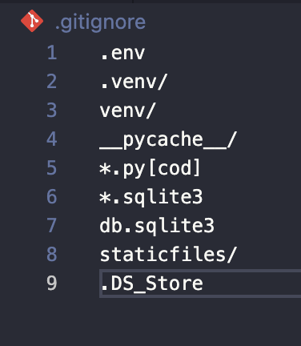

*Picture 35: The .gitignore file excludes the local environment file, virtual environments, database files and generated files from version control.*

#### DEBUG Configuration

Django's `DEBUG` setting controls whether detailed error information is displayed.

The configuration in UniNotes is:

```python
DEBUG = os.environ.get(
    "DEBUG", "True"
).lower() == "true"
```

During local development, enabling debugging helps identify problems because Django displays detailed tracebacks.

However, these tracebacks can expose information about the application's internal structure.

For production, `DEBUG` should be set to `False`.

For example, the Heroku configuration should contain:

```text
DEBUG=False
```

When debugging is disabled, Django does not display its detailed technical traceback pages to ordinary visitors.

The current settings default to `True` when the environment variable is missing.

This makes it particularly important to confirm that `DEBUG=False` is configured in Heroku.

A future improvement would be to use a safer production default and enable debugging explicitly only during development.

#### HTTPS

HTTPS protects information transmitted between a user's browser and the website by encrypting the connection.

This is important for UniNotes because users enter login credentials and access personal account information.

The Django settings include security options that are enabled when `DEBUG=False`.

```python
if not DEBUG:
    SECURE_SSL_REDIRECT = True
    SESSION_COOKIE_SECURE = True
    CSRF_COOKIE_SECURE = True
    SECURE_HSTS_SECONDS = 31536000
    SECURE_HSTS_INCLUDE_SUBDOMAINS = True
```

These settings have the following purposes:

| Setting | Purpose |
|---|---|
| SECURE_SSL_REDIRECT | Redirects HTTP requests to HTTPS. |
| SESSION_COOKIE_SECURE | Sends session cookies only over HTTPS. |
| CSRF_COOKIE_SECURE | Sends CSRF cookies only over HTTPS. |
| SECURE_HSTS_SECONDS | Instructs browsers to prefer HTTPS for a defined period. |
| SECURE_HSTS_INCLUDE_SUBDOMAINS | Extends the HSTS policy to subdomains. |

Heroku operates behind a reverse proxy, so Django must also correctly recognise when the original browser request used HTTPS.

This configuration should be verified before relying on Django's HTTPS redirects.

The HSTS configuration should also be reviewed carefully, especially when using a shared hosting domain rather than a domain fully controlled by the project.

##### HTTPS Deployment Screenshot

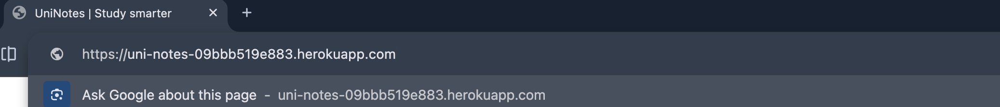

*Picture 36: The deployed UniNotes website is accessed through an HTTPS address, providing evidence that the browser is using an encrypted connection.*

#### CSRF Protection

Cross-Site Request Forgery (CSRF) is an attack where a malicious website attempts to make a user's browser submit an unwanted request to another website.

Django provides built-in CSRF protection through its middleware and template tags.

UniNotes includes the following middleware:

```python
"django.middleware.csrf.CsrfViewMiddleware",
```

I also used `` in POST forms.

For example, the revision note form contains:

```django
<form
    method="post"
    enctype="multipart/form-data"
>
    
```

The CSRF token allows Django to check that protected form submissions include a valid token.

I included CSRF protection in:

- Registration forms.
- Login forms.
- Logout forms.
- Revision note creation forms.
- Revision note editing forms.
- Revision note deletion confirmation forms.
- Stripe checkout initiation forms.

This provides protection against unauthorised cross-site form submissions.

##### CSRF Protection Screenshot

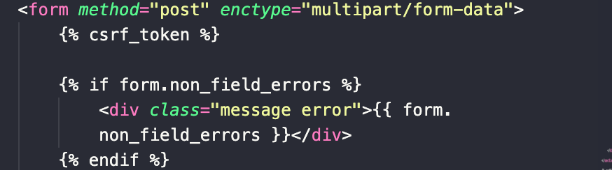

*Picture 37: The revision note form template contains Django's CSRF token, which helps protect POST form submissions against cross-site request forgery.*

#### Django Security Middleware

Django uses middleware to process requests and responses.

I included several middleware components that contribute to the application's security.

These are configured in `uninotes/settings.py`.

```python
MIDDLEWARE = [
    "django.middleware.security.SecurityMiddleware",
    "whitenoise.middleware.WhiteNoiseMiddleware",
    "django.contrib.sessions.middleware.SessionMiddleware",
    "django.middleware.common.CommonMiddleware",
    "django.middleware.csrf.CsrfViewMiddleware",
    "django.contrib.auth.middleware.AuthenticationMiddleware",
    "django.contrib.messages.middleware.MessageMiddleware",
    "django.middleware.clickjacking.XFrameOptionsMiddleware",
]
```

The main security-related middleware includes:

**SecurityMiddleware**

Supports HTTPS-related security settings and response headers.

**SessionMiddleware**

Allows Django to manage user sessions.

**CsrfViewMiddleware**

Provides CSRF protection for applicable requests.

**AuthenticationMiddleware**

Associates the authenticated user with each request.

**XFrameOptionsMiddleware**

Adds protections against certain clickjacking attacks by controlling whether pages can be embedded in frames.

**WhiteNoiseMiddleware**

Supports serving the application's static files, such as CSS and JavaScript.

Although WhiteNoise is not a replacement for Django's security controls, it helps provide static assets in the deployed environment.

##### Django Middleware Screenshot

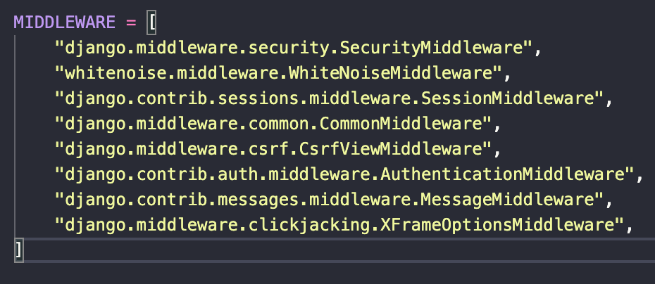

*Picture 38: The middleware configuration includes Django's security, session, authentication, CSRF and clickjacking protection components.*

#### Password Security

UniNotes uses Django's built-in user authentication system.

Django stores passwords using password hashing rather than saving plain-text passwords in the database.

I used Django's `UserCreationForm` for account registration.

The project also includes the following password validators:

- UserAttributeSimilarityValidator.
- MinimumLengthValidator.
- CommonPasswordValidator.
- NumericPasswordValidator.

These validators help reject passwords that are too similar to user information, too short, too common or entirely numeric.

I chose Django's existing authentication tools rather than attempting to create my own password storage system.

This reduced the amount of custom security-sensitive code needed for registration.

#### Authentication Security

I used Django's authentication system to control access to registered-user features.

The application includes:

- User registration.
- Login.
- Logout.
- Authenticated sessions.
- Restricted account pages.
- Password validation.

I used the `@login_required` decorator to restrict access to features that require an account.

For example:

```python
@login_required
def revision_notes(request):
    notes = RevisionNote.objects.filter(
        owner=request.user
    )

    return render(
        request,
        "notes/revision_list.html",
        {"revision_notes": notes},
    )
```

Anonymous users who attempt to access protected pages are redirected to login.

I also used a custom `anonymous_required` decorator to redirect already-authenticated users away from registration.

These checks help keep the user experience consistent and restrict access to account-specific functionality.

#### Authorisation and Permissions

Authentication confirms the user's identity, while authorisation determines what that user is allowed to access.

For UniNotes, I implemented permissions primarily through Django view decorators and database queries.

Anonymous users can browse public study resources.

Registered users can additionally:

- Create personal revision notes.
- View their own revision notes.
- Edit their own revision notes.
- Delete their own revision notes.
- View their purchases.
- Download resources they have purchased.

However, users should not be allowed to access another person's personal revision notes.

I therefore included ownership checks in the revision note views.

The current application does not include a custom role-based administration dashboard.

This could be introduced in future development.

#### Ownership Protection

I implemented ownership protection using Django's `get_object_or_404()` function.

For example:

```python
note = get_object_or_404(
    RevisionNote,
    pk=pk,
    owner=request.user,
)
```

This checks that the requested revision note exists and belongs to the current user.

If the note belongs to another account, Django returns a 404 response.

I used this approach in the revision note detail, edit and delete views.

This prevents users from accessing or modifying another person's revision notes through these views by changing an ID in the URL.

##### Ownership Protection Screenshot

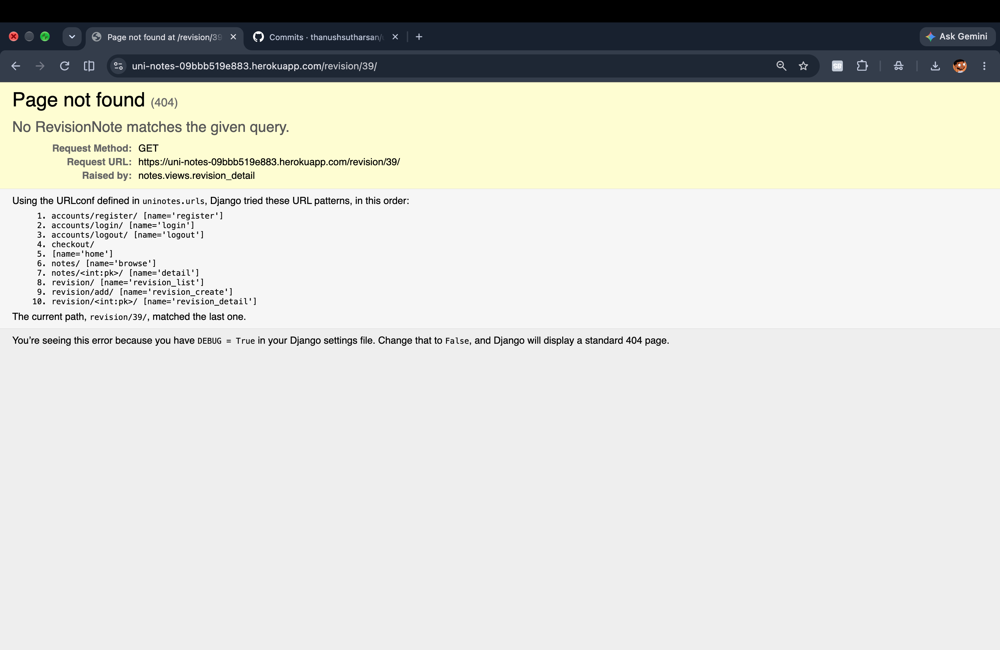

*Picture 39: UniNotes returns a 404 response when an authenticated test user attempts to access a revision note belonging to another account.*

#### Secure Payment Handling

UniNotes uses Stripe Checkout for processing payments.

Using Stripe's hosted checkout means the application does not directly collect or store customer card numbers.

I used environment variables for Stripe API credentials.

The checkout process also includes several checks:

- Users must be authenticated.
- Checkout must be initiated through a POST request.
- The selected resource must be active.
- Existing purchase records are checked.
- Stripe's payment status is checked after session retrieval.
- The returned session metadata is compared with the logged-in user.
- Duplicate purchase records are restricted.

The `Purchase` model includes a unique database constraint covering the user and study resource.

However, the current payment implementation has limitations.

The success view does not independently verify the paid amount and currency against the expected resource price.

The application also does not currently process verified Stripe webhooks.

These improvements are necessary before the application should accept live customer payments.

#### External API Security

The Stripe API is accessed through Django's backend rather than exposing the Stripe secret key in custom frontend JavaScript.

The Stripe secret key is loaded using:

```python
STRIPE_SECRET_KEY = os.environ.get(
    "STRIPE_SECRET_KEY", ""
).strip()
```

The payment success view retrieves the Stripe Checkout session using the backend Stripe library.

It also catches Stripe API errors during session retrieval.

```python
try:
    session = stripe.checkout.Session.retrieve(
        session_id
    )
except stripe.error.StripeError:
    messages.error(
        request,
        "Stripe could not verify this payment.",
    )
    return redirect("notes:browse")
```

This prevents handled Stripe retrieval errors from immediately producing an unhandled exception in that view.

An improvement would be to introduce equivalent error handling around Checkout session creation.

Stripe credentials must not be exposed in screenshots, GitHub commits or browser-accessible code.

#### Production Security

When deploying UniNotes to Heroku, I need to ensure that the production environment uses secure configuration.

The main production security requirements are:

| Configuration | Required Production State |
|---|---|
| DEBUG | False |
| SECRET_KEY | Unique, securely generated secret |
| ALLOWED_HOSTS | Includes the deployed application's hostname |
| CSRF_TRUSTED_ORIGINS | Includes the appropriate HTTPS origin where required |
| DATABASE_URL | Secure hosted database connection |
| STRIPE_SECRET_KEY | Stored as a private environment variable |
| SESSION_COOKIE_SECURE | True |
| CSRF_COOKIE_SECURE | True |
| HTTPS | Enabled and verified |

The application should also use its production dependencies from `requirements.txt`.

For example, the project includes Gunicorn as the application server and WhiteNoise for static files.

I can use Django's built-in deployment checks to identify potential configuration problems.

```bash
python manage.py check --deploy
```

This command checks several security-related Django settings.

However, the results depend on the settings and environment variables used when the command runs.

Running it locally with development settings does not automatically verify the deployed Heroku configuration.

Any warnings should be reviewed and recorded before considering production security complete.

The current media storage also needs attention.

Uploaded files are stored using Django's local filesystem storage.

This is not suitable for reliable private file storage on Heroku's temporary filesystem.

A future improvement would be to use private persistent cloud storage with access-controlled downloads.

#### Security Evaluation

Overall, I used Django's built-in security features to provide a foundation for protecting UniNotes.

Environment variables helped separate sensitive configuration from the source code.

Django's authentication system provided password hashing, password validation and authenticated sessions.

The `@login_required` decorator restricted account-specific pages, while ownership checks prevented users from accessing another person's revision notes through the protected views.

I also included CSRF protection in POST forms and used Stripe Checkout to avoid directly collecting card payment information.

The database relationships and unique constraints helped maintain ownership and purchase information.

However, security is an area where further development is required.

The most important improvements include:

- Removing the predictable Django secret key fallback from production.
- Using a safer production default for DEBUG.
- Verifying HTTPS and reverse-proxy configuration on Heroku.
- Checking HSTS settings against the deployment domain.
- Implementing verified Stripe webhooks.
- Validating payment amounts and currency before granting access.
- Using private persistent storage for purchased resources and personal attachments.
- Adding more automated security and permission tests.
- Improving file validation beyond extensions and size limits.

These improvements would strengthen UniNotes and make it more suitable for use beyond the current development project.

The implemented security measures demonstrate how Django's authentication, middleware, database and form features can be used together to protect a full-stack web application.


<a name="jump-defensive-programming"></a>

### Defensive Programming

#### Defensive Programming Overview

Defensive programming involves writing code that anticipates errors, invalid information and unexpected user actions before they cause problems within an application.

I considered defensive programming throughout the development of UniNotes because the application manages user accounts, personal revision notes, uploaded attachments and purchased study resources.

I used Django's built-in functionality alongside Python validation, conditional statements and exception handling to help prevent invalid operations and unauthorised access.

The main defensive programming techniques used in UniNotes include:

- Form validation.
- Model-level validators.
- Authentication checks.
- User permission checks.
- Ownership protection.
- Safe database retrieval.
- Stripe payment verification.
- API exception handling.
- Missing file handling.
- Delete confirmation pages.
- User feedback messages.

These measures help improve the reliability of the application and protect information associated with individual users.

#### Form Validation

I used Django forms to validate information submitted by users before allowing it to be saved to the database.

The application contains two main forms in `notes/forms.py`:

- `RegisterForm`
- `RevisionNoteForm`

The registration form validates user account information, while the revision note form validates personal notes and uploaded attachments.

For example, the revision note creation view checks whether the submitted form is valid before saving it.

```python
if form.is_valid():
    note = form.save(commit=False)
    note.owner = request.user
    note.save()
```

The `is_valid()` method checks the submitted information against the form's validation rules.

If the form is invalid, the application displays the form again with error messages rather than saving the information.

I also implemented custom attachment validation to restrict the size of uploaded files.

```python
def clean_attachment(self):
    attachment = self.cleaned_data.get("attachment")

    if attachment and attachment.size > 5 * 1024 * 1024:
        raise forms.ValidationError(
            "The uploaded file must be 5 MB or smaller."
        )

    return attachment
```

This method checks whether the uploaded attachment exceeds the maximum permitted file size of 5 MB.

If the file is too large, Django raises a validation error and prevents the attachment from being accepted through the normal revision note form.

This helps prevent users from uploading unnecessarily large files.

##### Form Validation Screenshot

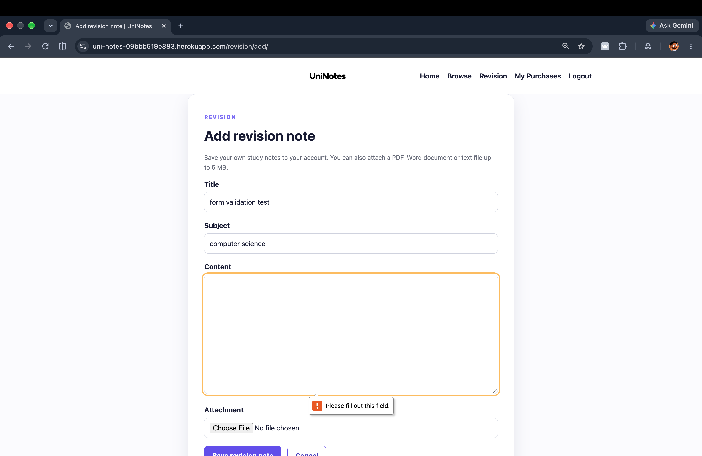

*Picture 40: UniNotes displays validation feedback when a user submits invalid form information, preventing the record from being saved until the error is corrected.*

#### Model Validation

I used Django model validators to define restrictions on information stored in the database.

For example, the `StudyNote` model contains a minimum price validator.

```python
price = models.DecimalField(
    max_digits=6,
    decimal_places=2,
    validators=[
        MinValueValidator(Decimal("0.50"))
    ],
)
```

This defines a minimum valid study resource price of £0.50 during model validation.

I also used `FileExtensionValidator` to restrict the permitted extensions for uploaded resources.

Study resources support PDF files, while personal revision notes support the following extensions:

- PDF
- DOC
- DOCX
- TXT

For example:

```python
FileExtensionValidator(
    allowed_extensions=[
        "pdf",
        "doc",
        "docx",
        "txt",
    ]
)
```

These validators help prevent unsuitable information from being submitted through the associated Django forms.

However, Django does not automatically run every model validator whenever a record is saved directly through the ORM.

This means that validation must also be considered when data is created or updated outside the normal form workflow.

File extension validation also does not guarantee that the content of an uploaded file is safe.

Additional file-content validation could improve this functionality in future development.

#### Authentication Checks

I used Django's `@login_required` decorator to restrict access to features intended for registered users.

For example, the revision notes list view uses authentication protection.

```python
@login_required
def revision_notes(request):
    notes = RevisionNote.objects.filter(
        owner=request.user
    )

    return render(
        request,
        "notes/revision_list.html",
        {"revision_notes": notes},
    )
```

The decorator checks whether the current user has an authenticated session.

If the user is not logged in, Django redirects them to the login page.

I used authentication protection for:

- Viewing personal revision notes.
- Creating revision notes.
- Editing revision notes.
- Deleting revision notes.
- Viewing purchase history.
- Downloading purchased resources.
- Starting Stripe Checkout.
- Accessing payment success and cancellation views.

These checks help prevent anonymous visitors from directly accessing account-specific functionality.

#### Permission Checks

Authentication identifies the user, while authorisation determines which information and actions that user is allowed to access.

In UniNotes, registered users can create and manage personal revision notes.

However, users should not be allowed to access or modify revision notes belonging to another account.

I implemented permission checks using Django view decorators and database queries.

The application also checks whether a user has purchased a study resource before granting access through the protected download view.

These restrictions help prevent unauthorised access through changes to URL parameters.

The current application does not include a separate custom role-based permission system.

#### Ownership Checks

Ownership checks are particularly important because UniNotes stores personal revision notes belonging to individual users.

Each `RevisionNote` record contains an `owner` field that links the note to a registered user.

I implemented ownership protection in two ways.

##### Filtering the Revision Notes List

Firstly, I restricted the revision notes list to records belonging to the authenticated user.

```python
@login_required
def revision_notes(request):
    notes = RevisionNote.objects.filter(
        owner=request.user
    )

    return render(
        request,
        "notes/revision_list.html",
        {"revision_notes": notes},
    )
```

The `filter()` method retrieves only revision notes where the owner matches the currently logged-in user.

This means that when a user opens their revision notes page, they only receive records associated with their own account.

For example, if User A and User B have both created revision notes, User A's list should only display User A's records.

This prevents personal revision notes belonging to other users from appearing in the list returned by this view.

##### Revision Notes Ownership Filtering Screenshot

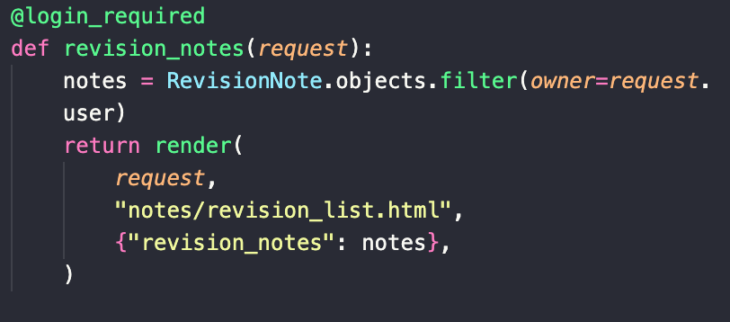

*Picture 41: The revision_notes() view uses owner=request.user to retrieve only the revision notes belonging to the authenticated user, preventing other users' notes from appearing in the personal revision notes list.*

##### Protecting Individual Revision Notes

Secondly, I implemented ownership checks when retrieving individual revision notes.

This is important because users could attempt to access another person's revision note by manually changing the ID in the URL.

For example, a URL might contain the primary key of an individual revision note.

Changing this number should not allow someone to access information belonging to another account.

To prevent this, I used Django's `get_object_or_404()` function.

```python
note = get_object_or_404(
    RevisionNote,
    pk=pk,
    owner=request.user,
)
```

This checks that:

1. The requested revision note exists.
2. The revision note belongs to the authenticated user.

If either condition is not satisfied, Django raises an HTTP 404 response.

I used this approach in the following views:

- `revision_detail()`
- `revision_edit()`
- `revision_delete()`

This helps prevent users from viewing, editing or deleting revision notes belonging to another account.

I also assigned ownership through the backend when creating a revision note.

```python
note = form.save(commit=False)
note.owner = request.user
note.save()
```

This ensures that the owner is assigned using the authenticated Django user rather than information supplied by the form.

##### Individual Revision Note Ownership Protection Screenshot

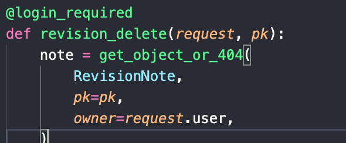

*Picture 42: The individual revision note views use get_object_or_404() with owner=request.user to verify that a requested record belongs to the logged-in user. Django returns a 404 response when no matching record exists.*

#### Safe Database Retrieval

I used Django's `get_object_or_404()` function to handle situations where requested database records do not exist.

This function attempts to retrieve the requested record.

If no matching record exists, Django raises an `Http404` exception rather than leaving an unhandled database lookup exception.

For example, the study resource detail view contains:

```python
note = get_object_or_404(
    StudyNote,
    pk=pk,
    is_active=True,
)
```

This retrieves a study resource only when the requested record exists and its `is_active` field is set to `True`.

If a resource does not exist or has been marked inactive, Django returns a 404 response.

I also used a similar approach when checking whether a user has purchased a resource.

```python
purchase = get_object_or_404(
    Purchase.objects.select_related("note"),
    user=request.user,
    note_id=pk,
)
```

This query checks whether the authenticated user has a Purchase record matching the requested study resource.

If no matching purchase exists, Django returns a 404 response.

This helps prevent users from downloading paid resources through the protected download view without a matching purchase record.

The query also uses `select_related()` to retrieve the related study resource together with the Purchase record.

This can help reduce additional database queries when accessing information from related models.

##### Protected Download Screenshot

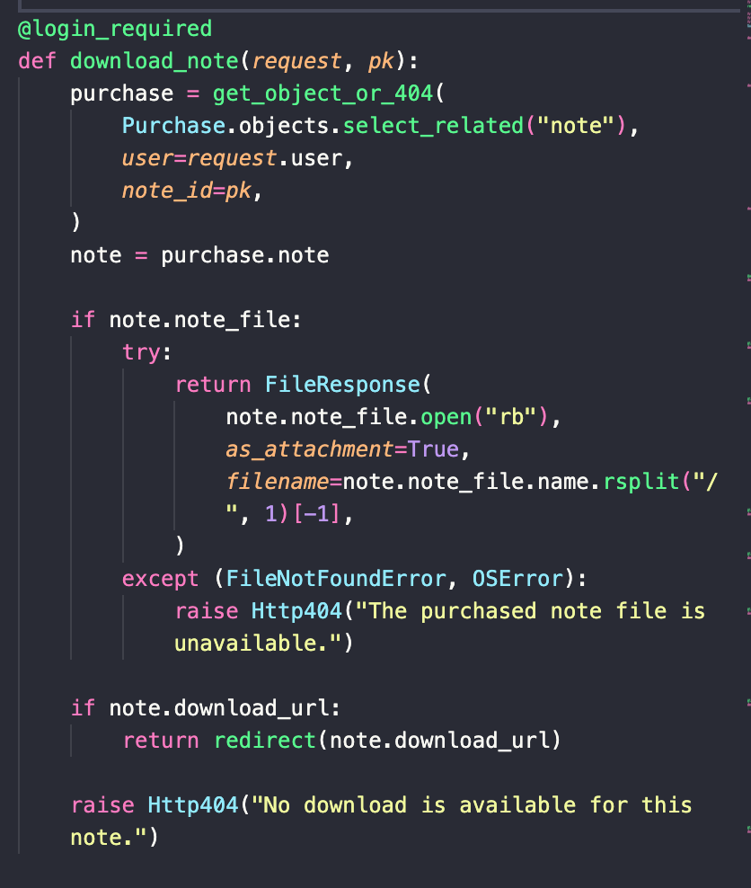

*Picture 43: The download view uses get_object_or_404() to check that the authenticated user has a matching Purchase record before allowing access to a purchased study resource.*

#### API Failure Handling

UniNotes communicates with the Stripe API to create checkout sessions and retrieve payment information.

Because external APIs can return errors, I included defensive checks during payment verification.

The payment success view first checks whether a Stripe Checkout session identifier and Stripe secret key are available.

```python
session_id = request.GET.get("session_id", "")

if not session_id or not settings.STRIPE_SECRET_KEY:
    messages.error(
        request,
        "We could not verify this payment.",
    )
    return redirect("notes:browse")
```

If either value is missing, the application displays an error message and redirects the user to Browse Notes.

This prevents the view from attempting payment verification without the required information.

I also included exception handling when retrieving the Stripe Checkout session.

```python
try:
    session = stripe.checkout.Session.retrieve(
        session_id
    )
except stripe.error.StripeError:
    messages.error(
        request,
        "Stripe could not verify this payment.",
    )
    return redirect("notes:browse")
```

The `try` block attempts to retrieve the session from Stripe.

If Stripe raises an error covered by `StripeError`, the exception is handled.

The application displays an error message instead of continuing with an unverified payment.

However, the checkout session creation view in the previously reviewed implementation does not contain equivalent exception handling.

An unexpected Stripe error during session creation could therefore produce an unhandled server error.

This could be improved in future development.

#### Payment Failure Handling

I implemented checks to prevent the application from recording purchases when the returned Stripe session information does not meet the existing verification requirements.

When a user returns from Stripe Checkout, the payment success view retrieves the session information.

The application then checks the payment status and metadata.

```python
user_matches = (
    session.metadata.get("user_id")
    == str(request.user.pk)
)

note_id = session.metadata.get("note_id")

if (
    session.payment_status != "paid"
    or not user_matches
    or not note_id
):
    messages.error(
        request,
        "Payment has not been confirmed.",
    )
    return redirect("notes:browse")
```

These checks help prevent an unpaid session or a session associated with another account from being accepted.

I also used `get_or_create()` when recording purchases.

```python
Purchase.objects.get_or_create(
    user=request.user,
    note=note,
    defaults={
        "stripe_session_id": session.id,
        "amount_paid": amount_paid,
    },
)
```

This helps prevent duplicate purchase records for the same user and study resource.

The Purchase model also contains a database uniqueness constraint covering the combination of user and study resource.

However, the current implementation has limitations.

It does not independently verify the returned payment amount and currency against the expected price of the resource.

It also does not use verified Stripe webhooks to record purchases independently of the browser returning to the website.

These areas should be improved before enabling live customer payments.

##### Stripe Payment Verification Screenshot

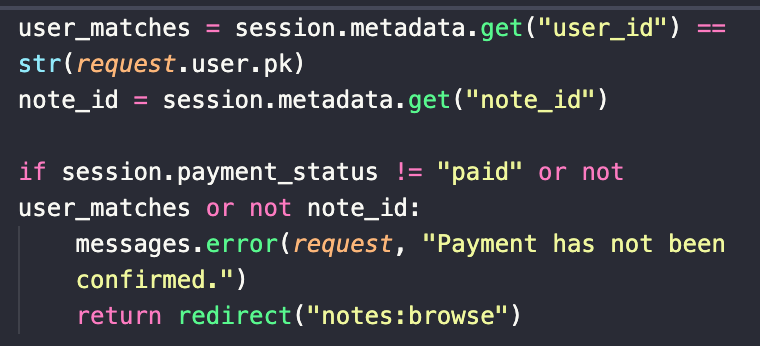

*Picture 44: The payment success view checks the Stripe payment status and user metadata before recording a purchase, helping prevent unverified transactions from being accepted.*

#### Error Handling

I used Django's exception handling and HTTP responses to manage situations where requested resources cannot be accessed.

For example, the purchased resource download view attempts to open the requested study note file.

```python
if note.note_file:
    try:
        return FileResponse(
            note.note_file.open("rb"),
            as_attachment=True,
            filename=note.note_file.name.rsplit(
                "/", 1
            )[-1],
        )
    except (FileNotFoundError, OSError):
        raise Http404(
            "The purchased note file is unavailable."
        )
```

The `try` block attempts to open the file.

If the file cannot be opened because of a handled filesystem error, Django raises an HTTP 404 response.

The application also checks whether an external download URL exists.

If neither an uploaded file nor a download URL is available, the view raises:

```python
raise Http404(
    "No download is available for this note."
)
```

This prevents the application from attempting to provide a resource when no download is available.

I also used Django's messages framework to provide feedback after different operations.

Examples include:

- Revision note saved to your account.
- Revision note updated.
- Revision note deleted.
- Payment has not been confirmed.
- Stripe could not verify this payment.

These messages help users understand whether an operation was successful or why it could not be completed.

#### Custom Error Pages

Django provides standard responses for common HTTP errors.

I considered the following status codes when evaluating UniNotes:

- 400 - Bad Request.
- 403 - Forbidden.
- 404 - Not Found.
- 500 - Internal Server Error.

The previously reviewed version of UniNotes does not contain dedicated custom templates for all four error codes.

I have therefore documented the existing behaviour and identified custom error pages as a future improvement.

##### 400 - Bad Request

HTTP 400 indicates that the server cannot process a request because it is invalid.

Django can generate this response for certain invalid requests.

The previously reviewed project does not contain a dedicated `400.html` template.

A future improvement would be to create a user-friendly error page explaining that the request could not be processed.

##### 403 - Forbidden

HTTP 403 indicates that access to a requested resource is forbidden.

Django can return this response when CSRF validation fails or when a view raises a permission-related exception.

In UniNotes, the main revision note views use ownership-filtered database queries.

These return a 404 response when a revision note does not belong to the authenticated user.

The previously reviewed project does not contain a dedicated `403.html` template.

##### 404 - Not Found

HTTP 404 is used when a requested resource cannot be found.

I used `get_object_or_404()` throughout UniNotes to handle missing database records.

Examples include:

- Opening a study resource that does not exist.
- Attempting to access an inactive study resource.
- Attempting to view another user's revision note.
- Attempting to download a resource without a matching purchase record.

For example:

```python
note = get_object_or_404(
    StudyNote,
    pk=pk,
    is_active=True,
)
```

If no matching study resource exists, Django returns a 404 response.

This helps prevent the application from attempting to display invalid database records.

##### Missing Study Resource Screenshot

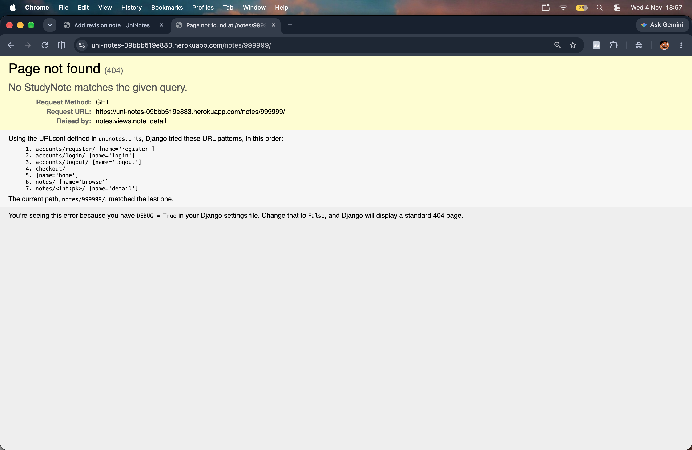

*Picture 45: UniNotes returns an HTTP 404 response when a user attempts to access a study resource that does not exist.*

##### 500 - Internal Server Error

HTTP 500 indicates that an unexpected server-side error has occurred.

When `DEBUG=False`, Django normally displays a generic server error response rather than a detailed development traceback.

The previously reviewed project does not contain a dedicated `500.html` template.

A future improvement would be to introduce a custom 500 error page.

This could display a simple message explaining that an unexpected problem occurred and provide navigation back to the home page.

Additional production error logging would also help with identifying unexpected backend problems.

#### Defensive Programming Evaluation

Overall, defensive programming helped improve the reliability and security of UniNotes.

Django form validation helped prevent incomplete or invalid information from being saved through the application's forms.

Model validators provided additional restrictions on prices and uploaded file extensions.

Authentication checks restricted personal functionality to registered users.

Ownership checks prevented users from accessing another person's revision notes through the protected views.

Filtering the revision notes list using `owner=request.user` ensured that users only retrieved records associated with their accounts.

Using `get_object_or_404()` provided additional protection when users attempted to access individual revision notes or purchased resources.

I also included exception handling for missing purchased files and selected Stripe API errors.

The revision note deletion feature requires a POST request after displaying a confirmation page, reducing the risk of accidental deletion.

However, there are areas that could be improved.

Future improvements include:

- More comprehensive Stripe API error handling.
- Verified Stripe webhooks.
- Payment amount and currency verification.
- Additional uploaded file security checks.
- Private persistent storage for purchased resources.
- Custom 400, 403, 404 and 500 error pages.
- More automated tests for invalid requests.
- Additional tests for unauthorised editing and deletion.

These improvements would make UniNotes more reliable and better prepared for handling unexpected situations.

The current implementation demonstrates how Django's form validation, authentication, ownership checks, database queries and Python exception handling can work together to reduce errors and protect user information.


<a name="jump-code-quality-and-organisation"></a>

### Code Quality and Organisation

#### Code Quality Overview

Code quality was an important consideration during the development of UniNotes because I wanted the application to be organised, readable and easy to maintain.

As the project developed, I added features such as user authentication, personal revision notes, study resources, file uploads and Stripe payment integration.

These features required different parts of the application to work together. I wanted to avoid placing all the functionality into one large file because this would make the code difficult to understand and maintain.

To help improve code quality, I followed Django's project structure and separated the application into smaller components.

The main areas I considered were:

- Organising the project into separate Django applications.
- Following Django's Model-View-Template architecture.
- Separating models, views, forms and URL configurations.
- Following Python PEP 8 coding conventions where possible.
- Using descriptive function and variable names.
- Reusing existing Django functionality.
- Reducing unnecessary code duplication.
- Separating HTML, CSS and JavaScript.
- Using Django template inheritance.
- Organising static files.
- Keeping configuration settings separate from application logic.
- Using Git and GitHub with structured commit messages.

These approaches helped make UniNotes easier to develop, debug and update.

#### Project Directory Structure

I organised UniNotes using Django's standard project structure.

The project contains two main Django applications called `notes` and `checkout`.

The main Django configuration is stored in the `uninotes` directory.

I also organised HTML templates, CSS, JavaScript, images and uploaded files into separate directories.

The following structure shows the main directories and selected files from my project.

```text
uni-notes/
│
├── assets/
│   └── wireframes/
│
├── checkout/
│   ├── tests.py
│   ├── urls.py
│   └── views.py
│
├── media/
│   └── study_notes/
│
├── notes/
│   ├── decorators.py
│   ├── forms.py
│   ├── models.py
│   ├── urls.py
│   └── views.py
│
├── static/
│   ├── css/
│   │   └── style.css
│   ├── images/
│   └── js/
│       └── nav.js
│
├── templates/
│   ├── base.html
│   ├── checkout/
│   │   ├── cancel.html
│   │   └── success.html
│   ├── notes/
│   │   ├── browse.html
│   │   ├── revision_form.html
│   │   └── revision_list.html
│   └── registration/
│       └── login.html
│
├── uninotes/
│   ├── settings.py
│   └── urls.py
│
├── .env.example
├── .gitignore
├── LICENCE.md
├── Procfile
├── README.md
├── manage.py
├── requirements.txt
└── runtime.txt
```

This is a simplified structure showing the main directories and selected files rather than every file in the repository.

The organisation helped me keep related functionality together.

For example, when working on revision notes, I could find the relevant code inside the `notes` application.

When working on payments, I could focus on the `checkout` application.

This made development more manageable and helped me identify the correct files when fixing problems.

#### Separation of Django Applications

I divided UniNotes into two main Django applications so that different areas of functionality could be managed separately.

##### Notes Application

The `notes` application contains the main functionality of UniNotes.

Its responsibilities include:

- Displaying the home page.
- Displaying study subjects.
- Browsing and searching study resources.
- Displaying individual study notes.
- User registration.
- Personal revision note creation.
- Viewing personal revision notes.
- Editing revision notes.
- Deleting revision notes.
- Viewing purchased resources.
- Downloading purchased study notes.

The main files include:

| File | Responsibility |
|---|---|
| `notes/models.py` | Defines database models and relationships. |
| `notes/forms.py` | Defines registration and revision note forms. |
| `notes/views.py` | Processes requests and controls application logic. |
| `notes/urls.py` | Defines URL patterns for the notes application. |
| `notes/decorators.py` | Contains a custom authentication-related decorator. |

Keeping these files separate makes it easier to understand how each part of the application works.

##### Checkout Application

The `checkout` application contains the Stripe payment functionality.

Its responsibilities include:

- Creating Stripe Checkout sessions.
- Redirecting users to Stripe.
- Handling payment success requests.
- Handling payment cancellations.
- Retrieving Stripe Checkout session information.
- Recording purchases.
- Testing checkout functionality.

The main files include:

| File | Responsibility |
|---|---|
| `checkout/views.py` | Contains Stripe payment processing logic. |
| `checkout/urls.py` | Defines checkout URL patterns. |
| `checkout/tests.py` | Contains automated Django checkout tests. |

Separating the checkout functionality from the notes application made the project easier to maintain.

For example, changes to Stripe payment processing can be made without unnecessarily changing the personal revision note functionality.

#### Model-View-Template Architecture

UniNotes follows Django's Model-View-Template (MVT) architecture.

This separates the application's database structure, backend logic and frontend presentation.

##### Models

Models define the information stored in the database.

The main models are stored in:

```text
notes/models.py
```

The application contains four main models:

- `Subject`
- `StudyNote`
- `RevisionNote`
- `Purchase`

These models define the fields and relationships used to store information.

For example, the `RevisionNote` model stores personal revision notes and connects them to registered users.

The `Purchase` model records which study resources belong to users after purchase.

##### Views

Views contain the Python code that processes incoming HTTP requests.

The main notes views are stored in:

```text
notes/views.py
```

For example, the `revision_notes()` view retrieves records belonging to the logged-in user.

```python
@login_required
def revision_notes(request):
    notes = RevisionNote.objects.filter(
        owner=request.user
    )

    return render(
        request,
        "notes/revision_list.html",
        {"revision_notes": notes},
    )
```

This view retrieves the required information from the database and passes it to an HTML template.

##### Templates

Templates control how information is displayed in the browser.

For example:

```text
templates/notes/revision_list.html
```

This template displays the personal revision notes returned by the view.

Separating models, views and templates helped me keep the code organised.

It also meant I could update the design of a page without unnecessarily changing its database structure.

#### Separation of Models, Forms and Views

I used separate Python files for models, forms and views.

Each file has a different responsibility.

| File | Purpose |
|---|---|
| `models.py` | Defines database structures and relationships. |
| `forms.py` | Controls form fields and validation. |
| `views.py` | Processes HTTP requests and responses. |
| `urls.py` | Connects URL paths to view functions. |

For example, the `RevisionNote` model defines the information stored for personal revision notes.

The `RevisionNoteForm` controls which fields can be submitted and applies validation rules.

The revision note views then process the submitted form.

An example is:

```python
if form.is_valid():
    note = form.save(commit=False)
    note.owner = request.user
    note.save()
```

This allows the form to handle validation while the view controls ownership assignment and database saving.

Keeping these responsibilities separate helped reduce unnecessary duplication.

It also made validation easier to manage because the same form could be reused in different views.

#### Forms and Validation Organisation

I placed the main Django forms inside:

```text
notes/forms.py
```

The file contains:

- `RegisterForm`
- `RevisionNoteForm`

The `RegisterForm` extends Django's `UserCreationForm` to provide registration functionality.

It also contains custom email validation to check whether another account already uses the submitted email address.

The `RevisionNoteForm` extends Django's `ModelForm`.

This form handles the information users submit when creating and updating personal revision notes.

For example, I added an attachment size check.

```python
def clean_attachment(self):
    attachment = self.cleaned_data.get("attachment")

    if attachment and attachment.size > 5 * 1024 * 1024:
        raise forms.ValidationError(
            "The uploaded file must be 5 MB or smaller."
        )

    return attachment
```

This checks the size of an uploaded file before the form is accepted.

By placing this validation inside the form, I avoided repeating the same check in the revision note creation and editing views.

This helped keep the validation consistent.

#### Python Coding Standards

I considered the Python PEP 8 style guide when developing the backend.

PEP 8 provides recommendations for writing Python code that is readable and consistent.

The main areas I considered included indentation, spacing, line lengths, naming conventions and imports.

##### Indentation

I used four spaces for indentation in Python files.

For example:

```python
if form.is_valid():
    note = form.save(commit=False)
    note.owner = request.user
    note.save()
```

Consistent indentation is important because Python uses indentation to identify code blocks.

##### Line Length

I tried to avoid unnecessarily long lines of code.

For example, database queries can be separated across multiple lines.

```python
note = get_object_or_404(
    RevisionNote,
    pk=pk,
    owner=request.user,
)
```

This makes the code easier to read.

##### Spacing

I used spacing around assignment operators and after commas.

For example:

```python
note.owner = request.user
```

Consistent spacing improves readability and helps maintain the same style throughout the project.

##### Import Organisation

I kept imports at the beginning of Python files.

For example, the notes views import functionality from Django and the application's own modules.

```python
from django.contrib.auth.decorators import login_required
from django.shortcuts import get_object_or_404, redirect, render

from .forms import RegisterForm, RevisionNoteForm
from .models import Purchase, RevisionNote, StudyNote, Subject
```

Grouping imports makes it easier to understand which packages and modules are required.

Although I considered PEP 8 during development, I have not claimed that every Python file passes automated validation.

Any actual validation results will be recorded in the Testing section.

#### Naming Conventions

I used descriptive naming conventions to make the code easier to understand.

In Python, `snake_case` is normally used for variables and functions.

Examples from UniNotes include:

```python
revision_notes
revision_create
revision_edit
revision_delete
create_checkout_session
payment_success
payment_cancel
```

These names describe the purpose of each view.

For example, `revision_delete` clearly identifies the function responsible for deleting a personal revision note.

I also used descriptive variable names.

Examples include:

```python
session_id
note_id
user_matches
amount_paid
```

These variable names make it easier to understand the information being processed.

For Django model classes, I used `PascalCase`.

Examples include:

```python
Subject
StudyNote
RevisionNote
Purchase
```

Following consistent naming conventions helped make the code more readable.

#### URL Organisation

I organised the URL patterns using Django's routing system.

The main URL configuration is stored in:

```text
uninotes/urls.py
```

This file connects the main project to the two applications.

For example:

```python
path("checkout/", include("checkout.urls")),
path("", include("notes.urls")),
```

Each application also contains its own URL configuration file.

These are:

```text
notes/urls.py
checkout/urls.py
```

The notes application handles routes for study resources and personal revision notes.

The checkout application contains routes for Stripe payment processing.

For example:

```python
urlpatterns = [
    path(
        "buy/<int:pk>/",
        views.create_checkout_session,
        name="buy",
    ),
    path(
        "success/",
        views.payment_success,
        name="success",
    ),
    path(
        "cancel/<int:pk>/",
        views.payment_cancel,
        name="cancel",
    ),
]
```

I also used named URL patterns to avoid hard-coding complete URLs throughout the project.

For example:

```python
return redirect("notes:browse")
```

This redirects the user to the named Browse Notes route.

Named routes make the application easier to maintain if a URL path changes.

#### Separation of HTML, CSS and JavaScript

I organised the frontend code into separate HTML, CSS and JavaScript files.

Each technology has a different purpose.

##### HTML

HTML defines the structure and content of the website.

I used Django templates to display information from the backend.

The templates are organised inside:

```text
templates/
```

The project contains different folders for notes, checkout and registration pages.

##### CSS

The main stylesheet is located at:

```text
static/css/style.css
```

This file controls the visual appearance of UniNotes.

It contains styling for:

- Colours.
- Typography.
- Navigation.
- Buttons.
- Forms.
- Study resource cards.
- Layouts.
- Spacing.
- Responsive design.
- Keyboard focus indicators.

Keeping CSS separate from HTML makes it easier to update the visual design.

For example, I can adjust the appearance of the navigation without changing the Python views.

##### JavaScript

The responsive navigation JavaScript is stored in:

```text
static/js/nav.js
```

This file manages the mobile navigation menu.

It includes functionality for:

- Opening the navigation menu.
- Closing the navigation menu.
- Updating accessibility attributes.
- Closing the menu when a navigation link is selected.
- Closing the menu when clicking outside it.
- Supporting the Escape key.
- Responding to changes in browser width.

Keeping this JavaScript in a separate file makes the navigation functionality easier to maintain.

#### Template Inheritance

I used Django template inheritance to reduce repeated HTML and maintain a consistent page layout.

The shared base template is located at:

```text
templates/base.html
```

This template contains common elements such as:

- HTML document structure.
- Navigation.
- Authentication links.
- Django messages.
- Main content block.
- Footer.
- CSS reference.
- JavaScript reference.

Other pages extend this template.

For example, the revision note form contains:

```html

{{ page_title }} | UniNotes

```

This allows the page to reuse the common layout while providing its own content.

Template inheritance helped me avoid repeating the navigation and footer in every HTML file.

It also made the website easier to maintain.

For example, updating the navigation in `base.html` can update the navigation across all templates that inherit from it.

#### Reusable Code and the DRY Principle

I considered the DRY principle when developing UniNotes.

DRY stands for "Don't Repeat Yourself".

The principle encourages developers to reuse existing functionality instead of unnecessarily repeating code.

I used several Django features that support code reuse.

##### Reusable Forms

I used `RevisionNoteForm` for both creating and editing personal revision notes.

This means both operations can use the same fields and validation rules.

##### Authentication Decorators

I used Django's `@login_required` decorator to protect views intended for registered users.

For example:

```python
@login_required
def revision_notes(request):
    ...
```

This avoids manually repeating login checks in every protected view.

##### Custom Decorator

I created a custom decorator inside:

```text
notes/decorators.py
```

The decorator is called `anonymous_required`.

```python
def anonymous_required(view_func):
    @wraps(view_func)
    def wrapper(request, *args, **kwargs):
        if request.user.is_authenticated:
            return redirect("notes:home")

        return view_func(request, *args, **kwargs)

    return wrapper
```

This decorator redirects authenticated users away from views intended for anonymous visitors.

It allows the same behaviour to be reused where required.

##### Database Helpers

I used Django's `get_object_or_404()` function when retrieving database records.

For example:

```python
note = get_object_or_404(
    RevisionNote,
    pk=pk,
    owner=request.user,
)
```

This provides a consistent way of retrieving records and handling missing objects.

##### Template Inheritance

Using `base.html` allowed me to reuse common HTML elements throughout the website.

Overall, these features helped reduce repeated functionality and made the application easier to maintain.

#### Static File Organisation

I organised the website's static files inside:

```text
static/
```

The main directories include:

```text
static/
├── css/
│   └── style.css
├── images/
└── js/
    └── nav.js
```

The CSS directory contains the website's stylesheet.

The JavaScript directory contains the navigation functionality.

The images directory contains the image assets used by the application.

Keeping these assets separate from Python code helped make the project easier to manage.

The Django settings file also contains the static file configuration.

```python
STATIC_URL = "static/"
STATICFILES_DIRS = [BASE_DIR / "static"]
STATIC_ROOT = BASE_DIR / "staticfiles"
```

The `STATICFILES_DIRS` setting identifies the directory containing the source static files.

The `STATIC_ROOT` setting identifies the location used when collecting static files for deployment.

I also used WhiteNoise to support static file delivery in the deployed application.

#### Configuration Organisation

I kept the main Django configuration inside:

```text
uninotes/settings.py
```

This file contains settings for:

- Installed applications.
- Middleware.
- Templates.
- Database connections.
- Static files.
- Media files.
- Authentication redirects.
- Stripe configuration.
- Environment variables.
- Deployment security.

For example, the project loads the secret key and debug setting from environment variables.

```python
SECRET_KEY = os.environ.get(
    "SECRET_KEY",
    "django-insecure-local-development-key-change-before-deployment",
)

DEBUG = os.environ.get("DEBUG", "True").lower() == "true"
```

Using environment variables allows configuration values to be changed without modifying the application logic.

The project also contains:

```text
.env.example
.gitignore
```

The `.env.example` file helps document the environment variables required by the application.

The `.gitignore` file is used to exclude selected files and directories from version control.

Separating configuration from application functionality helped keep the project organised.

However, a production deployment must supply a secure secret key and disable debugging.

#### Code Comments and Readability

I tried to make the Python code easy to understand by using descriptive function names, meaningful variable names and consistent formatting.

Comments can be helpful when explaining code that may not be immediately obvious.

However, I tried to avoid adding unnecessary comments that simply repeat what the code already says.

For example:

```python
user_matches = (
    session.metadata.get("user_id")
    == str(request.user.pk)
)
```

The variable name `user_matches` explains what the comparison is checking.

Another example is:

```python
notes = RevisionNote.objects.filter(
    owner=request.user
)
```

This clearly shows that revision notes are filtered by their owner.

I also included comments in parts of the project where additional explanation was useful.

For example, the database configuration contains comments explaining why SQLite is used when a database URL has not been supplied.

Using readable code and appropriate comments made it easier to return to the project and understand how different features work.

#### Version Control and Commit Conventions

I used Git and GitHub throughout the development of UniNotes to manage changes and track my progress.

The GitHub repository is available at:

https://github.com/thanushsutharsan/uni-notes

I also used structured commit message prefixes to identify different types of changes made during development.

For example, I used:

- `docs:` for documentation updates, including changes to the README.
- `chore:` for general project maintenance, organisation and supporting configuration tasks.

This style of commit messaging made it easier to identify the purpose of a change by reading the commit message.

For example, a documentation change would begin with `docs:`, followed by a short description of what was updated.

A general maintenance change would begin with `chore:`.

I found this approach useful because the project involved several different development activities, including adding functionality, updating the README, fixing problems and maintaining the project structure.

Using structured commit messages helped me keep my development history more organised.

I also tried to make commit descriptions meaningful rather than using vague messages that did not explain the changes.

Version control was particularly useful when working on different parts of the project because it allowed me to review previous changes.

GitHub provided a remote repository where the project files and commit history could be maintained.

The `.gitignore` file also helped prevent selected local files from being included in the repository.

The detailed Git history, including actual commit messages, commit references and changes made during development, will be documented separately in the Version Control section of this README.

Overall, using Git alongside structured prefixes such as `docs:` and `chore:` helped me maintain a clearer and more organised development process.

#### Code Quality Testing

Code quality can also be assessed using automated validation tools.

For UniNotes, relevant checks include:

- Python PEP 8 validation.
- HTML validation.
- CSS validation.
- JavaScript validation.
- Django system checks.
- Automated Django tests.

These checks can help identify formatting problems, invalid markup, programming errors and unexpected behaviour.

However, automated checks do not guarantee that an application is completely error-free.

Manual testing is also important because it allows the application to be evaluated from the perspective of a user.

The actual validation commands, evidence and results will be recorded in the Testing section of this README.

I have not claimed that tests or validation checks passed without confirmed results.

#### Code Quality Evaluation

Overall, I aimed to keep UniNotes organised, readable and maintainable throughout development.

Separating the project into the `notes` and `checkout` applications helped me keep the main study-related features separate from payment processing.

Following Django's Model-View-Template architecture allowed database models, application logic and HTML templates to have different responsibilities.

Using Django forms helped centralise validation and reduced the need to repeat the same checks in multiple views.

Authentication decorators and database helpers also helped reduce duplicated functionality.

Template inheritance allowed me to maintain a consistent layout throughout the application.

Separating HTML, CSS and JavaScript made the frontend code easier to manage.

Using descriptive Python naming conventions improved readability, particularly when working with revision note functionality and Stripe payments.

I also used Git and GitHub to organise development progress.

Structured commit prefixes such as `docs:` and `chore:` helped me identify different types of changes in the project history.

However, there are areas where code quality could be improved.

Future improvements include:

- Running comprehensive Python linting across the project.
- Reviewing imports and formatting more consistently.
- Refactoring longer view functions where appropriate.
- Introducing reusable service functions for more complicated Stripe operations.
- Adding additional automated tests.
- Improving error logging.
- Adding more documentation for complex backend processes.
- Reviewing duplicated code as additional features are developed.

These improvements would help make UniNotes easier to maintain and extend.

Overall, the current project structure demonstrates how separate Django applications, organised directories, reusable functionality, readable Python code and structured version control practices can improve the quality of a full-stack web application.
