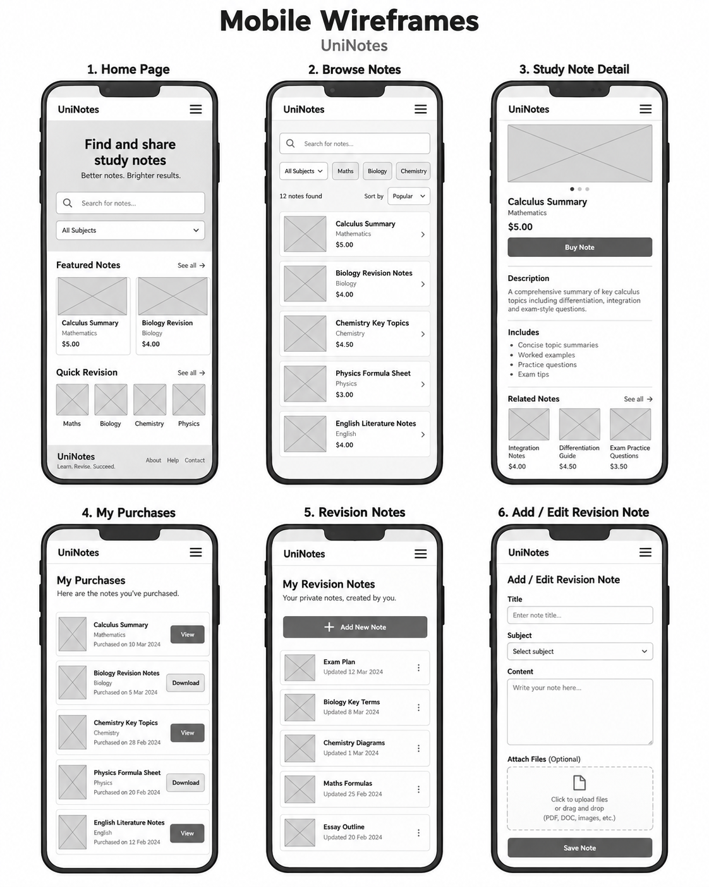
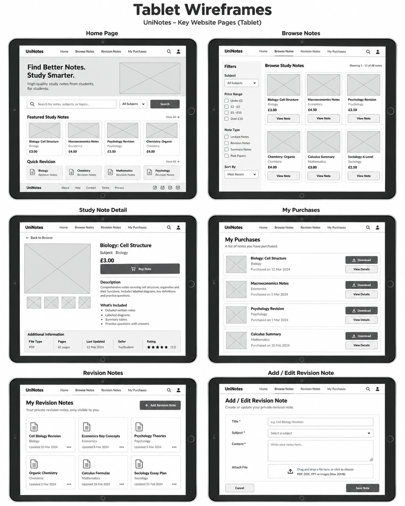
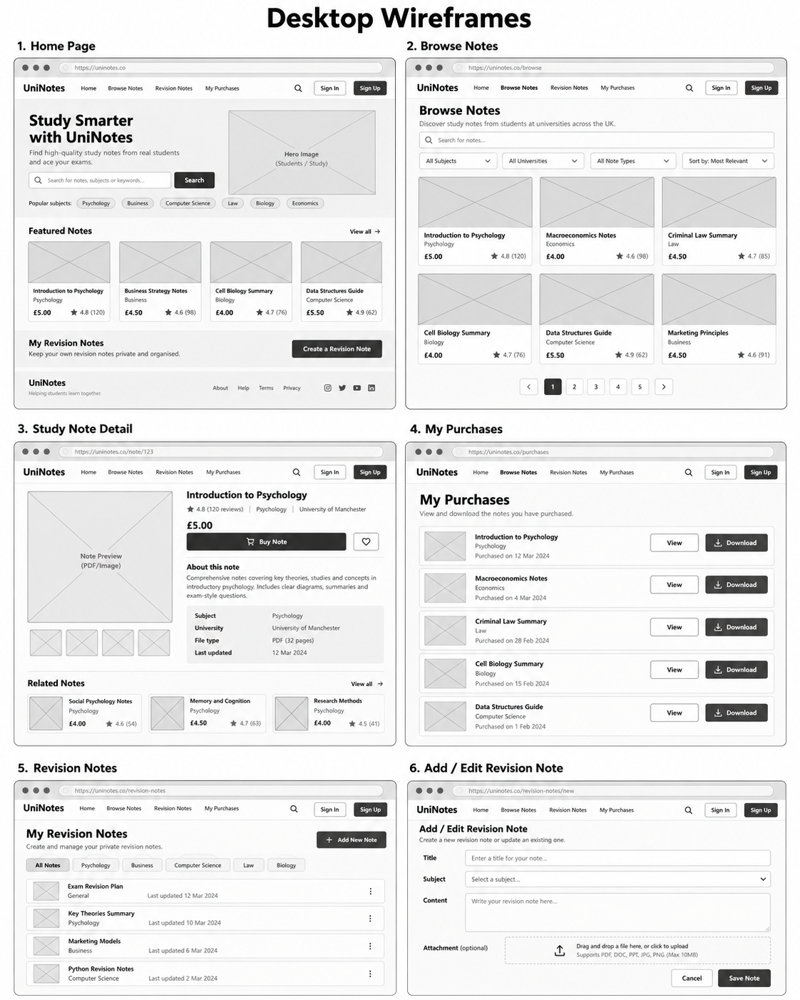

# UX and interface design

[Back to UniNotes README](../README.md#documentation)

[IV. Skeleton](#jump-iv-skeleton) · [V. Surface](#jump-v-surface)

---

# Purpose

The purpose of **UniNotes** is to provide university students with a simple and organised platform for accessing revision resources and managing their own study material. The application brings together two main areas of revision in one place: students can browse and purchase prepared study notes, while also creating and managing their own private revision notes through their account.

Users can search the available study-note library using keywords or filter resources by subject, allowing them to find relevant material more efficiently. Each study note has its own page containing information such as the subject, title, description and price. Registered users can purchase notes through Stripe Checkout, and completed purchases are stored within their account so that the resources can be accessed and downloaded again from the **My Purchases** section.

UniNotes also provides a personal revision area. Logged-in users can create revision notes containing a title, subject and written content, with the option to upload a supporting file. These notes can later be viewed, edited or deleted. This gives students a private space to organise their own revision alongside the resources they have purchased.

Overall, the purpose of the project is to create a useful study platform that makes revision resources easier to find, access and organise.


<a name="jump-iv-skeleton"></a>

## IV. Skeleton

The **Skeleton Plane** focuses on how the interface of **UniNotes** is arranged and how users interact with the functionality defined during the Strategy, Scope and Structure stages.

At this stage, the location of navigation, forms, buttons, study-note cards, revision content and purchasing controls was considered before final styling decisions were applied.

The main aim was to create an interface that is:

- Easy to understand
- Consistent between pages
- Responsive across different screen sizes
- Accessible using keyboard and assistive technologies
- Clear about which actions are available
- Suitable for both first-time and returning users
- Structured around the main user journeys identified during UX planning

The skeleton design considers three main screen sizes:

- Mobile
- Tablet
- Desktop

The same core functionality remains available across these screen sizes, but the layout changes to use the available space more effectively.


### Wireframes

Wireframes were created before finalising the visual design of UniNotes.

The wireframes provide a low-fidelity representation of:

- Navigation
- Page structure
- Search controls
- Study-note cards
- Study-note details
- Purchase information
- Personal revision notes
- Forms
- Buttons
- Content hierarchy
- Responsive behaviour

Wireframes were produced for the main pages at mobile, tablet and desktop sizes.

The pages represented include:

1. Home Page
2. Browse Notes
3. Study Note Detail
4. My Purchases
5. Revision Notes
6. Add / Edit Revision Note

Creating wireframes at multiple sizes helped identify how the same functionality could be reorganised without changing the purpose of the page.


#### Mobile Wireframes

The mobile wireframes use a primarily single-column structure.

Navigation is simplified into a compact menu, while study-note cards and account content are stacked vertically to prevent horizontal scrolling.



The mobile designs prioritise:

- A compact navigation menu
- Full-width search controls
- Stacked study-note cards
- Large touch-friendly buttons
- Clearly separated content sections
- Single-column forms
- Simple purchase and download actions
- Easy access to revision functionality

On smaller screens, content is displayed vertically so that users can scroll naturally through the application without losing important functionality.


#### Tablet Wireframes

The tablet wireframes use the additional horizontal space to introduce multi-column layouts where appropriate.



The tablet designs include:

- Horizontal navigation
- Wider search and filter controls
- Two or three-column study-note layouts where space allows
- Wider form fields
- Side-by-side content within study-note details
- More compact purchase lists
- Revision cards displayed in a grid

The tablet layout acts as a transition between the single-column mobile design and the wider desktop layout.


#### Desktop Wireframes

The desktop wireframes make greater use of horizontal space while maintaining the same content hierarchy used on smaller devices.



The desktop designs include:

- Full horizontal navigation
- Larger hero sections
- Search and filtering controls displayed together
- Multi-column study-note cards
- Wider study-note detail layouts
- Horizontal purchase records
- Wider revision management areas
- Larger forms with clearer spacing

The desktop interface avoids unnecessarily stretching individual pieces of content across the entire screen. Instead, related information is grouped into clearly defined sections.


### Navigation Design

Navigation was designed to remain simple because UniNotes only requires a small number of primary destinations.

The main navigation focuses on:

- Home
- Browse
- Revision
- My Purchases
- Register
- Login
- Logout

The options displayed depend on the user's authentication state.

| User State | Navigation Options |
|---|---|
| **Anonymous User** | Home, Browse, Register, Login |
| **Authenticated User** | Home, Browse, Revision, My Purchases, Logout |

This prevents anonymous users from being presented with account-specific functionality that they cannot use.

On desktop and larger tablet screens, navigation links can be displayed horizontally.

On smaller screens, the navigation collapses into a menu to prevent links from becoming crowded.

The responsive menu can be:

- Opened using the menu button
- Closed using the menu button
- Closed after selecting a navigation link
- Closed by clicking outside the menu
- Closed using the `Escape` key

The menu state is also communicated through accessibility attributes such as `aria-expanded`.


### Page Layout

The page layout uses a consistent structure throughout UniNotes.

A typical page follows the structure:

```text
Header
↓
Navigation
↓
Page Heading / Hero
↓
Primary Page Content
↓
Secondary Content / Actions
↓
Footer
```

Consistency helps users understand where information and controls are likely to appear when moving between pages.


#### Home Page Layout

The homepage introduces UniNotes and provides fast access to the main study-resource functionality.

The planned hierarchy is:

```text
Navigation
↓
Hero / Introduction
↓
Search
↓
Subject Selection
↓
Featured Study Notes
↓
Revision Promotion
↓
Footer
```


#### Browse Page Layout

The Browse page focuses on resource discovery.

```text
Navigation
↓
Page Heading
↓
Keyword Search
↓
Subject Filter
↓
Study Note Results
↓
Footer
```

Study-note cards are displayed according to the available screen width.


#### Study Note Detail Layout

The Study Note Detail page focuses the user's attention on one resource.

```text
Navigation
↓
Study Note Information
↓
Subject
↓
Description
↓
Price
↓
Purchase Action
↓
Additional / Related Information
↓
Footer
```


#### My Purchases Layout

The My Purchases page provides a simple account-specific list.

```text
Navigation
↓
My Purchases Heading
↓
Purchased Resource
↓
Purchased Resource
↓
Purchased Resource
↓
Download / Access Actions
↓
Footer
```


#### Revision Layout

The Revision area gives users control over their personal notes.

```text
Navigation
↓
My Revision Notes
↓
Add Revision Note
↓
Revision Note List
↓
View / Edit / Delete Actions
↓
Footer
```


### Interface Design

The interface was planned around simplicity and consistency.

Common interface components include:

| Component | Purpose |
|---|---|
| **Navigation Links** | Move between the main areas of UniNotes |
| **Search Field** | Search available study notes |
| **Subject Filter** | Narrow study resources by subject |
| **Study-Note Cards** | Present resource information consistently |
| **Buttons** | Clearly identify available actions |
| **Forms** | Collect registration and revision-note information |
| **Feedback Messages** | Confirm successful or unsuccessful actions |
| **Empty States** | Explain when content is unavailable |
| **Purchase Controls** | Begin Stripe Checkout |
| **Download Actions** | Provide access to owned resources |

Buttons should use clear action-based wording such as:

- View Note
- Buy Note
- Add Revision Note
- Save Note
- Edit
- Delete
- Download
- Login
- Register

This reduces ambiguity and makes the result of each action easier to predict.


### Form Design

Forms within UniNotes are kept simple and focused on the information required to complete the task.

Forms are used for:

- Registration
- Login
- Creating revision notes
- Editing revision notes

Form design principles include:

- Visible labels
- Logical field ordering
- Adequate spacing
- Clear validation feedback
- Appropriate field types
- Full-width fields on smaller screens
- Clear submit buttons
- Optional fields identified appropriately

The revision-note form contains fields for:

- Title
- Subject
- Content
- Optional attachment

A simplified layout is:

```text
Title
[________________________]

Subject
[________________________]

Content
[                        ]
[                        ]
[                        ]

Attachment
[ Choose File ]

[ Save Note ]
```

The form does not ask for information that is unnecessary for creating a revision note.


### CRUD Interface Design

The main CRUD interface within UniNotes is the personal Revision area.

CRUD stands for:

- Create
- Read
- Update
- Delete

Each action is presented through a clear user interface.


#### Create

Users can select an **Add Revision Note** action.

```text
Revision List
↓
Add Revision Note
↓
Revision Form
↓
Save
↓
Revision Note Created
```

The create form allows the user to enter revision content and optionally attach a file.


#### Read

Existing revision notes are displayed within the user's Revision area.

The user can select a note to view its content.


#### Update

An Edit action allows the authenticated owner to open an existing revision note within the same form structure used for creation.

Existing values are displayed so they can be modified rather than entered again.


#### Delete

A Delete action allows the owner to remove a revision note.

Deletion is treated differently from ordinary navigation because it permanently removes stored content.

A confirmation step is therefore used before the record is deleted.


### Authentication Interface

Authentication pages are designed to remain simple and focused.

Account functionality is separated from the main study-resource interface so users understand when they are entering account information.


#### Registration

The registration interface allows a new user to create an account.

The registration form should:

- Clearly identify that a new account is being created
- Display appropriate field labels
- Explain validation errors
- Use a clear registration button
- Avoid collecting unnecessary personal information

The registration journey is:

```text
Register
↓
Complete Form
↓
Validation
↓
Account Created
↓
Feedback / Next Action
```


#### Login

The login interface allows existing users to authenticate.

The page contains only the information necessary to complete login.

```text
Username
[________________]

Password
[________________]

[ Login ]
```

If authentication fails, an appropriate message should explain that the submitted information could not be accepted without exposing sensitive account information.


#### Logout

Logout should be clear and predictable.

When the user logs out:

- Their authenticated session ends
- Account-specific areas are no longer available
- Navigation returns to the anonymous-user state

Logout should not remove the user's database information, revision notes or purchases.


### Checkout Interface

UniNotes uses **Stripe Checkout** rather than creating a custom payment-card interface.

The UniNotes interface is responsible for allowing the user to select the study resource they want to purchase.

The checkout interface flow is:

```text
Study Note Detail
↓
Price Displayed
↓
Buy Button
↓
Stripe Checkout
↓
Payment
↓
Success or Cancellation
↓
Return to UniNotes
```

The Study Note Detail page clearly displays:

- Resource title
- Subject
- Description
- Price
- Purchase action

Once the user selects the purchase action, the payment interface is provided by Stripe.

This avoids designing a custom form that would directly collect card information inside UniNotes.


### User Feedback Design

Feedback is required so that users understand the result of their actions.

The interface should not rely on the user guessing whether an operation has succeeded.


#### Success Messages

Success messages are used following actions such as:

- Registration
- Creating a revision note
- Updating a revision note
- Deleting a revision note
- Completing appropriate account actions

Messages should be:

- Short
- Clear
- Specific to the completed action

Example:

```text
Your revision note has been saved successfully.
```


#### Error Messages

Error messages should explain what went wrong without displaying unnecessary technical information.

Errors may occur because of:

- Invalid form data
- Missing required information
- Invalid file types
- Unauthorised access
- Unsuccessful payment verification
- Missing resources

Messages should focus on what the user can do next rather than exposing internal Django errors.


#### Confirmation Messages

Confirmation is particularly important for destructive actions.

Deleting a revision note should require the user to confirm the action before the record is permanently removed.

Example layout:

```text
Delete Revision Note

Are you sure you want to delete this revision note?

[ Cancel ]    [ Delete ]
```

The destructive action should be clearly distinguishable from the safe action.


#### Form Validation Feedback

Validation feedback should appear close to the field that caused the problem where possible.

Examples include:

```text
Title
[________________]
This field is required.
```

or:

```text
Attachment
[ Choose File ]

Only supported file types can be uploaded.
```

Users should not have to search the page to understand why a form submission failed.


### Error Prevention

The interface is designed to prevent errors rather than relying only on error messages after something has gone wrong.

Error-prevention techniques include:

| Potential Error | Prevention |
|---|---|
| Purchasing the same resource again | Existing purchases are checked during the normal purchasing flow |
| Editing another user's note | Ownership is checked on the server |
| Deleting another user's note | Ownership is checked before deletion |
| Accidentally deleting personal content | A confirmation page is used |
| Submitting incomplete forms | Required fields are validated |
| Uploading inappropriate revision attachments | File validation is applied |
| Accessing private functionality while logged out | Authentication checks protect the route |
| Incorrect resource price | Price is obtained from server-side data |
| Assuming payment succeeded from the redirect alone | Stripe payment information is verified server-side |
| Becoming lost on smaller screens | Responsive navigation remains available |

Combining interface-level prevention with server-side validation provides stronger protection than relying on either approach alone.


### Accessibility Planning

Accessibility was considered during the skeleton stage because it affects the structure of the interface as well as its final visual appearance.

Planning accessibility before final styling makes it easier to create an interface that can be used through different input methods and assistive technologies.


#### Semantic HTML

Semantic HTML should be used where appropriate to communicate the purpose of page content.

Examples include:

```html
<header>
<nav>
<main>
<section>
<form>
<footer>
```

Heading elements should also follow a logical hierarchy rather than being selected only because of their default size.


#### Keyboard Accessibility

Interactive elements should remain usable without requiring a mouse.

Keyboard accessibility requirements include:

- Links reachable with the keyboard
- Buttons reachable with the keyboard
- Forms usable using keyboard controls
- Visible focus states
- Responsive navigation operable with the keyboard
- Navigation menu closable using the `Escape` key

Interactive functionality should use appropriate HTML elements rather than making non-interactive elements behave like buttons unnecessarily.


#### Form Accessibility

Forms should provide a clear relationship between each label and input.

Good form structure includes:

```html
<label for="title">Title</label>
<input id="title" name="title">
```

Form accessibility planning includes:

- Visible field labels
- Appropriate input types
- Clear required fields
- Understandable error messages
- Logical tab order
- Accessible submit buttons


#### Alternative Text

Meaningful images should include alternative text.

Alternative text should describe the purpose of the image rather than simply repeating the filename.

Decorative images that provide no meaningful information should not create unnecessary screen-reader content.


#### ARIA Labels

ARIA attributes are used where standard HTML alone does not communicate enough information.

Within the responsive navigation, attributes such as:

```html
aria-expanded
aria-label
```

can communicate:

- Whether the navigation is currently open
- What the menu button does

ARIA should supplement semantic HTML rather than replace it.


#### Responsive Accessibility

Accessibility must remain consistent when the layout changes.

On smaller screens:

- Navigation should remain keyboard accessible
- Buttons should remain large enough to interact with
- Text should remain readable
- Forms should not require horizontal scrolling
- Content should maintain a logical order
- Important functionality should not disappear
- Focus states should remain visible

Responsive design therefore considers more than visual appearance.


### Responsive Design Planning

UniNotes was planned using a responsive approach so that the same application can be used across mobile, tablet and desktop-sized screens.

The layout changes depending on available space while keeping the functionality consistent.

| Element | Mobile | Tablet | Desktop |
|---|---|---|---|
| **Navigation** | Collapsed menu | Horizontal or adapted navigation | Full horizontal navigation |
| **Hero Content** | Stacked | Wider layout | Side-by-side content possible |
| **Search** | Full width | Wider search row | Search and filters displayed together |
| **Study Notes** | Primarily one column | Two or more columns | Multiple columns |
| **Purchases** | Stacked rows | Wider rows | Horizontal resource rows |
| **Revision Notes** | Stacked | Grid / wider list | Wider list or grid |
| **Forms** | Single column | Wider single column | Centred wide form |
| **Buttons** | Larger/full width where useful | Standard controls | Standard controls |
| **Footer** | Stacked | Adapted horizontal layout | Full horizontal layout |

The design follows the principle that responsive layouts should **reorganise content rather than remove important functionality**.


### Information Hierarchy

Information hierarchy determines what users notice first on each page.

The hierarchy uses:

- Page headings
- Subheadings
- Grouped sections
- Buttons
- Cards
- Spacing
- Content order

For example, the Study Note Detail page prioritises:

1. Study-note title
2. Subject
3. Description
4. Price
5. Purchase action
6. Supporting information

The My Purchases page prioritises:

1. Page title
2. Purchased resource title
3. Resource information
4. Access or download action

The Revision page prioritises:

1. My Revision Notes
2. Add Revision Note
3. Existing revision notes
4. Individual management actions

This ensures that the most important action or information is visually and structurally easier to identify.


### User Control

Users should maintain control over their own actions and content.

UniNotes provides user control by allowing authenticated users to:

- Create revision notes
- View revision notes
- Edit revision notes
- Delete revision notes
- Decide whether to include an attachment
- Access previous purchases
- Choose which resources to purchase
- Log in and log out when required
- Cancel destructive actions before confirmation

Users are not automatically forced into purchases or destructive actions.


### Confirmation

Confirmation is used where the result of an action is important or potentially irreversible.

The most important example is revision-note deletion.

Before deletion:

```text
User Selects Delete
↓
Confirmation Page
↓
Cancel or Confirm
↓
Delete Only if Confirmed
```

Purchase confirmation is handled differently.

A purchase is not considered valid simply because the user reaches the success page.

Instead:

```text
Stripe Checkout Completed
↓
Stripe Session Retrieved
↓
Payment Status Verified
↓
User Verified
↓
Study Note Verified
↓
Purchase Recorded
↓
Success Displayed
```

This combination of **visual confirmation, server-side validation and clear feedback** helps ensure that users understand the result of important actions and reduces accidental or unauthorised changes.


<a name="jump-v-surface"></a>

## V. Surface

The **Surface Plane** represents the final visual appearance of **UniNotes** and brings together the decisions made during the Strategy, Scope, Structure and Skeleton stages.

The surface design focuses on creating a modern educational platform that feels clear, trustworthy and easy to use. Visual decisions were made to support the functionality of the website rather than distract from it.

The interface uses a consistent combination of:

- Navy text
- Purple interactive elements
- White content surfaces
- Soft purple and grey backgrounds
- Rounded cards
- Consistent button styles
- Clear typography
- Responsive spacing
- Accessible focus states
- Subject-related imagery
- A consistent UniNotes logo

The final design aims to give UniNotes its own visual identity while maintaining a professional appearance suitable for university students.


### Design Decisions

The visual design of UniNotes was developed around the needs of the target audience.

University students need to quickly identify resources, understand prices, locate account functionality and manage their own revision material. Therefore, the design avoids unnecessary visual complexity and places greater emphasis on readability and clear actions.


#### Colour Scheme

UniNotes uses a mainly **navy, purple and white colour palette**.

The main colours are stored as CSS variables so they can be reused consistently throughout the application.

| Colour | Hex Value | Usage |
|---|---|---|
| **Dark Navy** | `#171a35` | Main text, footer background and important interface elements |
| **Primary Purple** | `#5b3df5` | Primary buttons, interactive elements and branding accents |
| **Dark Purple** | `#4430c7` | Hover states, links and stronger purple contrast |
| **Muted Grey** | `#666a7a` | Secondary text and supporting information |
| **White** | `#ffffff` | Cards, forms and primary content surfaces |
| **Soft Surface** | `#f5f6ff` | Soft background areas and visual separation |
| **Page Background** | `#fbfbfe` | Main website background |
| **Border Colour** | `#e2e4ef` | Borders around cards and interface components |
| **Danger Red** | `#c63d4f` | Destructive actions such as deletion |
| **Success Green** | `#168a5b` | Successful-result indicators |
| **Focus Orange** | `#ffbf47` | Visible keyboard focus outline |

Purple was selected as the primary accent because it provides a strong contrast against the white interface while giving UniNotes a recognisable identity.

Dark navy is used instead of pure black for most text because it maintains strong readability while working more naturally with the purple colour scheme.

White surfaces are used for cards and forms to separate important content from the light page background.


#### Typography

UniNotes uses the following font stack:

`Inter, ui-sans-serif, system-ui, -apple-system, BlinkMacSystemFont, "Segoe UI", sans-serif`

**Inter** is the preferred typeface, with system fonts available as fallbacks.

A sans-serif font was selected because it provides:

- Clear readability
- A modern appearance
- Good performance at small sizes
- Consistency across interface elements
- Suitable presentation for digital content

Typography is used to create hierarchy throughout the application.

Large headings identify the main purpose of each page, while smaller headings separate individual sections.

Supporting information such as:

- Subjects
- Dates
- Help text
- Descriptions
- Secondary information

uses more muted styling so that it does not compete with the main content.

The homepage hero uses responsive typography through CSS `clamp()` so that the heading adapts to the available screen width without requiring separate fixed font sizes for every device.


#### Images and Media

Images are used to support the content rather than being included only for decoration.

UniNotes includes:

- The UniNotes logo
- Homepage hero imagery
- Subject images
- Study-note cover images
- Fallback images

The project contains subject-specific images for areas such as:

- Computer Science
- Law
- Economics
- Mathematics
- Psychology
- Business

Subject imagery helps users visually distinguish between different study areas.

Study-note cards can display a resource-specific `cover_url`. If that image is unavailable, the interface falls back to the relevant subject image.

If the subject image is also unavailable, a general fallback image is used.

This creates a more robust visual system because a broken external image does not leave the interface with an empty or broken image element.

Images use responsive CSS such as:

- `max-width: 100%`
- `object-fit: cover`
- Defined aspect ratios

This helps maintain a consistent card layout across different resources and screen sizes.


#### Icons

UniNotes does not depend on a large external icon library.

Simple interface icons and symbols are used only where they improve understanding.

Examples include:

- Hamburger navigation lines
- Lock indicator for restricted Revision access
- Success indicator
- Cancellation indicator

The responsive hamburger icon is created using CSS rather than an external image.

When the menu opens, the lines transform to indicate the changed navigation state.

Icons are used alongside text where necessary so that important actions are not communicated using an icon alone.

Decorative icon elements can also use `aria-hidden="true"` where appropriate so that unnecessary information is not announced by screen readers.


#### Buttons

Buttons use a consistent design throughout UniNotes.

The primary button style uses:

- Purple background
- White text
- Rounded corners
- Clear padding
- Strong font weight
- Minimum interactive height

The main button styling includes:

- `min-height: 44px`
- `border-radius: 10px`
- Purple background
- Darker purple hover state

Primary buttons are used for important actions such as:

- Register
- Search
- View
- Save
- Purchase

Secondary buttons use a white background with purple text.

This allows lower-priority actions to remain available without competing visually with the primary action.

Dangerous actions use the red danger colour so they can be visually distinguished from normal actions.

Button styles include:

| Button Type | Purpose |
|---|---|
| **Primary Button** | Main page action |
| **Small Button** | Compact actions within cards |
| **Wide Button** | Full-width actions where appropriate |
| **Secondary Button** | Lower-priority or alternative action |
| **Danger Button** | Destructive action such as deletion |

Hover states are also used to show users that the element is interactive.


#### Forms

Form styling remains consistent between authentication forms and revision-note forms.

Inputs, select menus and textareas use:

- White backgrounds
- Dark navy text
- Light grey borders
- Rounded corners
- Consistent internal padding
- Full available width
- Visible focus states

Standard form controls use a minimum height of approximately `46px`, helping make them easier to interact with.

Textareas use a larger minimum height because users may need to enter longer revision content.

Form labels are displayed above fields and use increased font weight so that the purpose of each field is clear.

Validation errors are displayed near the relevant field and use a darker red colour.

Fields containing an error also receive a red border.

This gives users both textual and visual feedback instead of relying on colour alone.


#### Cards and Components

Cards are one of the main reusable visual components within UniNotes.

Cards are used for:

- Subjects
- Study notes
- Revision notes
- Forms
- Study-note details
- Purchases
- Empty states
- Checkout results

A common visual style is used across these components:

- White background
- `1px` border
- Rounded corners
- Subtle shadow
- Consistent spacing

The primary card radius is defined as:

`18px`

The shared shadow is:

`0 14px 35px rgba(30, 34, 90, 0.10)`

This gives content enough visual separation from the page background without creating an overly heavy interface.


##### Study Note Cards

Study-note cards include:

- Cover image
- Subject
- Study-note title
- Price
- View action

The information is kept concise so users can compare multiple resources quickly.


##### Subject Cards

Subject cards contain:

- Subject illustration
- Subject name
- Number of available notes

The image and text are grouped together within a single interactive card.


##### Revision Cards

Revision cards contain:

- Subject badge
- Date information
- Revision-note title
- Content preview
- Relevant actions

On desktop, revision cards can be displayed across multiple columns.

On smaller devices, the number of columns is reduced until cards display in a single vertical column.


#### Layout

The main application content uses a reusable `.shell` container.

The maximum content width is approximately:

`1120px`

The width is defined responsively using:

`width: min(1120px, calc(100% - 32px));`

This prevents content from becoming excessively wide on large displays while maintaining appropriate margins on smaller screens.

The main layouts use CSS Grid and Flexbox.

Examples include:

| Area | Layout |
|---|---|
| Subject Cards | CSS Grid |
| Study Note Cards | CSS Grid |
| Revision Cards | CSS Grid |
| Navigation | Flexbox |
| Purchase Rows | Flexbox |
| Detail Page | CSS Grid |
| Authentication Page | CSS Grid |
| Form Actions | Flexbox |

The combination of Grid and Flexbox allows page components to reorganise according to the available screen width.


#### Spacing

Consistent spacing is used to prevent the interface from appearing crowded.

Main page sections normally use approximately:

`64px`

of vertical padding on larger screens.

On smaller devices this is reduced to approximately:

`44px`

Cards contain consistent internal padding according to their purpose.

Examples include:

- Study-note card body: `20px`
- Purchase row: `22px`
- Revision card: `24px`
- Detail content: `34px`
- Authentication cards: `38px`

Consistent spacing helps separate unrelated content while keeping related content visually grouped.


#### Animations and Effects

Animations and visual effects are intentionally limited.

UniNotes does not use large or distracting animations because the main purpose of the website is revision and resource access.

Subtle effects are used to provide interaction feedback.

These include:

- Smooth scrolling
- Navigation-menu transitions
- Button hover states
- Navigation hover effects
- Hamburger icon transformation
- Small active-state transformations
- Card shadows
- Sticky navigation with background blur

The responsive navigation uses short transitions for:

- Height
- Opacity
- Position
- Visibility

This allows the menu to open smoothly without creating a distracting animation.

The navigation toggle also slightly scales when actively pressed.

These effects provide feedback while maintaining a professional interface.


### Visual Consistency

Visual consistency is maintained by reusing the same styling rules across the application.

CSS variables define important design values such as:

- Colours
- Border radius
- Shadows

Reusable classes are then applied to components such as:

- Buttons
- Cards
- Forms
- Headings
- Navigation
- Messages

For example, study-note cards, revision cards and purchase rows all use similar:

- Borders
- Backgrounds
- Rounded corners
- Shadows

This helps users recognise that these elements belong to the same application.

The same purple colour is also used consistently for primary actions and important links.

Consistency reduces the amount of new interface behaviour users need to learn when moving between pages.


### Branding

UniNotes uses a dedicated visual identity rather than relying only on text.

The main branding includes:

- **UniNotes name**
- **UniNotes logo**
- **Purple primary colour**
- **Dark navy typography**
- **Subject imagery**
- **University-focused hero imagery**
- **Consistent rounded interface design**

The UniNotes logo is displayed within the main navigation and is linked to the homepage.

The logo also includes alternative text:

`UniNotes logo`

The homepage uses a large hero image combined with a dark gradient overlay.

This allows white heading text to remain readable while maintaining a visually engaging introduction to the website.

The hero message reinforces the purpose of the brand by focusing on university revision and affordable study resources.


### Colour Contrast

Colour contrast is important because important information must remain readable against its background.

The main colour combinations provide strong contrast.

| Foreground | Background | Approximate Contrast |
|---|---|---:|
| `#171a35` Dark Navy | `#ffffff` White | **17.0:1** |
| `#4430c7` Dark Purple | `#ffffff` White | **8.42:1** |
| `#5b3df5` Primary Purple | `#ffffff` White | **6.12:1** |
| `#666a7a` Muted Text | `#ffffff` White | **5.37:1** |
| `#c63d4f` Danger Red | `#ffffff` White | **5.02:1** |

These core text combinations provide sufficient contrast for normal text under WCAG AA contrast guidance.

The hero section also applies a dark gradient over its background image so that white text is not displayed directly against a visually complex photograph.

Colour is not used as the only method of communicating information.

For example:

- Error fields receive a border and an error message
- Restricted Revision access includes text and a lock indicator
- Buttons include descriptive text
- Success and error messages include readable content

Keyboard focus is highlighted using a visible orange outline:

`#ffbf47`

This makes the currently focused control easier to identify.


### Responsive Visual Design

The visual design adapts at several CSS breakpoints.

The main responsive breakpoints include:

- `860px`
- `620px`
- `480px`

At widths below approximately `860px`:

- Full navigation changes to a collapsible menu
- Multi-column page layouts become simpler
- Detail pages become single-column
- Authentication layouts become single-column
- Subject cards change from four columns to two
- Study-note cards change from three columns to two
- Revision cards change from three columns to two

At widths below approximately `620px`:

- Subject cards become one column
- Study-note cards become one column
- Revision cards become one column
- Search controls stack vertically
- Filter controls stack vertically
- Purchase rows become vertical
- Footer content stacks
- Page spacing is reduced
- Forms receive smaller internal padding

At very small screen widths, additional navigation adjustments are made to preserve usable spacing.

This ensures that the same visual design remains recognisable across mobile, tablet and desktop devices without forcing desktop layouts onto smaller screens.


### Accessibility of Visual Elements

Visual accessibility was considered throughout the final styling.

The interface includes:

- Visible keyboard focus states
- High-contrast primary text
- Clear form labels
- Alternative text for meaningful images
- Descriptive links
- Large interactive buttons
- Error text alongside error colouring
- Responsive text sizing
- Readable line spacing
- Screen-reader-only labels where visual labels are unnecessary
- Clear distinction between primary and secondary actions

A global `:focus-visible` style provides a visible outline around keyboard-focused elements.

The website also includes a **Skip to content** link.

The link remains hidden during normal browsing but becomes visible when focused with the keyboard, allowing keyboard and screen-reader users to bypass repeated navigation.

Study images contain alternative text such as:

- Subject study illustration
- Study-note cover
- UniNotes logo

The application also includes fallback images so that missing external imagery does not create broken visual content.


### Final Planned User Interface

The final planned user interface combines the low-fidelity wireframes created during the Skeleton stage with the visual styling developed during the Surface stage.

The wireframes established:

- Where content should appear
- How users should navigate
- Where buttons should be positioned
- How forms should be structured
- How study resources should be presented
- How layouts should change between devices

The Surface stage then adds:

- UniNotes branding
- Purple and navy colour scheme
- Typography
- Real imagery
- Shadows
- Rounded corners
- Responsive spacing
- Hover states
- Focus indicators
- Feedback colours

The final interface can therefore be understood as the progression:

`User Requirements → Structure → Wireframes → Visual Design → Final Interface`

The planned visual outcome for each major page is shown below.

| Page | Final Interface Design |
|---|---|
| **Home** | Large branded hero image with clear heading and search functionality, followed by subject cards and featured study-note cards |
| **Browse** | Structured resource discovery page containing keyword search, subject filtering and responsive study-note cards |
| **Study Note Detail** | Large resource image alongside the note title, subject, price, description and purchase action |
| **My Purchases** | Clean list of resources associated with the authenticated user's purchases with clear access actions |
| **Revision Notes** | Personal dashboard containing responsive revision cards with subject, date and management options |
| **Revision Detail** | Focused reading layout for an individual revision note with content and attachment information |
| **Add / Edit Revision Note** | Clear single-purpose form containing title, subject, content and optional attachment fields |
| **Registration** | Branded authentication layout with clear labels, validation feedback and registration action |
| **Login** | Simple authentication interface focused on allowing returning users to access their account |
| **Checkout Success** | Clear result interface confirming successful completion of the purchase process |
| **Checkout Cancelled** | Clear result interface explaining that the checkout process was not completed |

The final interface maintains the same underlying structure across the application while adapting individual components according to the page's purpose.

This provides consistency without requiring every page to have exactly the same layout.

Overall, the Surface design completes the UX process by transforming the functional wireframes into a **recognisable, responsive and accessible UniNotes interface** while ensuring that visual styling continues to support the main purpose of the application: helping university students find, purchase and organise revision resources.
