# Features and implementation

[Back to UniNotes README](../README.md#documentation)

## Contents

- [CRUD Functionality](#crud-functionality)
  - [Create](#create), [Read](#read), [Update](#update), & [Delete](#delete)
  - [CRUD Permissions](#crud-permissions)
  - [CRUD Testing](#crud-testing)
- [Forms and Validation](#forms-and-validation)
  - [Django Forms](#django-forms)
  - [Form Validation](#form-validation)
  - [Model-Level Validation](#model-level-validation)
- [Authentication, Authorisation and Permissions](#jump-authentication-authorisation-and-permissions)
  - [Registration](#registration), [Login](#login), & [Logout](#logout)
  - [Ownership Checks](#ownership-checks)
  - [Restricted Pages](#restricted-pages)
- [E-Commerce and Payments](#jump-e-commerce-and-payments)
  - [Checkout Process](#checkout-process)
  - [Payment Validation](#payment-validation)
  - [Payment Security](#payment-security)
  - [Payment Testing](#payment-testing)
- [API Integration](#jump-api-integration)
  - [API Data Flow](#api-data-flow)
  - [API Error Handling](#api-error-handling)
  - [API Testing](#api-testing)

---

### CRUD Functionality

#### CRUD Overview

One of the main features I developed for UniNotes is the ability for registered users to create and manage their own revision notes.

I implemented this functionality using Django's Create, Read, Update and Delete (CRUD) operations.

CRUD refers to the four main operations used when managing information stored in a database:

| Operation | Purpose | UniNotes Implementation |
|---|---|---|
| Create | Add new information to the database. | Users create personal revision notes. |
| Read | Retrieve information from the database. | Users view their saved revision notes. |
| Update | Modify existing information. | Users edit their revision notes. |
| Delete | Remove information from the database. | Users permanently delete revision notes. |

I implemented these operations using the `RevisionNote` model in `notes/models.py` and the corresponding functions in `notes/views.py`.

The revision note functionality is available to authenticated users only.

Each revision note is linked to the user who created it, allowing the application to retrieve and manage notes belonging to the correct account.

I used Django's ModelForm functionality to handle creating and editing records rather than manually processing every form field.

This helped reduce repeated code and made the forms easier to maintain.

#### Create

The Create functionality allows registered users to add new revision notes to their accounts.

Users can enter the following information:

- Revision note title.
- Subject name.
- Revision note content.
- Optional file attachment.

Attachments can be PDF, DOC, DOCX or TXT files, with a maximum file size of 5 MB.

The Create functionality is handled by the `revision_create()` view in `notes/views.py`.

The URL used to access the page is:

```text
/revision/add/
```

The Django URL pattern is:

```python
path("revision/add/", views.revision_create, name="revision_create")
```

When a user opens the page, Django creates an empty instance of `RevisionNoteForm`.

After the user completes the form and submits it, the browser sends the information to the Django view using a POST request.

The view then checks whether the form is valid before saving anything to the database.

The following code handles creating a revision note:

```python
@login_required
def revision_create(request):
    if request.method == "POST":
        form = RevisionNoteForm(request.POST, request.FILES)
        if form.is_valid():
            note = form.save(commit=False)
            note.owner = request.user
            note.save()
            messages.success(request, "Revision note saved to your account.")
            return redirect(note.get_absolute_url())
    else:
        form = RevisionNoteForm()

    return render(
        request,
        "notes/revision_form.html",
        {"form": form, "page_title": "Add revision note"},
    )
```

I used `form.save(commit=False)` because I needed to assign the logged-in user as the owner before saving the record.

The line `note.owner = request.user` connects the new revision note to the current user.

This is important because the owner field is not included in the user-facing form.

After the record has been saved, the user is redirected to the revision note detail page.

A success message is also displayed to confirm that the information has been saved.

If the form contains invalid information, Django displays the form again with validation errors.

**Create process:**

1. The user logs into UniNotes.
2. The user visits the revision notes page.
3. The user selects Add Revision Note.
4. The application displays the revision note form.
5. The user enters the required information.
6. The user optionally uploads an attachment.
7. The form is submitted using POST.
8. Django validates the submitted information.
9. The logged-in user is assigned as the owner.
10. The new record is saved to the database.
11. The user is redirected to the created revision note.

This feature gives students a way to save their own revision materials within UniNotes.


##### Create Revision Note Screenshot

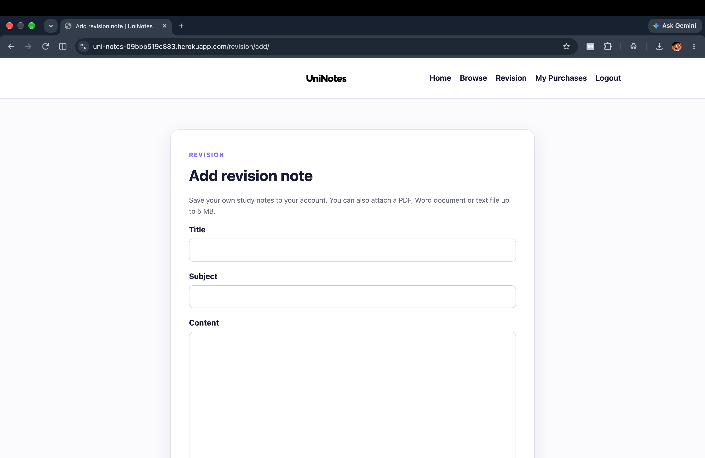

*Picture 1: The Create form allows registered users to add personal revision notes, including a title, subject, content and optional attachment.*

#### Read

The Read functionality allows users to retrieve and view information already stored in the database.

I implemented two main ways of reading revision notes:

- Viewing a list of personal revision notes.
- Viewing an individual revision note in more detail.

The revision notes list is handled by the `revision_notes()` view.

```python
@login_required
def revision_notes(request):
    notes = RevisionNote.objects.filter(owner=request.user)
    return render(
        request,
        "notes/revision_list.html",
        {"revision_notes": notes},
    )
```

The query:

```python
RevisionNote.objects.filter(owner=request.user)
```

retrieves revision notes belonging to the currently logged-in user.

I used this filter because users should not be able to view other people's personal revision notes.

The records are passed to the `revision_list.html` template.

The page displays information including:

- Revision note title.
- Subject.
- A preview of the content.
- Last updated date.
- Whether an attachment is available.
- Links to view, edit or delete the note.

I used a Django template loop to display the records.

The template also contains an empty-state message when a user has not created any revision notes.

**Viewing an individual revision note**

The `revision_detail()` view retrieves one revision note using its primary key.

```python
@login_required
def revision_detail(request, pk):
    note = get_object_or_404(
        RevisionNote,
        pk=pk,
        owner=request.user,
    )
    return render(
        request,
        "notes/revision_detail.html",
        {"revision_note": note},
    )
```

I used `get_object_or_404()` to retrieve the requested record.

The query checks both the primary key and the owner.

If the record does not exist, or the record does not belong to the logged-in user, Django returns a 404 response.

This prevents users from viewing another person's revision note simply by changing the ID in the URL.

The detail page displays the full content of the selected revision note.

**Additional Read functionality**

UniNotes also retrieves other database information outside the revision note CRUD feature.

For example:

- `home()` retrieves featured study resources.
- `browse_notes()` retrieves active study resources and applies search filters.
- `note_detail()` retrieves information about individual study resources.
- `my_purchases()` retrieves purchases belonging to the logged-in user.

These functions demonstrate how Django's ORM is used throughout the application to retrieve relevant information.


##### Revision Notes List Screenshot

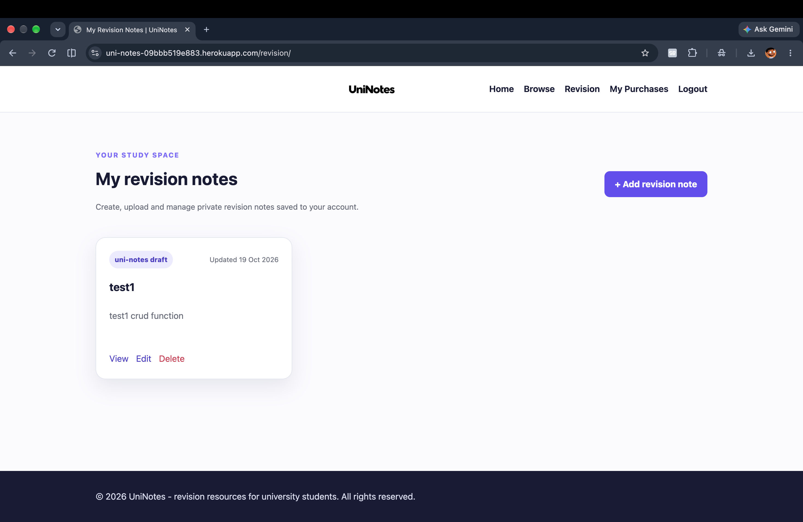

*Picture 2: The revision notes page displays notes belonging to the logged-in user, with options to view, edit or delete them.*


##### Individual Revision Note Screenshot

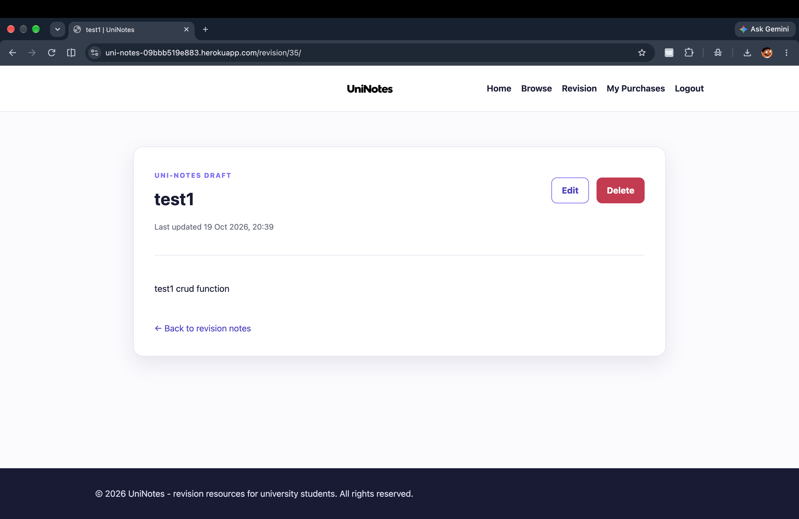

*Picture 3: The detail page displays the selected revision note, including its title, subject and saved content.*


#### Update

The Update functionality allows registered users to edit revision notes they have already created.

This is useful because students may need to correct mistakes, add more information or update their revision materials as they continue studying.

The Update functionality is handled by the `revision_edit()` view.

The URL contains the primary key of the revision note being edited.

```text
/revision/<id>/edit/
```

The application first retrieves the requested revision note and checks whether it belongs to the logged-in user.

The following view handles editing an existing revision note:

```python
@login_required
def revision_edit(request, pk):
    note = get_object_or_404(
        RevisionNote,
        pk=pk,
        owner=request.user,
    )
    if request.method == "POST":
        form = RevisionNoteForm(
            request.POST,
            request.FILES,
            instance=note,
        )
        if form.is_valid():
            form.save()
            messages.success(request, "Revision note updated.")
            return redirect(note.get_absolute_url())
    else:
        form = RevisionNoteForm(instance=note)

    return render(
        request,
        "notes/revision_form.html",
        {
            "form": form,
            "page_title": "Edit revision note",
            "revision_note": note,
        },
    )
```

I reused `RevisionNoteForm` for both creating and editing revision notes.

The main difference is the use of the `instance` argument.

For example:

```python
form = RevisionNoteForm(instance=note)
```

This loads the existing information into the form so the user can see what has already been saved.

When the user submits their changes, the form receives the existing record again:

```python
form = RevisionNoteForm(
    request.POST,
    request.FILES,
    instance=note,
)
```

This tells Django to update the existing database record rather than create a new one.

After validation, `form.save()` stores the updated information.

The user then receives the message:

```text
Revision note updated.
```

**Update process:**

1. The user opens their revision notes.
2. The user selects the note they want to edit.
3. The user selects Edit.
4. Django retrieves the existing record.
5. The form displays the previously saved information.
6. The user changes the required fields.
7. The updated form is submitted.
8. Django validates the submitted information.
9. The existing database record is updated.
10. The user is redirected to the updated revision note.

I also used the `updated_at` field in the `RevisionNote` model.

This field automatically records the time of the most recent save, helping users identify when their notes were last changed.


##### Edit Revision Note Screenshot

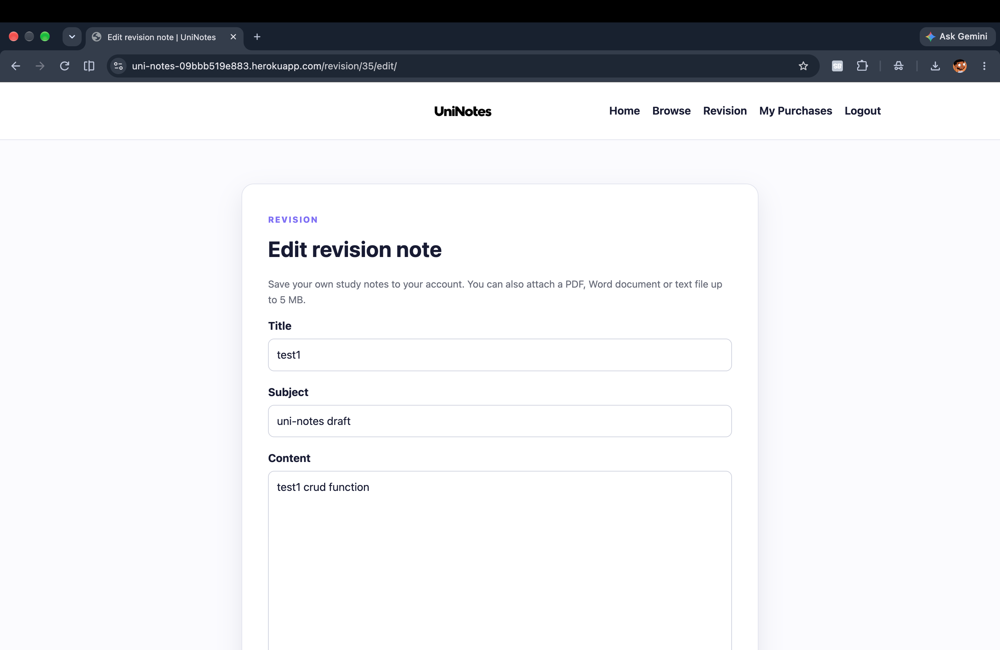

*Picture 4: The Update form displays existing revision note information, allowing users to make changes and save them.*


#### Delete

The Delete functionality allows registered users to permanently remove revision notes they no longer need.

I included a separate confirmation page because deleting information is a destructive action.

The Delete functionality is handled by the `revision_delete()` view.

The URL structure is:

```text
/revision/<id>/delete/
```

The following code handles deletion:

```python
@login_required
def revision_delete(request, pk):
    note = get_object_or_404(
        RevisionNote,
        pk=pk,
        owner=request.user,
    )
    if request.method == "POST":
        note.delete()
        messages.success(request, "Revision note deleted.")
        return redirect("notes:revision_list")

    return render(
        request,
        "notes/revision_confirm_delete.html",
        {"revision_note": note},
    )
```

I used `get_object_or_404()` with the owner field to prevent users from deleting revision notes belonging to another account.

When the user first selects Delete, Django displays the `revision_confirm_delete.html` template.

The page shows the title of the selected revision note and asks the user to confirm the action.

The user can either:

- Confirm the deletion.
- Cancel and return to the revision note.

The application only deletes the database record when it receives a POST request.

The confirmation form also includes Django's CSRF token.

```django
<form method="post">
    
    <button type="submit">Yes, delete note</button>
</form>
```

This prevents a normal GET request from deleting a record.

Once the user confirms the action, Django executes:

```python
note.delete()
```

The user is redirected to the revision notes list and receives a success message.

**Delete process:**

1. The user opens an existing revision note.
2. The user selects Delete.
3. Django checks that the note belongs to the current user.
4. The application displays a confirmation page.
5. The user chooses whether to continue.
6. If the user cancels, the record remains unchanged.
7. If the user confirms, a POST request is submitted.
8. Django deletes the record.
9. The user returns to the revision notes list.
10. A success message confirms the deletion.

This additional confirmation step reduces the likelihood of a user accidentally deleting their revision notes.

Deleting the database record is permanent. The current view does not implement a recycle bin or recovery feature.


##### Delete Confirmation Screenshot

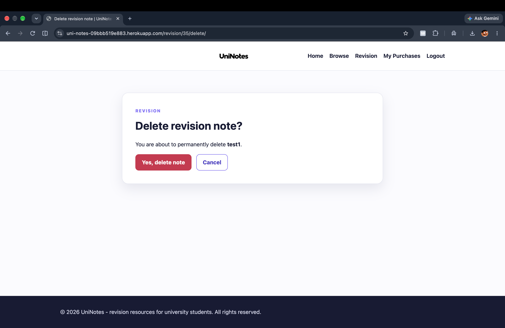

*Picture 5: The Delete confirmation page asks users to confirm their decision before permanently removing a revision note.*


#### CRUD User Interface Feedback

I wanted users to understand what happens when they create, edit or delete a revision note.

To achieve this, I used Django's messages framework to display feedback after successful actions.

| Operation | User Feedback |
|---|---|
| Create | Revision note saved to your account. |
| Read | The requested revision note is displayed. |
| Update | Revision note updated. |
| Delete | Revision note deleted. |
| Invalid form | Validation errors are displayed beside the relevant fields. |
| Missing or inaccessible note | Django returns a 404 response. |

I also included navigation links to help users move between pages.

For example, the revision notes list contains actions to view, edit and delete individual notes.

The revision note form includes a Cancel option so users can leave without submitting changes.

The Delete confirmation page also contains a Cancel option.

When a user has no revision notes, the application displays an empty-state message encouraging them to create their first note.

These features help make the CRUD functionality easier to understand and use.


##### CRUD Success Message Screenshot

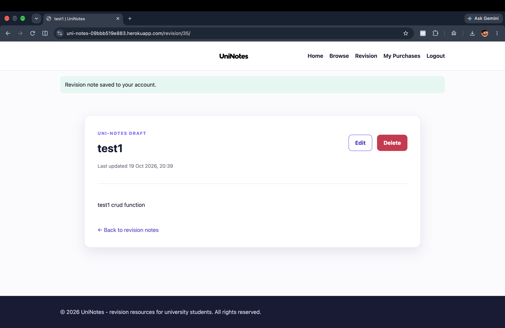

*Picture 6: A success message confirms that a revision note has been successfully saved or updated.*


#### CRUD Permissions

The revision note CRUD functionality is restricted to authenticated users.

I used Django's `@login_required` decorator on the following views:

- `revision_notes()`
- `revision_detail()`
- `revision_create()`
- `revision_edit()`
- `revision_delete()`

This prevents anonymous users from accessing the personal revision note pages directly.

I also implemented ownership checks when retrieving individual revision notes.

For example:

```python
note = get_object_or_404(
    RevisionNote,
    pk=pk,
    owner=request.user,
)
```

This query ensures that the requested record belongs to the logged-in user.

If someone changes the ID in the URL to reference another user's note, the view returns a 404 response instead of displaying or modifying the record.

The owner field is assigned in the backend during creation, rather than being supplied through the form.

This prevents users from choosing another account as the owner through the normal form.

**Permission summary**

| Action | Anonymous User | Registered User |
|---|---|---|
| Browse public study resources | Allowed | Allowed |
| View personal revision notes | Restricted | Own notes only |
| Create revision notes | Restricted | Allowed |
| Edit revision notes | Restricted | Own notes only |
| Delete revision notes | Restricted | Own notes only |
| View other users' revision notes | Restricted | Restricted |
| Download purchased study resources | Restricted | Requires a purchase record |

These restrictions help protect the database records associated with each account.

One limitation to consider is that direct media-file URLs require separate protection if uploaded attachments must remain private. The current ownership checks protect the revision note views, but they do not automatically provide private file storage.

#### CRUD Testing

I created automated Django tests for the revision note functionality in `notes/tests.py`.

These tests use Django's `TestCase` class and test client to simulate requests.

The `RevisionCrudTests` class covers the main CRUD operations.

The following tests are included:

| Test Function | Purpose |
|---|---|
| `test_user_can_create_revision_note` | Checks that a revision note can be created and linked to its owner. |
| `test_user_can_view_own_revision_note` | Checks that a user can access their own revision note. |
| `test_user_can_edit_own_revision_note` | Checks that changes to a revision note are saved. |
| `test_user_can_delete_own_revision_note` | Checks that a revision note can be deleted. |
| `test_user_cannot_view_another_users_revision_note` | Checks that another user's revision note returns a 404 response. |

For example, I created a test that checks whether a new revision note is correctly saved.

```python
def test_user_can_create_revision_note(self):
    response = self.client.post(
        reverse("notes:revision_create"),
        {
            "title": "Arrays",
            "subject": "Computer Science",
            "content": "Arrays store ordered values.",
        },
    )
    self.assertEqual(RevisionNote.objects.count(), 1)
    self.assertEqual(response.status_code, 302)
    self.assertEqual(RevisionNote.objects.first().owner, self.user)
```

This test checks three things:

1. One revision note has been created in the database.
2. The application returns a redirect after the form is submitted.
3. The new revision note belongs to the correct logged-in user.

I also included a test that checks whether users can view another person's revision note.

```python
def test_user_cannot_view_another_users_revision_note(self):
    note = RevisionNote.objects.create(
        owner=self.other_user,
        title="Private note",
        subject="Psychology",
        content="Private revision content.",
    )
    response = self.client.get(
        reverse("notes:revision_detail", args=[note.pk])
    )
    self.assertEqual(response.status_code, 404)
```

This test checks that the application returns a 404 response when a user tries to view a revision note belonging to another account.

The automated tests can be run using:

```bash
python manage.py test notes
```

The complete test results, additional permission tests, manual testing evidence and any corrections made during testing will be documented in the Testing section of this README.

#### CRUD Evaluation

Overall, the CRUD functionality provides registered users with a way to create and manage personal revision notes within UniNotes.

The Create operation allows users to store revision information and optional attachments.

The Read operation retrieves saved information and displays it through Django templates.

The Update operation allows users to make changes without creating duplicate records.

The Delete operation allows users to remove records after confirming their decision.

One important part of the implementation is the use of ownership checks to restrict access to personal revision note records.

Using Django's ModelForm functionality also helped reduce code duplication because the same form can be used for both creating and editing records.

The interface provides success messages, validation errors and confirmation pages to help users understand the outcome of their actions.

A possible future improvement would be introducing a soft-delete feature, allowing users to recover accidentally deleted revision notes.

Additional automated tests could also be added to cover attempts to edit or delete another user's notes, invalid file uploads and deletion using GET requests.

The current implementation provides the four main database operations needed for the personal revision note feature of UniNotes.


### Forms and Validation

#### Django Forms

I used Django forms to collect, process and validate information submitted by users.

Forms are an important part of UniNotes because users need to register for an account and manage their own revision notes.

I used Django's built-in form functionality rather than manually validating each submitted field.

The forms are located in `notes/forms.py`.

I created two main forms:

- `RegisterForm` - allows new users to register.
- `RevisionNoteForm` - allows registered users to create and edit revision notes.

Using Django forms helped me organise the validation logic separately from the HTML templates and backend views.

#### Create Forms

I implemented two forms that allow users to submit new information to the application.

##### User Registration Form

I created a registration form to allow visitors to create a UniNotes account.

The registration form inherits from Django's built-in `UserCreationForm`.

I extended this form by adding a required email address field.

The form contains:

- Username
- Email address
- Password
- Password confirmation

The following code is from `notes/forms.py`:

```python
class RegisterForm(UserCreationForm):
    email = forms.EmailField(required=True)

    class Meta:
        model = User
        fields = (
            "username",
            "email",
            "password1",
            "password2",
        )
```

I chose `UserCreationForm` because it provides built-in validation for usernames and passwords.

It also checks that the two passwords match before creating the account.

When the form is submitted, Django validates the information.

If the submitted data is valid, the account is created, the user is automatically logged in and redirected to the home page.

If the form is invalid, the user remains on the registration page and receives validation feedback.

**Registration Form Screenshot**

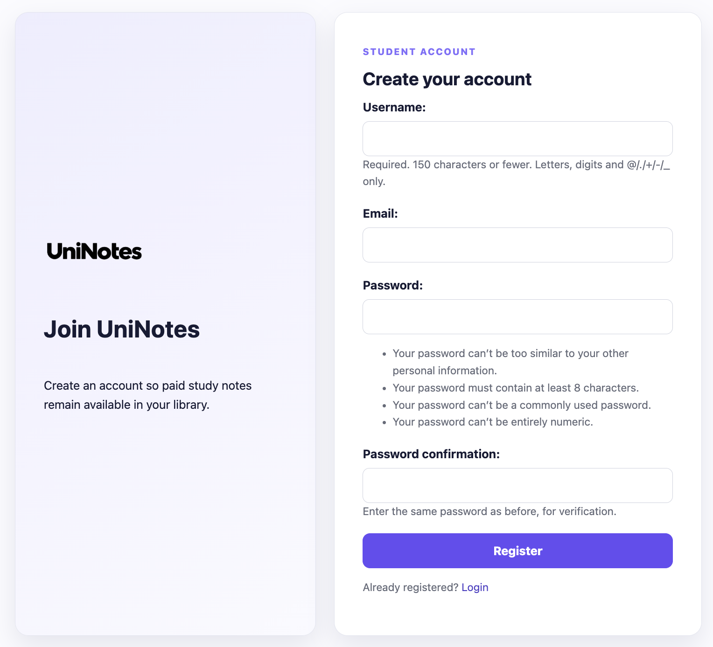

*Picture 7: The UniNotes registration form allows new users to create an account using their username, email address and password.*

##### Revision Note Creation Form

I also created a form that allows registered users to add personal revision notes.

This form is based on Django's `ModelForm` and is connected to the `RevisionNote` model.

The form contains:

- Title
- Subject
- Content
- Optional attachment

The following code is from `notes/forms.py`:

```python
class RevisionNoteForm(forms.ModelForm):
    class Meta:
        model = RevisionNote
        fields = (
            "title",
            "subject",
            "content",
            "attachment",
        )
        widgets = {
            "content": forms.Textarea(
                attrs={"rows": 10}
            ),
        }
```

I used a larger text area for the content field so that students have enough space to write their revision information.

The form also supports uploading a document alongside the revision note.

When the user submits the form, Django checks that the information is valid before saving it.

I used the following code in `notes/views.py`:

```python
if form.is_valid():
    note = form.save(commit=False)
    note.owner = request.user
    note.save()
```

Using `commit=False` allows the logged-in user to be assigned as the owner before the revision note is saved.

This is important because the owner field should be controlled by the backend rather than selected by the user.

**Revision Note Creation Screenshot**

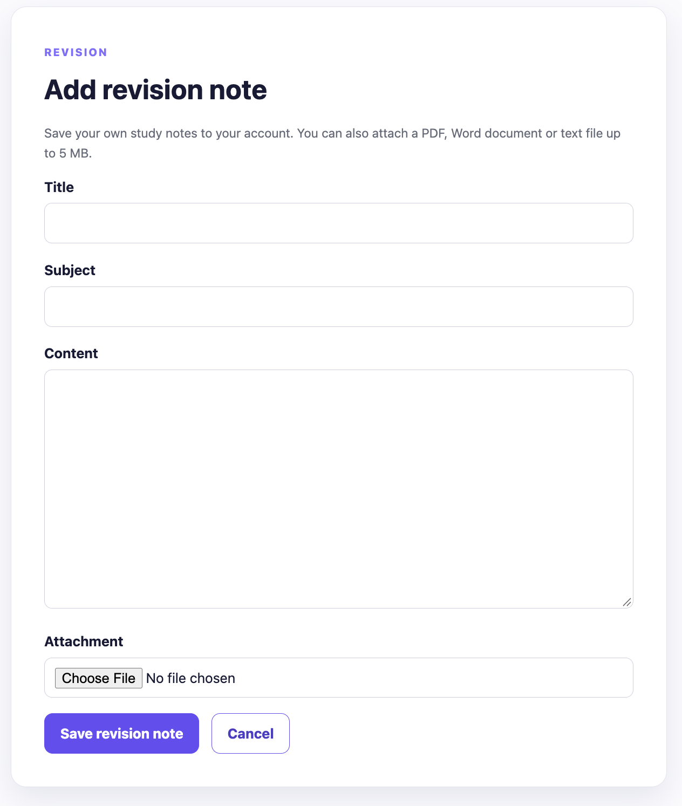

*Picture 8: The revision note creation form allows registered users to enter a title, subject, content and optional file attachment.*

#### Edit Forms

I reused the `RevisionNoteForm` to allow registered users to edit existing revision notes.

Instead of creating a completely separate form, I passed the existing database record into the form using Django's `instance` argument.

For example:

```python
form = RevisionNoteForm(instance=note)
```

This loads the previously saved information into the form.

When the user submits their changes, the view processes the updated information:

```python
form = RevisionNoteForm(
    request.POST,
    request.FILES,
    instance=note,
)
```

If the submitted data passes validation, Django saves the changes to the existing revision note.

I reused the form because the same fields are needed for both creating and editing revision notes.

This reduced duplicated code and made the forms easier to maintain.

**Edit Revision Note Screenshot**


*Picture 9: The Edit form displays the previously saved revision note information, allowing users to update their content.*

#### Form Validation

I implemented validation to prevent incomplete or invalid information from being accepted through the application's forms.

Django provides built-in validation for common requirements, while custom validation methods can be used for more specific checks.

##### Required Fields

Some fields must contain information before the form can be submitted successfully.

For registration, the required fields include:

- Username
- Email address
- Password
- Password confirmation

For revision notes, the required fields include:

- Title
- Subject
- Content

The attachment field is optional.

If a required field is left empty, Django marks the form as invalid.

The form is displayed again with validation errors so that the user can correct the missing information.

This helps prevent incomplete revision notes from being saved.

**Required Fields Validation Screenshot**

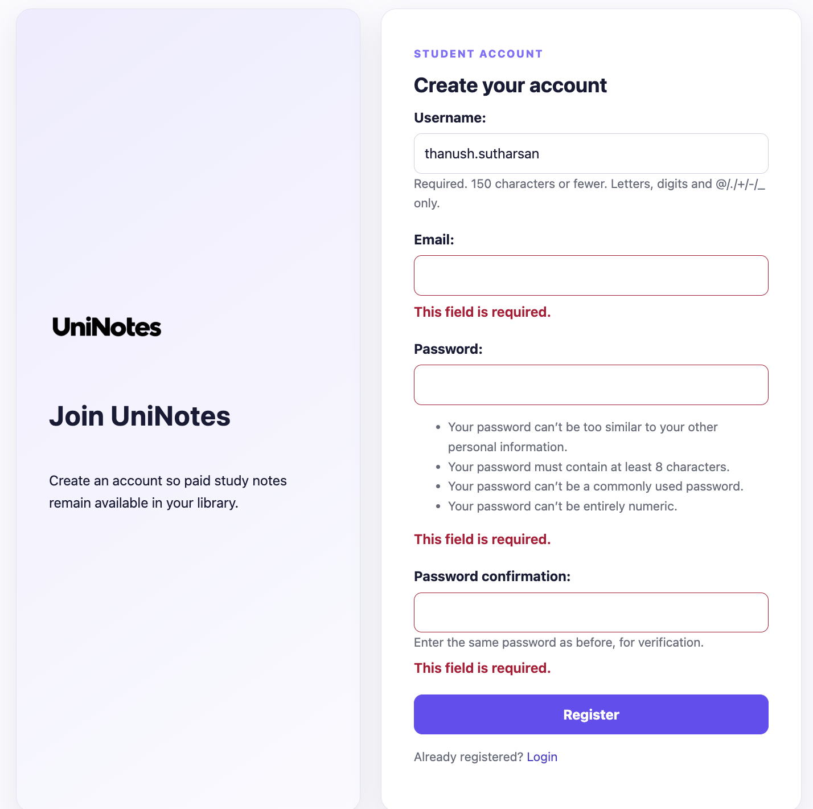

*Picture 10: Required field validation prevents an incomplete revision note form from being accepted and identifies the fields that need information.*

##### Format Validation

I used Django's built-in field types and validators to check the format of submitted information.

For example, the registration form uses:

```python
email = forms.EmailField(required=True)
```

This checks whether the submitted email address follows a valid format.

I also used `FileExtensionValidator` to control which attachment extensions are accepted.

The `RevisionNote` model allows the following attachment extensions:

- PDF
- DOC
- DOCX
- TXT

The validator is defined in `notes/models.py`:

```python
FileExtensionValidator(
    allowed_extensions=[
        "pdf",
        "doc",
        "docx",
        "txt",
    ]
)
```

If a user attempts to upload a file with an unsupported extension, the form returns a validation error.

This helps control the types of files submitted to the application.

However, checking a file extension does not guarantee that the file contents are safe. More detailed file validation could be introduced in future development.

**Unsupported File Validation Screenshot**

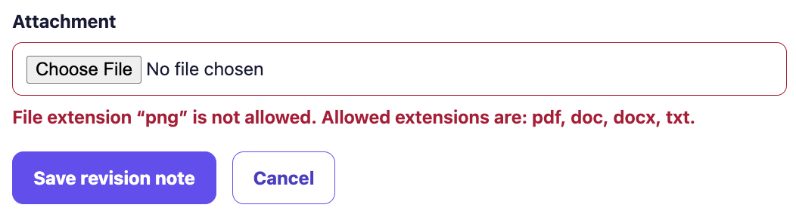

*Picture 11: File extension validation rejects an unsupported attachment type and displays feedback explaining which formats are permitted.*

##### Range / Value Validation

I also used field limits to control the amount of information users can submit.

The `RevisionNote` model contains the following limits:

| Field | Maximum Length |
|---|---|
| Title | 120 characters |
| Subject | 100 characters |
| Content | 5,000 characters |

These restrictions are defined in the model fields.

For example:

```python
title = models.CharField(max_length=120)

subject = models.CharField(max_length=100)

content = models.TextField(max_length=5000)
```

When these fields are processed through the ModelForm, Django validates their maximum lengths.

I also included a maximum file size of 5 MB for revision note attachments.

The `StudyNote` model includes a minimum price validator of £0.50.

These checks help prevent invalid values and unnecessarily large submissions.

##### Custom Validation

I created custom validation methods for registration emails and revision note attachments.

**Duplicate Email Validation**

The `RegisterForm` contains a `clean_email()` method.

```python
def clean_email(self):
    email = self.cleaned_data["email"].lower()

    if User.objects.filter(
        email__iexact=email
    ).exists():
        raise forms.ValidationError(
            "An account already uses this email."
        )

    return email
```

This method converts the email address to lowercase before checking whether another account already uses it.

I used `email__iexact` to make the database lookup case-insensitive.

For example, if an existing account uses `student@example.com`, a new registration using `STUDENT@example.com` should not be accepted through this form.

If the email address is already registered, Django raises a validation error.

This helps prevent duplicate email addresses during registration.

**Duplicate Email Validation Screenshot**

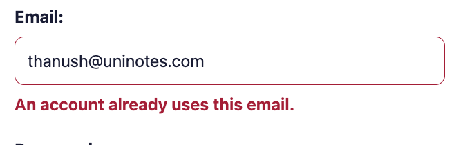

*Picture 12: The registration form displays an error when a user attempts to register with an email address already associated with an existing account.*

**Attachment File Size Validation**

I also created a `clean_attachment()` method to validate uploaded file sizes.

The code is located in `notes/forms.py`.

```python
def clean_attachment(self):
    attachment = self.cleaned_data.get(
        "attachment"
    )

    if attachment and attachment.size > 5 * 1024 * 1024:
        raise forms.ValidationError(
            "The uploaded file must be 5 MB or smaller."
        )

    return attachment
```

This method checks the uploaded attachment before the form is accepted.

If the file is larger than the configured limit, the form raises a validation error.

The user receives the message:

"The uploaded file must be 5 MB or smaller."

I added this restriction to prevent users from uploading unnecessarily large documents.

**Attachment Size Validation Screenshot**

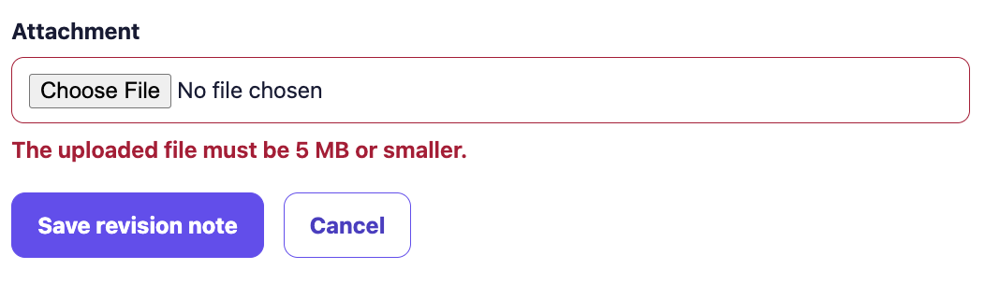

*Picture 13: The attachment validation displays an error when a user attempts to upload a file larger than the permitted size.*

#### Model-Level Validation

I also used Django model validators to define restrictions directly in the database models.

These are located in `notes/models.py`.

For example, the `StudyNote` model uses `MinValueValidator` to define the minimum permitted resource price.

```python
price = models.DecimalField(
    max_digits=6,
    decimal_places=2,
    validators=[
        MinValueValidator(Decimal("0.50"))
    ],
)
```

The model also uses `FileExtensionValidator` to restrict uploaded study resource files to PDF extensions.

The `RevisionNote` model uses a similar validator for personal revision note attachments.

Model validators are useful because Django can use these restrictions when validating forms based on the models.

However, saving a model directly through the ORM does not automatically run every model validator.

Therefore, validation should also be considered when records are created or modified outside the application's normal forms.

#### User Feedback for Invalid Data

I wanted the forms to provide clear feedback when users submitted invalid information.

Both the registration and revision note templates display error messages near the relevant form fields.

For example, the revision note template contains the following code:

```django

    <div class="form-group has-error">
        <label for="{{ field.id_for_label }}">
            {{ field.label }}
        </label>

        {{ field }}

        
            <div class="help-text">
                {{ field.help_text }}
            </div>
        

        
            <div class="field-error">
                {{ error }}
            </div>
        
    </div>

```

This allows Django to display validation errors alongside the relevant input fields.

Examples of feedback include:

- Required information is missing.
- An invalid email address has been entered.
- An email address is already registered.
- An unsupported file extension has been uploaded.
- An attachment exceeds the file size limit.
- Passwords do not match during registration.

If validation fails, the form is displayed again rather than saving invalid information.

The form templates also contain Django's CSRF token.

```django

```

This provides protection against cross-site request forgery during form submissions.

Although CSRF protection is separate from input validation, both are important for handling form submissions securely.

#### Forms and Validation Evaluation

Overall, Django forms provided a suitable way to manage user input throughout UniNotes.

Using `UserCreationForm` made it easier to implement registration without manually creating password validation functionality.

Using `ModelForm` for revision notes allowed the form fields to remain connected to the database model.

Reusing the revision note form for both creating and editing records reduced code duplication.

Custom validation methods helped prevent duplicate registration emails and oversized attachments.

The validation messages also make it easier for users to understand why a form submission was unsuccessful.

One limitation is that uploaded files are currently checked mainly by their extension and file size rather than detailed file-content inspection.

Additional automated tests could also be introduced to check more invalid input scenarios.

Overall, the forms support the main registration and revision note management features required for UniNotes.


<a name="jump-authentication-authorisation-and-permissions"></a>

### Authentication, Authorisation and Permissions

#### Authentication Overview

I used Django's built-in authentication system to manage user accounts in UniNotes.

Authentication allows the application to identify users and control access to features that require an account.

I chose Django's authentication system because it already provides functionality for registration, login sessions, password validation and logout.

This was important for UniNotes because students need their own accounts to manage personal revision notes and access purchased study resources.

The authentication system is connected to the following files:

- `notes/forms.py` - Registration form and validation.
- `notes/views.py` - Registration and restricted application views.
- `notes/decorators.py` - Custom authentication-related decorator.
- `uninotes/urls.py` - Registration, login and logout URLs.
- `templates/registration/` - Registration and login templates.
- `templates/base.html` - Navigation links based on login status.

#### Registration

I created a registration page that allows new visitors to create a UniNotes account.

The registration page can be accessed at:

```text
/accounts/register/
```

The registration form contains four main fields:

- Username
- Email address
- Password
- Password confirmation

I used Django's `UserCreationForm` and added custom email validation.

The registration view is located in `notes/views.py`.

```python
@anonymous_required
def register(request):
    if request.method == "POST":
        form = RegisterForm(request.POST)
        if form.is_valid():
            user = form.save()
            login(request, user)
            messages.success(
                request,
                "Account created successfully.",
            )
            return redirect("notes:home")
    else:
        form = RegisterForm()

    return render(
        request,
        "registration/register.html",
        {"form": form},
    )
```

When a user submits the form, Django checks whether the information is valid.

If validation passes, the user account is created and the application automatically logs the user in.

The user is then redirected to the home page.

I also used a custom `anonymous_required` decorator to prevent users who are already logged in from accessing the registration page unnecessarily.

**Registration Screenshot**


*Picture 14: The UniNotes registration page allows new visitors to create an account.*

**Successful Registration Screenshot**

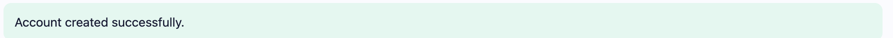

*Picture 15: After successful registration, the user is redirected to the home page and receives a confirmation message.*

#### Login

I used Django's built-in `LoginView` to handle user login.

The login page is available at:

```text
/accounts/login/
```

Users must enter their username and password to access their accounts.

The login URL is defined in `uninotes/urls.py`.

```python
path(
    "accounts/login/",
    auth_views.LoginView.as_view(
        redirect_authenticated_user=True
    ),
    name="login",
)
```

When a user submits their login details, Django checks whether the credentials match an existing account.

If the credentials are correct, Django creates an authenticated session.

If the credentials are incorrect, the login form displays an error message.

I enabled `redirect_authenticated_user=True` because users who are already logged in do not need to see the login page again.

After a successful login, users are redirected to their requested page when a valid `next` parameter is provided, or to the configured home page.

**Login Page Screenshot**

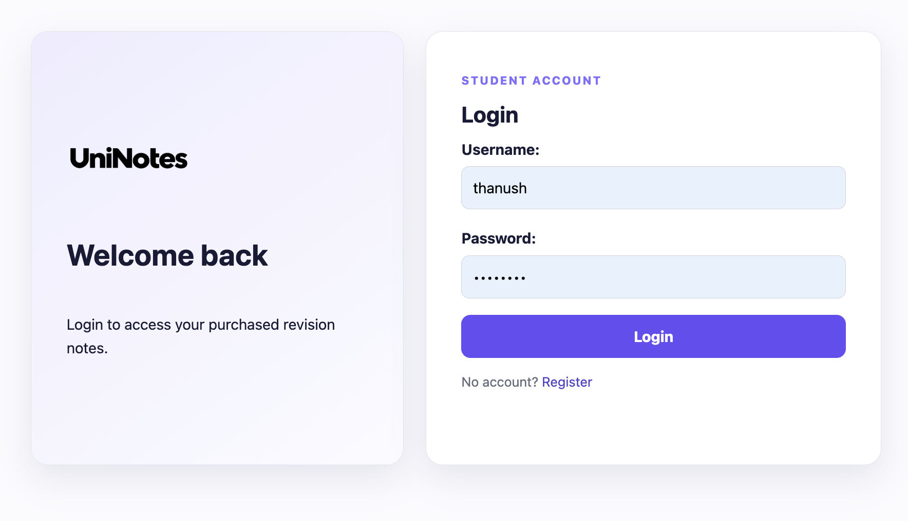

*Picture 16: The login page allows registered users to sign into their UniNotes accounts.*

**Invalid Login Screenshot**

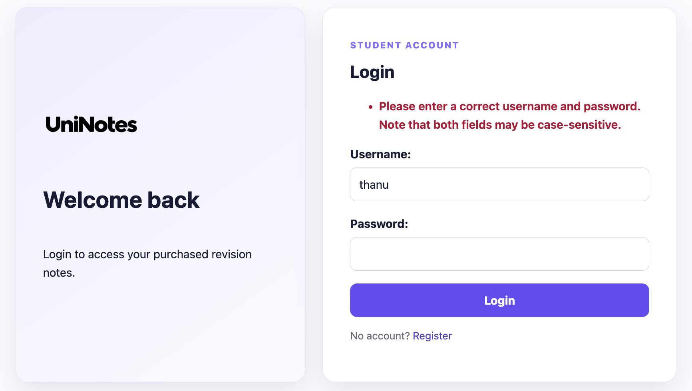

*Picture 17: The login form displays an error when a user enters incorrect authentication details.*

#### Logout

I used Django's built-in `LogoutView` to allow registered users to end their sessions.

The logout URL is:

```text
/accounts/logout/
```

The logout functionality is configured in `uninotes/urls.py`.

```python
path(
    "accounts/logout/",
    auth_views.LogoutView.as_view(),
    name="logout",
)
```

The logout button is displayed in the navigation when a user is authenticated.

I used a POST form instead of a normal navigation link.

```django
<form action="" method="post">
    
    <button type="submit">Logout</button>
</form>
```

This allows the logout action to be processed through a POST request with CSRF protection.

After logging out, the user is redirected to the home page.

The navigation also changes to display the Login and Register options.

**Logged-In Navigation Screenshot**

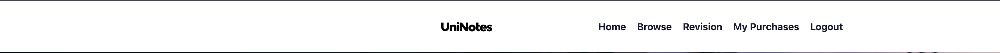

*Picture 18: The navigation displays the Revision, My Purchases and Logout options when a user is authenticated.*

**Logged-Out Navigation Screenshot**

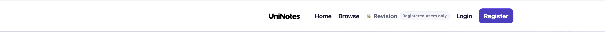

*Picture 19: After logging out, the navigation displays Login and Register instead of account-specific options.*

#### Why Users Need Accounts

I included user accounts because UniNotes contains features that need to be associated with individual students.

Registered accounts allow users to:

- Create personal revision notes.
- View their previously saved revision notes.
- Edit their own revision notes.
- Delete their own revision notes.
- Purchase study resources.
- Access their purchase history.
- Download resources they have purchased.

The application uses the authenticated user to identify the correct records in the database.

For example, the `RevisionNote` model contains an `owner` field that links each revision note to its creator.

Similarly, the `Purchase` model links purchased resources to the registered user.

This means users can return to their accounts and access their saved information.

#### Anonymous User Permissions

Anonymous users are visitors who have not logged into an account.

I allowed anonymous users to access the public areas of UniNotes.

These include:

- Home page.
- Browse study notes page.
- Search functionality.
- Subject filtering.
- Individual study resource details.
- Registration page.
- Login page.

However, anonymous users cannot access personal revision notes, purchase history or protected downloads.

If they attempt to access a page protected by `@login_required`, Django redirects them to the login page.

The application also displays a locked Revision navigation link for anonymous visitors.

This explains that an account is required to use the feature.

**Restricted Revision Access Screenshot**

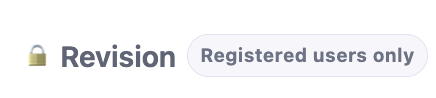

*Picture 20: An anonymous visitor who attempts to access personal revision notes is redirected to the login page.*

#### Registered User Permissions

Registered users can access the public features and additional account functionality.

They can:

- Create revision notes.
- View their own revision notes.
- Edit their own revision notes.
- Delete their own revision notes.
- Purchase study resources.
- Access their purchase history.
- Download purchased study notes.

However, being logged in does not mean a user can access every database record.

I added ownership checks to restrict personal revision note access.

Users can manage their own revision notes, but they cannot access another user's personal notes through the revision note views.

#### Admin Permissions

Django provides built-in staff and superuser functionality through its authentication system.

However, the current UniNotes project does not include a custom administration dashboard.

The Django admin application is not currently enabled in `INSTALLED_APPS`, and there is no `/admin/` URL configured.

The main application views do not currently use a separate custom staff role or permission system for managing study resources.

Introducing an administration dashboard could be a future improvement.

This would make it easier for authorised administrators to manage subjects, study resources and uploaded materials.

#### Ownership Checks

Ownership checks are important because UniNotes allows users to create personal revision notes.

I used Django's `get_object_or_404()` function to retrieve records while checking their owners.

For example:

```python
note = get_object_or_404(
    RevisionNote,
    pk=pk,
    owner=request.user,
)
```

This code checks two conditions:

1. The revision note has the requested primary key.
2. The revision note belongs to the currently logged-in user.

If the record does not exist or belongs to another account, Django returns a 404 response.

I implemented ownership checks in the following views:

- `revision_detail()`
- `revision_edit()`
- `revision_delete()`

I also restricted the revision notes list to records belonging to the current user.

```python
notes = RevisionNote.objects.filter(
    owner=request.user
)
```

This ensures that the personal revision notes page only retrieves records associated with the authenticated account.

**Unauthorised Access Screenshot**

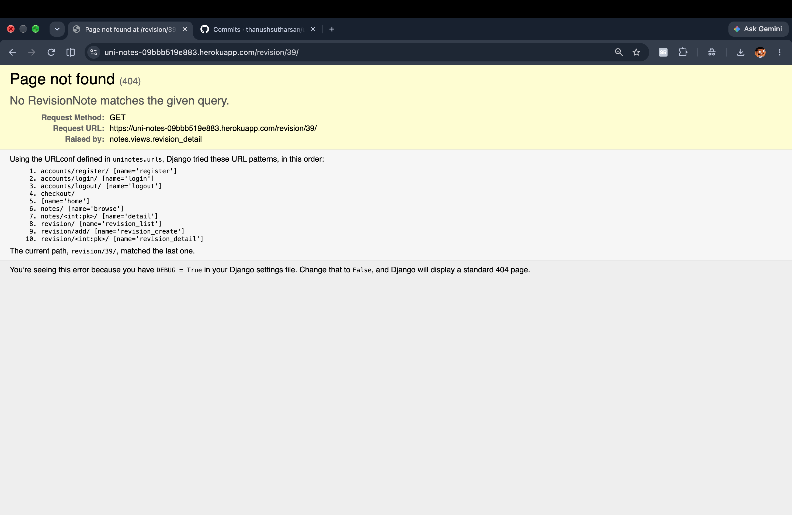

*Picture 21: The application returns a 404 response when a logged-in user attempts to access a revision note belonging to another account.*

#### Restricted Pages

I used Django's `@login_required` decorator to protect features that require authentication.

For example:

```python
@login_required
def revision_notes(request):
    notes = RevisionNote.objects.filter(
        owner=request.user
    )

    return render(
        request,
        "notes/revision_list.html",
        {"revision_notes": notes},
    )
```

The decorator checks whether the user is authenticated before allowing the view to execute.

If the user is not authenticated, Django redirects them to the login page.

I used this decorator on the following features:

- Revision notes list.
- Revision note detail page.
- Create revision note.
- Edit revision note.
- Delete revision note.
- My Purchases.
- Purchased resource downloads.
- Stripe Checkout.
- Payment success and cancellation pages.

This prevents anonymous users from accessing the restricted Django views directly.

#### Preventing Unauthorised Data Access

I implemented several measures to help protect user information.

**Authentication Checks**

I used `@login_required` to prevent anonymous users from accessing restricted pages.

**Ownership Checks**

I checked the owner of revision notes before allowing users to view, edit or delete them.

**Purchase Checks**

Before allowing a study resource to be downloaded, the application checks whether the current user has a matching purchase record.

The download view contains the following database query:

```python
purchase = get_object_or_404(
    Purchase.objects.select_related("note"),
    user=request.user,
    note_id=pk,
)
```

If no matching purchase exists, Django returns a 404 response.

**CSRF Protection**

I included `` in POST forms to help protect against cross-site request forgery.

**Password Security**

I used Django's built-in authentication system, which stores passwords using secure password hashing rather than plain text.

The project also includes Django's standard password validators.

These checks help protect the application's user accounts and personal data.

One limitation is that files stored in publicly accessible media locations may require additional protection.

Ownership checks in Django views do not automatically make direct media file URLs private.

#### Authentication and Authorisation Testing

I created automated tests in `notes/tests.py` using Django's `TestCase` class.

The existing test suite includes authentication and access-control tests.

The following tests are implemented:

| Test | Expected Result |
|---|---|
| Anonymous user visits My Purchases | Redirect to login. |
| Anonymous user visits Revision Notes | Redirect to login. |
| Logged-in user visits Register | Redirect to home page. |
| Logged-in user visits Login | Redirect to home page. |
| User attempts to download a resource without purchasing it | Return 404. |
| User attempts to view another user's revision note | Return 404. |

The automated tests can be run using:

```bash
python manage.py test notes
```

I also plan to manually test authentication and permissions using separate test accounts.

The manual testing will include:

1. Registering a new account.
2. Logging in with valid credentials.
3. Attempting to log in with invalid credentials.
4. Logging out successfully.
5. Attempting to access revision notes without logging in.
6. Attempting to view another user's revision note.
7. Attempting to edit another user's revision note.
8. Attempting to delete another user's revision note.
9. Attempting to download a study resource without purchasing it.

I will record the actual results and supporting evidence in the Testing section.

The current automated tests cover several important access restrictions, but additional tests would improve coverage of unauthorised edit and delete requests.

#### Authentication and Authorisation Evaluation

Overall, Django's built-in authentication system provided the functionality needed to manage user accounts in UniNotes.

Using Django's existing login and logout views reduced the amount of authentication code I needed to write.

The custom registration form allowed me to include email validation and automatically authenticate users after registration.

I also used conditional template rendering to change the navigation depending on whether a user is logged in.

The `@login_required` decorator helped restrict account-specific pages, while ownership checks protected personal revision note records.

The Purchase model is also used to check whether users have access to paid study materials through the protected download view.

One area for future improvement is the introduction of a dedicated administration dashboard.

Another improvement would be implementing private cloud file storage for user attachments and paid resources.

Additional automated permission tests would also help confirm that users cannot edit or delete records belonging to other accounts.

The existing implementation supports the main authentication and authorisation requirements of UniNotes.


<a name="jump-e-commerce-and-payments"></a>

### E-Commerce and Payments

#### E-Commerce Purpose

I developed UniNotes with e-commerce functionality to allow students to purchase digital study resources through the website.

The main purpose of this feature is to give users access to downloadable study materials that can support their learning and revision.

I decided to offer individual purchases rather than a subscription because students may only need resources for particular subjects.

The e-commerce functionality allows users to:

- Browse available study resources.
- View resource information and prices.
- Register or log in before purchasing.
- Purchase individual study notes.
- Complete payments using Stripe Checkout.
- View previously purchased resources.
- Download study materials they have purchased.

The payment functionality is handled by the `checkout` Django application.

The purchase records are stored in the `Purchase` model within the `notes` application.

#### Payment User Flow

I designed the payment process to be straightforward so that users can purchase their selected study resources without unnecessary steps.

The user journey follows this process:

1. The user visits the Browse Notes page.
2. The user selects a study resource.
3. The detail page displays the resource title, description, subject and price.
4. The user logs in or creates an account if required.
5. The user selects the Buy Now button.
6. Django checks whether the resource has already been purchased.
7. The application creates a Stripe Checkout session.
8. The user is redirected to Stripe's hosted checkout page.
9. The user completes or cancels the payment.
10. Following a successful checkout, Stripe redirects the user to the payment success URL.
11. Django retrieves the checkout session from Stripe and checks the returned details.
12. If the verification checks pass, the purchase is recorded in the database.
13. The user can download the purchased study resource.

This process connects the frontend, Django backend, Stripe API and database.

#### Payment Provider

I selected Stripe as the payment provider for UniNotes.

Stripe provides a hosted checkout page that allows users to complete payments without requiring me to develop a separate payment form.

I chose Stripe because it provides:

- A hosted payment interface.
- Integration with Python.
- Support for GBP payments.
- Test payment functionality.
- Payment session verification.
- API documentation.
- Payment error handling.

Using Stripe Checkout means UniNotes does not need to directly collect or store customers' card details.

This was useful because I could focus on the Django integration and how purchases are recorded in the database.

#### Payment Integration

I integrated Stripe using its Python library.

The payment-related files are located in the following directory:

```text
checkout/
├── __init__.py
├── apps.py
├── models.py
├── views.py
├── urls.py
├── tests.py
└── migrations/
```

The main payment functions are located in `checkout/views.py`.

These include:

- `create_checkout_session()`
- `payment_success()`
- `payment_cancel()`

The URL patterns are defined in `checkout/urls.py`.

```python
from django.urls import path

from . import views

app_name = "checkout"

urlpatterns = [
    path(
        "buy/<int:pk>/",
        views.create_checkout_session,
        name="buy",
    ),
    path(
        "success/",
        views.payment_success,
        name="success",
    ),
    path(
        "cancel/<int:pk>/",
        views.payment_cancel,
        name="cancel",
    ),
]
```

These URLs connect the checkout process to the relevant Django views.

The main project URL configuration includes the checkout application using:

```python
path("checkout/", include("checkout.urls"))
```

#### Products / Services / Purchases

The products available on UniNotes are downloadable study resources.

Each resource is represented by a `StudyNote` database model.

The model contains information including:

- Subject.
- Title.
- Description.
- Price.
- Cover image URL.
- Downloadable file.
- Active status.

The `price` field uses Django's `DecimalField` to store monetary values.

The `is_active` field controls whether a resource is available through the application's public browsing and purchasing functionality.

When a user purchases a study resource, the application stores the purchase information in the `Purchase` model.

The Purchase model includes the following fields:

| Field | Purpose |
|---|---|
| user | Identifies the user who purchased the resource. |
| note | Identifies the purchased study resource. |
| stripe_session_id | Stores the Stripe Checkout session identifier. |
| amount_paid | Records the payment amount returned by Stripe. |
| purchased_at | Records when the purchase was created. |

This allows users to return to their accounts and access their purchased study resources.

##### Study Resource Purchase Screenshot

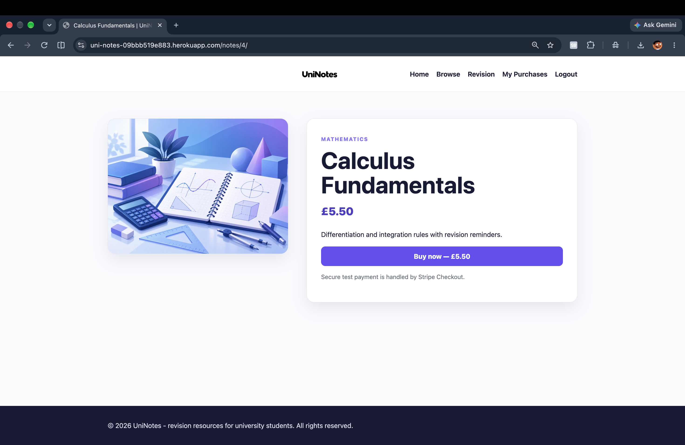

*Picture 22: The study resource detail page displays the resource title, subject, description, price and Buy Now button before checkout.*

#### Checkout Process

The checkout process begins when an authenticated user selects Buy Now.

The study resource detail page uses a POST form to begin checkout.

```django
<form
    action=""
    method="post"
>
    

    <button type="submit">
        Buy now — £{{ note.price }}
    </button>
</form>
```

I used POST because selecting Buy Now creates a Stripe Checkout session.

The CSRF token provides protection against cross-site request forgery.

The `create_checkout_session()` view retrieves the selected study resource.

```python
note = get_object_or_404(
    StudyNote,
    pk=pk,
    is_active=True,
)
```

This checks whether the study resource exists and is active.

The application also checks whether the user has already purchased it.

```python
if Purchase.objects.filter(
    user=request.user,
    note=note,
).exists():
    messages.info(
        request,
        "You already own this study note.",
    )
    return redirect("notes:purchases")
```

This prevents users from starting another checkout through the normal purchasing process for a resource they already own.

The application also checks whether the Stripe secret key has been configured.

If the key is missing, the user receives an error message instead of being redirected to checkout.

Once the checks pass, Django creates a Stripe Checkout session.

```python
session = stripe.checkout.Session.create(
    mode="payment",
    customer_email=request.user.email or None,
    line_items=[
        {
            "price_data": {
                "currency": "gbp",
                "product_data": {
                    "name": note.title
                },
                "unit_amount": int(
                    note.price * Decimal("100")
                ),
            },
            "quantity": 1,
        }
    ],
    metadata={
        "user_id": str(request.user.pk),
        "note_id": str(note.pk),
    },
    success_url=success_url,
    cancel_url=cancel_url,
)
```

The Checkout session contains:

- Product name.
- Product price.
- GBP currency.
- Quantity of one.
- Customer email, if available.
- User ID and study resource ID.
- Success URL.
- Cancellation URL.

I converted the price from pounds into pence because Stripe requires amounts in the smallest currency unit.

For example, a £5.00 resource is passed to Stripe as 500 pence.

After the session is created, Django redirects the user to Stripe.

```python
return redirect(session.url, code=303)
```

This opens Stripe's hosted checkout page.

##### Stripe Checkout Screenshot

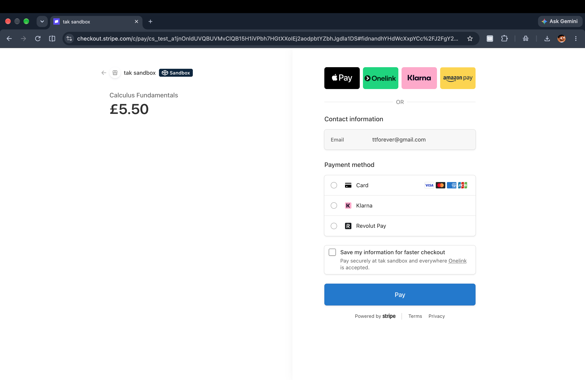

*Picture 23: Stripe Checkout displays the selected study resource and payment amount, allowing the user to complete the payment through Stripe's hosted interface.*

#### Payment Data Flow

The payment process involves communication between the UniNotes Django application, Stripe and the database.

When a user selects Buy Now, Django sends a request to Stripe to create a checkout session.

Stripe returns a session containing a checkout URL.

The user is redirected to this URL to complete the payment.

After a successful checkout, Stripe redirects the browser to the configured success URL with the session identifier.

The `payment_success()` view retrieves the session identifier from the request.

```python
session_id = request.GET.get("session_id", "")
```

The application then retrieves the Checkout session directly from Stripe.

```python
stripe.api_key = settings.STRIPE_SECRET_KEY

session = stripe.checkout.Session.retrieve(
    session_id
)
```

The retrieved information is checked before creating a purchase record.

The application verifies that:

- The payment status is `paid`.
- The session metadata contains the authenticated user's ID.
- The session metadata identifies a study resource.

If these checks pass, the application retrieves the relevant study resource.

It then records the purchase using Django's `get_or_create()` method.

```python
Purchase.objects.get_or_create(
    user=request.user,
    note=note,
    defaults={
        "stripe_session_id": session.id,
        "amount_paid": amount_paid,
    },
)
```

I used `get_or_create()` because it prevents another Purchase record from being created if the same user returns to the payment success URL again.

The Purchase model also contains a unique constraint covering the user and study resource.

Once the purchase record exists, the application displays the payment success page.

#### Successful Payment Feedback

After the Stripe session has been verified and the purchase has been recorded, the application displays the payment success page.

This page is located at:

```text
templates/checkout/success.html
```

The page displays:

- Payment successful heading.
- Purchased resource name.
- Download Note button.
- My Purchases link.
- Browse More Notes link.

This provides feedback that the application has recorded the purchase.

Users can also return to My Purchases to access their study resources.

##### Successful Payment Screenshot

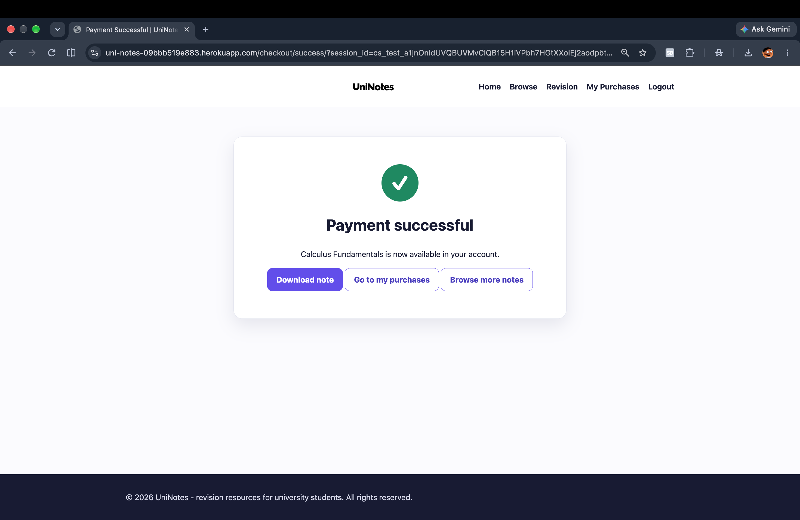

*Picture 24: The payment success page confirms that the study resource has been purchased and provides a link to download it.*

##### My Purchases Screenshot

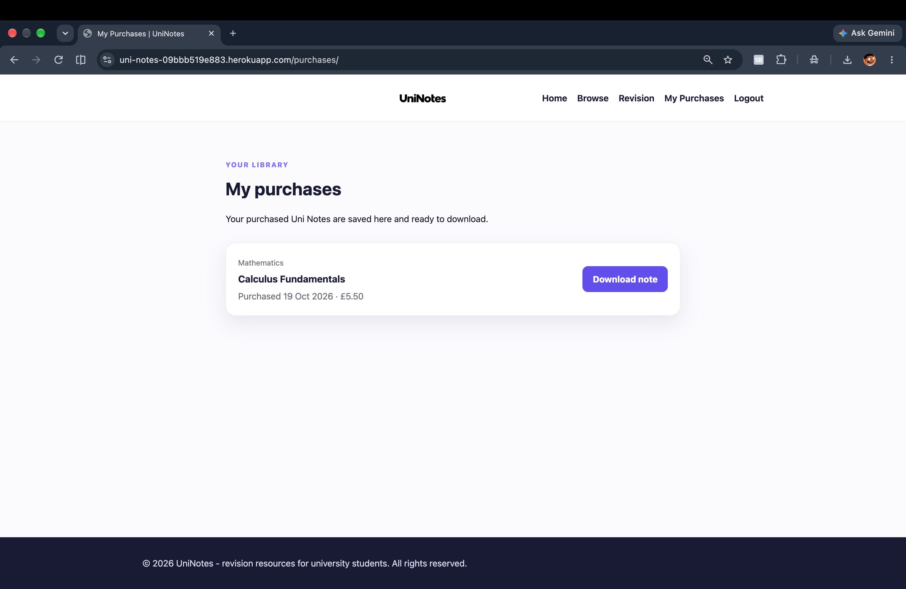

*Picture 25: The My Purchases page displays study resources associated with the logged-in user's account, including download options.*

#### Failed Payment Feedback

I implemented error handling to provide feedback when users cancel checkout or when the payment cannot be verified.

**Payment Cancellation**

If a user cancels Stripe Checkout, the browser returns to the cancellation page.

The cancellation view is handled by `payment_cancel()`.

```python
@login_required
def payment_cancel(request, pk):
    note = get_object_or_404(
        StudyNote,
        pk=pk,
    )

    messages.warning(
        request,
        "Payment was cancelled. You have not been charged.",
    )

    return render(
        request,
        "checkout/cancel.html",
        {"note": note},
    )
```

The cancellation page displays a message explaining that the user has left checkout.

It also provides links allowing users to return to the selected study resource or browse other notes.

The current cancellation view does not independently retrieve the Stripe session to verify its final payment status.

##### Payment Cancellation Screenshot

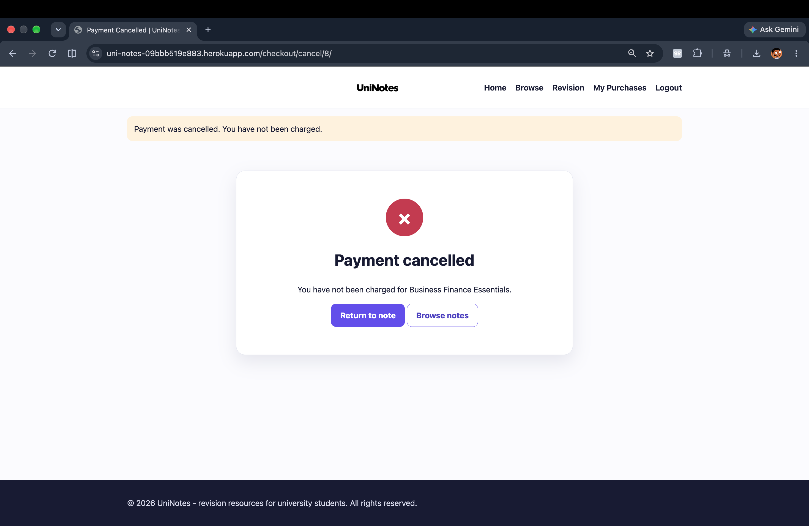

*Picture 26: The payment cancellation page displays feedback when the user returns from a cancelled checkout and provides navigation back to the study resources.*

**Payment Verification Error**

I also included error handling for situations where Django cannot verify the Stripe Checkout session.

For example, the application checks whether a checkout session ID has been supplied.

```python
session_id = request.GET.get("session_id", "")

if not session_id or not settings.STRIPE_SECRET_KEY:
    messages.error(
        request,
        "We could not verify this payment.",
    )
    return redirect("notes:browse")
```

If the session ID is missing, the application redirects the user to the Browse Notes page and displays an error message.

This prevents the success view from recording a purchase without the required session information.

I tested this error-handling scenario by opening the payment success URL on the deployed application without providing a checkout session ID.

The URL follows this format:

```text
https://your-app-domain/checkout/success/
```

The request must be made while logged into a test account because the view requires authentication.

This tests the missing-session-ID error-handling path. It does not simulate a failed card payment or a Stripe service outage.

##### Payment Verification Error Screenshot

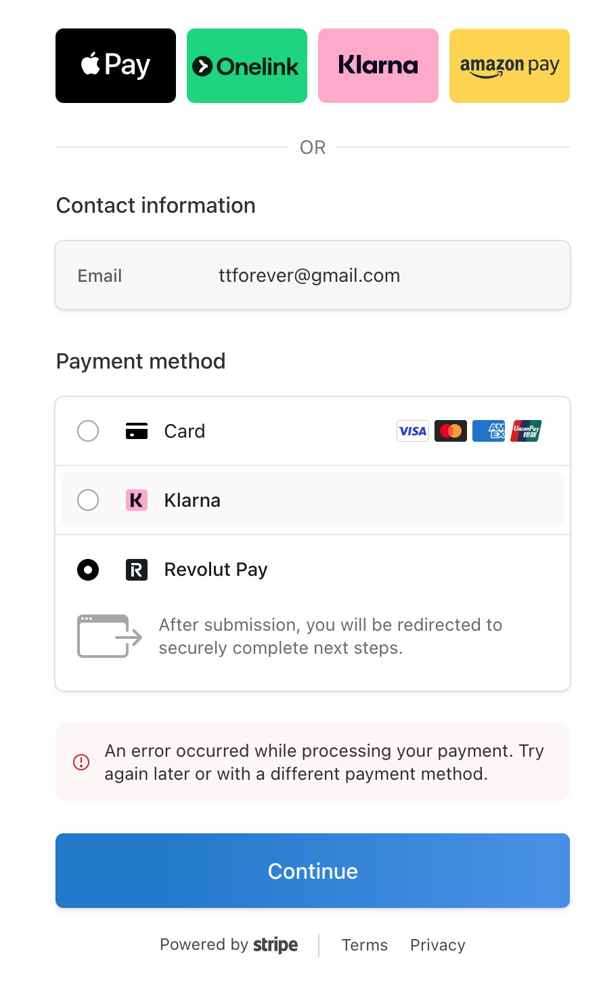

*Picture 27: UniNotes redirects the user to Browse Notes and displays an error message when the payment success URL is accessed without a Stripe Checkout session ID.*

The application also handles Stripe API errors during payment verification.

```python
try:
    session = stripe.checkout.Session.retrieve(
        session_id
    )
except stripe.error.StripeError:
    messages.error(
        request,
        "Stripe could not verify this payment.",
    )
    return redirect("notes:browse")
```

If Stripe raises an API error, Django displays an error message instead of proceeding with the purchase.

However, a separate screenshot would be required to demonstrate this API failure scenario.

#### Payment Validation

I included validation checks to reduce the risk of recording incorrect or duplicate purchases.

These checks include:

1. Requiring authentication before checkout.
2. Requiring POST requests to create checkout sessions.
3. Checking that the selected study resource exists.
4. Checking that the resource is active.
5. Checking whether the user has already purchased the resource.
6. Checking whether Stripe has been configured.
7. Retrieving the payment session directly from Stripe.
8. Checking that the returned payment status is paid.
9. Comparing the session user ID with the authenticated user's ID.
10. Checking that the session identifies a study resource.
11. Preventing duplicate purchase records.

The Purchase model also includes a unique constraint:

```python
models.UniqueConstraint(
    fields=["user", "note"],
    name="unique_user_note_purchase",
)
```

This prevents multiple Purchase records for the same user and study resource.

However, the current payment verification logic does not independently compare the payment amount and currency returned by Stripe with the expected resource price.

This is a limitation that should be addressed before accepting live payments.

#### Payment Security

I considered payment security when developing the Stripe integration.

**Environment Variables**

I used environment variables to configure Stripe credentials.

These are accessed through Django settings.

```python
STRIPE_PUBLIC_KEY = os.environ.get(
    "STRIPE_PUBLIC_KEY", ""
).strip()

STRIPE_SECRET_KEY = os.environ.get(
    "STRIPE_SECRET_KEY", ""
).strip()

STRIPE_WEBHOOK_SECRET = os.environ.get(
    "STRIPE_WEBHOOK_SECRET", ""
).strip()
```

This avoids hard-coding Stripe credentials into the project's source files.

**Stripe Hosted Checkout**

Stripe Checkout collects card payment information on Stripe's hosted payment page.

UniNotes does not directly store card numbers or other card details.

**Authentication**

The checkout process uses Django's `@login_required` decorator.

This prevents anonymous users from initiating the checkout view directly.

**CSRF Protection**

The checkout form includes Django's CSRF token to protect POST requests against cross-site request forgery.

**Purchase Ownership**

Each Purchase record is connected to a registered user.

The download view checks whether the logged-in user has purchased the requested resource.

**Duplicate Purchase Protection**

I used both a duplicate purchase check in the checkout view and a unique database constraint.

This helps prevent users from obtaining multiple Purchase records for the same resource.

**Payment Security Limitations**

The current implementation does not include a Stripe webhook endpoint.

Although the project settings contain `STRIPE_WEBHOOK_SECRET`, this setting is not currently used by a webhook processing view.

The application relies on the user returning to the success page before recording a verified purchase.

This means a customer could complete payment but close their browser before the purchase is recorded.

A future improvement would be to implement a verified Stripe webhook that processes successful payment events independently of the browser redirect.

I would also add explicit amount and currency verification before granting access to purchased resources.

These improvements should be completed before accepting real customer payments.

#### Payment Testing

I created automated tests for the checkout functionality in:

```text
checkout/tests.py
```

The tests use Django's `TestCase` and Python's `unittest.mock` functionality.

The existing test methods are:

| Test | Purpose |
|---|---|
| `test_checkout_session_redirects_to_stripe` | Checks that the checkout view redirects to the Stripe URL returned by a mocked session creation request. |
| `test_success_creates_purchase` | Checks that a mocked paid Stripe session results in a Purchase record. |

For example, the checkout redirect test mocks the Stripe session creation method.

```python
@override_settings(
    STRIPE_SECRET_KEY="sk_test_example"
)
@patch(
    "checkout.views.stripe.checkout.Session.create"
)
def test_checkout_session_redirects_to_stripe(
    self,
    mock_create,
):
    mock_create.return_value = MagicMock(
        url="https://checkout.stripe.com/test"
    )

    response = self.client.post(
        reverse(
            "checkout:buy",
            args=[self.note.pk],
        )
    )

    self.assertEqual(response.status_code, 303)
```

This checks that the application responds with the expected redirect.

I also created a test that simulates a successfully paid Stripe Checkout session.

The test verifies that the application creates a Purchase record for the correct user and study resource.

These tests check the Django payment integration using mocked Stripe responses.

They do not prove that a real end-to-end Stripe transaction has completed.

The checkout tests can be run using:

```bash
python manage.py test checkout
```

The actual test results will be recorded in the Testing section after execution.

Additional automated tests would improve coverage of:

- Invalid checkout session IDs.
- Missing Stripe credentials.
- Failed API requests.
- Unpaid Stripe sessions.
- Incorrect user metadata.
- Incorrect payment amounts.
- Duplicate purchase attempts.
- Cancellation behaviour.

#### Test Payments

Stripe's test environment allows payment scenarios to be tested without processing real transactions.

For manual testing, I will check the following scenarios:

| Test Scenario | Expected Result |
|---|---|
| Browse study resources | Available resources and prices are displayed. |
| Select Buy Now while logged out | Login is required. |
| Select Buy Now while logged in | A Stripe Checkout session is created. |
| Complete a successful test payment | The purchase is recorded and the success page is displayed. |
| Cancel checkout | The cancellation page is displayed. |
| Open the success URL without a session ID | The user is redirected to Browse Notes with an error message. |
| Purchase a resource already owned | The user is redirected to My Purchases. |
| Open My Purchases | The user's purchased resources are listed. |
| Download a purchased resource | The protected download view returns the resource, if the file is available. |
| Attempt a download without purchasing | The application returns a 404 response. |

Actual outcomes and screenshots will be documented in the Testing section.

I will only mark a test as passed after verifying its result.

##### Purchased Resource Download Screenshot

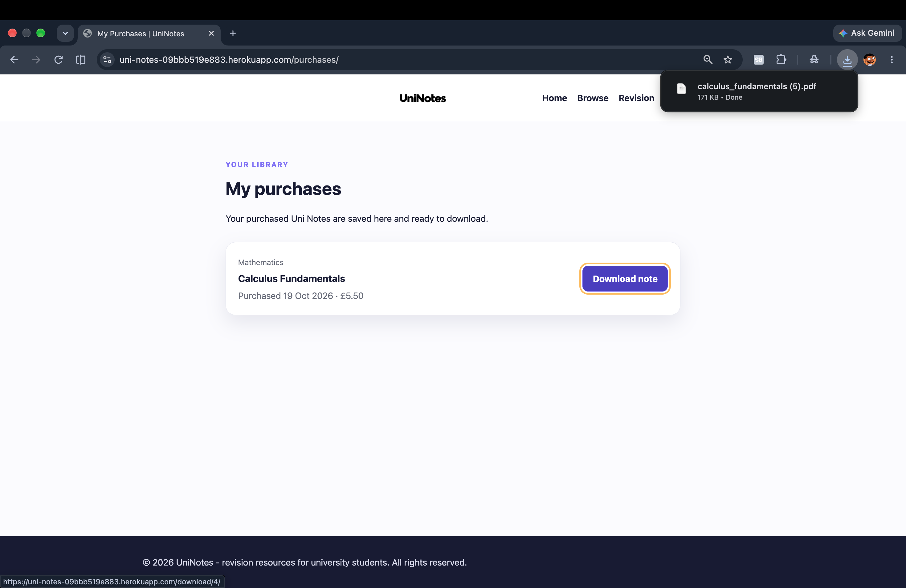

*Picture 28: After a purchase has been recorded, the study resource detail page displays the Download Note button instead of Buy Now.*

#### E-Commerce and Payments Evaluation

Overall, integrating Stripe allowed me to implement a purchasing process for downloadable study resources within UniNotes.

The integration connects the study resource details page, Django checkout views, Stripe API and Purchase database model.

Using Stripe's hosted checkout page reduced the need to build a separate payment interface and avoided directly handling card information.

I also included authentication checks, existing purchase checks and payment session verification before recording purchases.

The My Purchases page provides users with a way to return to previously purchased resources.

I included success, cancellation and verification error feedback to help users understand the outcome of the checkout process.

However, the current payment implementation has some limitations.

Purchase fulfilment depends on the customer returning to the success page, and the application does not yet use Stripe webhooks to confirm payment events independently.

The payment verification logic also needs additional checks for the expected amount and currency.

A future version could improve the payment integration through verified webhooks, stronger payment validation, and more reliable private storage of downloadable study materials.

These improvements would make the application more suitable for handling real customer payments.

The current implementation demonstrates how a Django application can communicate with an external payment provider and connect verified checkout information with database records.


<a name="jump-api-integration"></a>

### API Integration

#### API Overview

I integrated an external API into UniNotes to allow users to purchase digital study resources.

The application uses the Stripe API to create checkout sessions, retrieve payment information and check whether payments have been completed.

An Application Programming Interface (API) allows different software applications to communicate with one another.

In UniNotes, Django communicates with Stripe using the Stripe Python library.

The integration is located in `checkout/views.py`.

I used the Stripe API rather than developing my own payment processing system because Stripe provides a hosted checkout service and manages the collection of card payment information.

The main API operations are:

- Creating a Stripe Checkout session.
- Receiving the hosted checkout URL.
- Retrieving a Checkout session after the user returns.
- Checking the returned payment status.
- Reading session metadata.
- Recording verified purchase information in the UniNotes database.

The browser does not communicate directly with the Stripe API through custom frontend JavaScript. Instead, Django handles the API requests on the server.

#### Why the API Is Used

I decided to use the Stripe API because UniNotes includes paid study resources.

The application needs a way for users to complete payments and access the resources they have purchased.

Using an external payment provider meant I did not need to build a separate payment card processing system.

Stripe provides the following functionality:

- Secure hosted checkout.
- Payment processing.
- Checkout session creation.
- Payment status information.
- Support for GBP payments.
- Test-mode payment processing.
- API integration with Python.
- Payment error responses.

Using the Stripe API also allowed me to connect the payment process to Django's existing user authentication and database models.

For example, when a user purchases a study resource, the application can identify the selected note and associate the verified purchase with the authenticated user.

#### API Data Flow

The API integration begins when a registered user selects the Buy Now button on a study resource.

The following steps explain how Django communicates with Stripe:

1. The user selects a study resource.
2. The user clicks Buy Now.
3. Django receives a POST request.
4. The view checks whether the resource exists and is active.
5. Django checks whether the user already owns the resource.
6. The view prepares the resource information.
7. Django sends a request to Stripe to create a Checkout session.
8. Stripe returns a session containing a checkout URL.
9. Django redirects the user to Stripe Checkout.
10. The user completes or cancels the payment.
11. After successful checkout, Stripe redirects the browser to the configured success URL.
12. Django retrieves the Checkout session from Stripe.
13. Django checks the session's payment status and metadata.
14. If the existing checks pass, the application records the purchase in the database.
15. The user can access the purchased resource.

**Creating a Stripe Checkout Session**

The following code is located in `checkout/views.py`:

```python
stripe.api_key = settings.STRIPE_SECRET_KEY

session = stripe.checkout.Session.create(
    mode="payment",
    customer_email=request.user.email or None,
    line_items=[
        {
            "price_data": {
                "currency": "gbp",
                "product_data": {
                    "name": note.title
                },
                "unit_amount": int(
                    note.price * Decimal("100")
                ),
            },
            "quantity": 1,
        }
    ],
    metadata={
        "user_id": str(request.user.pk),
        "note_id": str(note.pk),
    },
    success_url=success_url,
    cancel_url=cancel_url,
)
```

The API request includes the selected study resource, its price and the URLs used when checkout is completed or cancelled.

I included metadata containing the user ID and study resource ID.

This allows the application to identify the relevant records when checking the returned Checkout session.

Stripe returns a session containing a URL for the hosted checkout page.

The application then redirects the browser using:

```python
return redirect(session.url, code=303)
```

This allows the user to complete payment on Stripe's hosted checkout page.

##### Stripe API Checkout Request Screenshot

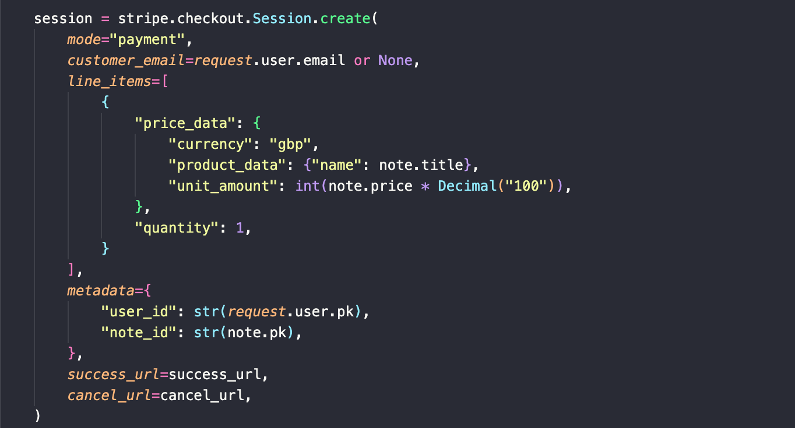

*Picture 29: The Stripe Checkout integration in `checkout/views.py` creates a payment session using the selected study resource and authenticated user's information.*

**Retrieving Payment Information**

After the user returns from a successful checkout, the application retrieves the session ID from the URL.

```python
session_id = request.GET.get("session_id", "")
```

Django then sends another API request to Stripe:

```python
session = stripe.checkout.Session.retrieve(
    session_id
)
```

The returned session contains payment information and metadata.

The application checks the payment status and verifies that the session is associated with the logged-in user.

```python
user_matches = (
    session.metadata.get("user_id")
    == str(request.user.pk)
)

note_id = session.metadata.get("note_id")

if (
    session.payment_status != "paid"
    or not user_matches
    or not note_id
):
    messages.error(
        request,
        "Payment has not been confirmed.",
    )
    return redirect("notes:browse")
```

These checks prevent the application from recording a purchase when the returned session does not meet the existing verification requirements.

After the checks pass, Django retrieves the study resource and creates or retrieves the matching Purchase record.

This connects the Stripe API response to the application's database.

##### Stripe API Request Evidence

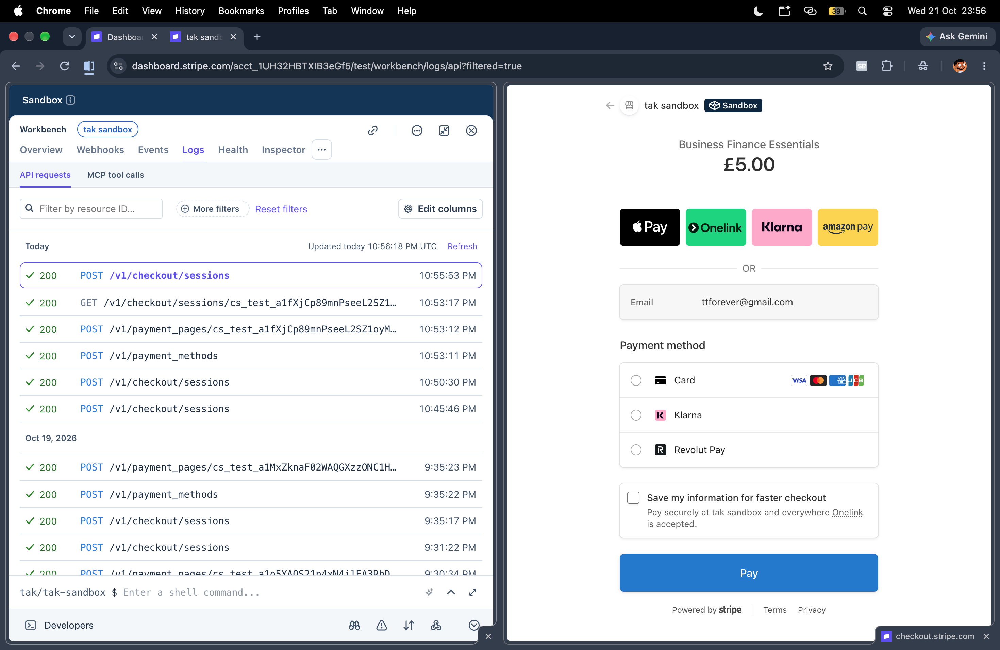

*Picture 30: Stripe's test-mode API request log provides evidence of communication between UniNotes and Stripe during checkout.*

#### API Error Handling

I implemented error handling for situations where the application cannot verify a Stripe Checkout session.

External APIs can return errors for different reasons, including:

- Invalid session identifiers.
- Missing API credentials.
- Incorrect API requests.
- Temporary connection problems.
- Stripe service errors.

The payment success view checks whether the session ID and Stripe secret key are available before contacting Stripe.

```python
session_id = request.GET.get("session_id", "")

if not session_id or not settings.STRIPE_SECRET_KEY:
    messages.error(
        request,
        "We could not verify this payment.",
    )
    return redirect("notes:browse")
```

If either value is missing, the application displays an error message and redirects the user to Browse Notes.

This prevents the application from continuing without the information required for payment verification.

I also used a `try` and `except` block when retrieving the Checkout session.

```python
try:
    session = stripe.checkout.Session.retrieve(
        session_id
    )
except stripe.error.StripeError:
    messages.error(
        request,
        "Stripe could not verify this payment.",
    )
    return redirect("notes:browse")
```

If Stripe raises an error covered by `StripeError`, Django displays a message instead of allowing the exception to propagate through this view.

This makes the payment verification process easier for users to understand.

#### Failed API Requests

Failed API requests are an important part of defensive programming because external services cannot always be guaranteed to respond successfully.

The current payment success view handles Stripe errors that occur when retrieving a Checkout session.

For example, if the application attempts to retrieve a session that Stripe cannot identify, Stripe can return an API error.

The `except stripe.error.StripeError` block catches this error and redirects the user to the Browse Notes page.

However, the current `create_checkout_session()` view does not contain equivalent exception handling around the Stripe session creation request.

This means an unexpected Stripe API error during session creation could result in an unhandled server error.

An improvement would be to add error handling around `stripe.checkout.Session.create()`.

This would allow the application to display a suitable message and return the user to the study resource page.

##### Failed Stripe API Request Screenshot

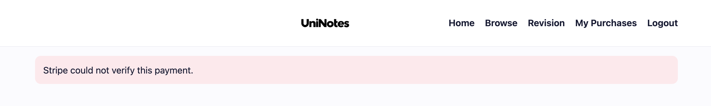

*Picture 31: UniNotes displays an error message when Stripe cannot retrieve and verify a Checkout session, preventing the payment success view from recording an unverified purchase.*

#### User Feedback When the API Fails

I wanted UniNotes to provide understandable feedback when payment verification cannot be completed.

The application uses Django's messages framework to display relevant error messages.

The following messages are implemented:

| Scenario | Feedback |
|---|---|
| Missing Stripe API configuration before checkout | Stripe is not configured. Add your test API keys first. |
| Missing checkout session ID or Stripe configuration during verification | We could not verify this payment. |
| Stripe raises an API error during session retrieval | Stripe could not verify this payment. |
| Payment status or session metadata fails verification | Payment has not been confirmed. |

These messages help users understand when the application cannot confirm their payment.

The application redirects users to an appropriate page after the handled errors.

For example, payment verification errors redirect the user to Browse Notes.

This prevents the success page from being displayed when the existing verification checks have not passed.

One improvement would be to provide more specific recovery instructions.

For example, users could be directed to check their purchase history before attempting another payment.

#### API Testing

I created automated tests for the Stripe integration in `checkout/tests.py`.

The tests use Django's `TestCase` class and Python's `unittest.mock` library.

Mocking allows the Stripe API responses to be simulated without creating real payment requests.

The existing tests include:

**Test 1 - Checkout Session Redirect**

The test named `test_checkout_session_redirects_to_stripe` checks whether the checkout view redirects to the URL returned by a mocked Stripe session creation request.

The test uses:

```python
@override_settings(
    STRIPE_SECRET_KEY="sk_test_example"
)
@patch(
    "checkout.views.stripe.checkout.Session.create"
)
def test_checkout_session_redirects_to_stripe(
    self,
    mock_create,
):
    mock_create.return_value = MagicMock(
        url="https://checkout.stripe.com/test"
    )

    response = self.client.post(
        reverse(
            "checkout:buy",
            args=[self.note.pk],
        )
    )

    self.assertEqual(response.status_code, 303)
    self.assertEqual(
        response.url,
        "https://checkout.stripe.com/test",
    )
```

This test checks the redirect behaviour without contacting the real Stripe API.

**Test 2 - Successful Payment Verification**

The test named `test_success_creates_purchase` checks whether a mocked paid Checkout session results in a Purchase record.

The test creates a simulated Stripe session containing:

- Session identifier.
- Paid payment status.
- Amount paid.
- User ID.
- Study resource ID.

The application retrieves the mocked session and checks whether a Purchase record is created for the authenticated user.

The test confirms the expected database outcome using:

```python
self.assertTrue(
    Purchase.objects.filter(
        user=self.user,
        note=self.note,
    ).exists()
)
```

**Running the Tests**

The checkout tests can be run using:

```bash
python manage.py test checkout
```

These tests confirm selected parts of the application's payment integration.

However, mocked tests do not demonstrate that communication with the real Stripe API is successful.

Additional tests should cover:

- Missing session IDs.
- Invalid session IDs.
- Missing API credentials.
- Stripe session creation failures.
- Stripe session retrieval failures.
- Unpaid sessions.
- Incorrect session metadata.
- Incorrect payment amounts.

Manual testing using Stripe's test environment is also required to verify the complete payment flow.

##### Stripe API Automated Test Screenshot

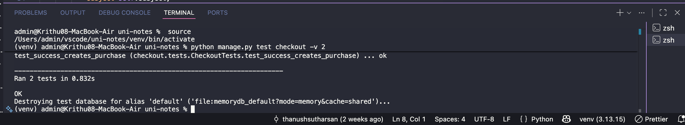

*Picture 32: The Django terminal displays the results of the automated checkout tests that verify the application's Stripe integration using mocked API responses.*

#### API Integration Evaluation

Overall, the Stripe API allowed me to connect external payment functionality to UniNotes without developing a separate card payment system.

Using Stripe's Python library provided a way to create checkout sessions and retrieve payment information through Django views.

The application also connects the Stripe session metadata to the relevant user and study resource.

I implemented checks to prevent purchases from being recorded when the returned payment status or metadata does not meet the existing requirements.

Using Python mocking also allowed me to test selected API behaviours without processing real payments.

However, the integration has some limitations.

The current checkout session creation view does not handle every possible Stripe API error.

The payment verification process also depends on users returning to the success page.

A verified Stripe webhook could improve reliability by allowing the application to process payment events independently of the browser redirect.

I would also strengthen payment verification by checking that the returned payment amount and currency match the selected study resource.

These improvements would be important before enabling live customer payments.

The current implementation demonstrates communication between a Django application and an external API, including request creation, response handling, payment verification and selected automated tests.


##### Bugs Identified During API Testing

During automated testing of the Stripe payment functionality, I encountered two problems that caused the checkout tests to fail.

I identified these issues when running the checkout test suite from the VS Code terminal using:

```bash
python manage.py test checkout -v 2
```

The `-v 2` option provides more detailed test output, including individual test names and results.

Django successfully created the test database, applied the required migrations and completed the system checks.

However, neither of the two checkout tests passed.

The initial results were:

```text
Found 2 test(s).

System check identified no issues (0 silenced).

test_checkout_session_redirects_to_stripe ... FAIL

test_success_creates_purchase ... ERROR

Ran 2 tests in 0.897s

FAILED (failures=1, errors=1)
```

The first issue involved an incorrect HTTP redirect status code.

The second issue occurred when Django attempted to render the payment success template using a static file that was missing from the static-file manifest.

These problems were identified through automated tests rather than during normal use of the website.

###### Initial Testing Result

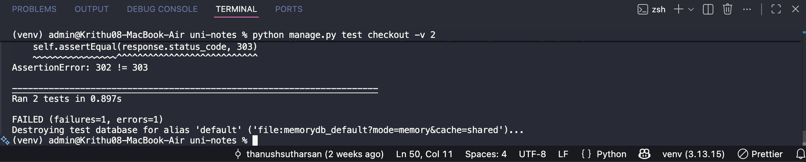

*Picture 33: The initial Django checkout test results show one failed assertion and one error. These results helped identify problems with the checkout redirect and static-file configuration.*

###### Bug 1 - Incorrect Stripe Checkout Redirect Status Code

**Problem Identified**

The first bug occurred during the automated test named:

`test_checkout_session_redirects_to_stripe`

This test checks whether the application redirects the user to Stripe Checkout using the expected HTTP status code.

The test expected HTTP status code `303`, but Django returned `302`.

The terminal displayed:

```text
FAIL: test_checkout_session_redirects_to_stripe

AssertionError: 302 != 303
```

This meant that the redirect response did not match the behaviour expected by the test.

**Cause of the Problem**

After reviewing `checkout/views.py`, I identified the following line inside the `create_checkout_session()` function:

```python
return redirect(session.url, code=303)
```

I had attempted to specify HTTP status code 303 by passing `code=303` to Django's `redirect()` function.

However, this argument does not configure the response status code.

Django's `redirect()` function was returning the normal HTTP 302 redirect.

This caused the automated assertion to fail.

**Original Code**

The original code used:

```python
return redirect(session.url, code=303)
```

**Correction Made**

The correction was to use Django's `HttpResponseRedirect` class and explicitly set the response status code to 303.

First, I needed to import the class into `checkout/views.py`:

```python
from django.http import HttpResponseRedirect
```

I then replaced the original redirect statement with:

```python
return HttpResponseRedirect(
    session.url,
    status=303,
)
```

**Before and After Comparison**

Before:

```python
return redirect(session.url, code=303)
```

After:

```python
return HttpResponseRedirect(
    session.url,
    status=303,
)
```

**Why This Change Was Made**

HTTP 303 tells the browser to follow the redirect using a GET request.

This is useful after a POST request because the browser can navigate to the destination without repeating the original POST operation.

By explicitly returning HTTP 303, the checkout view can match the expected response behaviour.

The change was intended to resolve the failing assertion without modifying the Stripe Checkout session creation logic.

**Retesting**

The existing test checks the response status and the destination URL.

```python
self.assertEqual(
    response.status_code,
    303,
)

self.assertEqual(
    response.url,
    "https://checkout.stripe.com/test",
)
```

After applying the correction, the checkout tests need to be run again.

```bash
python manage.py test checkout -v 2
```

The corrected view should return HTTP 303 when Stripe successfully provides a checkout URL.

The actual retest result must be confirmed by running the test suite.

###### Bug 2 - Missing Static Files Manifest During Payment Success Testing

**Problem Identified**

The second issue occurred during the test named:

`test_success_creates_purchase`

This test simulates a successful Stripe payment and checks whether UniNotes creates a Purchase record for the logged-in user.

During testing, Django attempted to render the payment success page.

However, an error occurred when the template referenced a CSS file.

The terminal displayed:

```text
ERROR: test_success_creates_purchase

ValueError: Missing staticfiles manifest
entry for 'css/style.css'
```

The error prevented the test from completing its assertions.

**Cause of the Problem**

After reviewing the traceback, I identified that the project uses WhiteNoise for static-file storage.

The configuration is located in `uninotes/settings.py`.

```python
STORAGES = {
    "default": {
        "BACKEND": (
            "django.core.files.storage."
            "FileSystemStorage"
        ),
    },
    "staticfiles": {
        "BACKEND": (
            "whitenoise.storage."
            "CompressedManifestStaticFilesStorage"
        ),
    },
}
```

WhiteNoise's manifest-based storage is useful for production because it provides versioned static-file references.

However, the Django test runner does not automatically execute the production `collectstatic` process.

When the payment success template attempted to load the CSS file, Django could not find its entry in the static-file manifest.

The terminal also displayed a warning that the local `staticfiles` directory did not exist.

This issue was related to the testing environment's static-file configuration rather than the mocked Stripe API response itself.

**Original Code**

The checkout test class in `checkout/tests.py` originally began with:

```python
class CheckoutTests(TestCase):
```

The tests inherited the normal static-file storage configuration from Django settings.

**Correction Made**

The proposed correction was to override the storage configuration for the checkout tests.

This allows the tests to use Django's standard `StaticFilesStorage` instead of WhiteNoise's manifest-based storage.

The following code was added immediately above the `CheckoutTests` class:

```python
@override_settings(
    STORAGES={
        "default": {
            "BACKEND": (
                "django.core.files.storage."
                "FileSystemStorage"
            ),
        },
        "staticfiles": {
            "BACKEND": (
                "django.contrib.staticfiles.storage."
                "StaticFilesStorage"
            ),
        },
    }
)
class CheckoutTests(TestCase):
```

**Before and After Comparison**

Before:

```python
class CheckoutTests(TestCase):
```

After:

```python
@override_settings(
    STORAGES={
        "default": {
            "BACKEND": (
                "django.core.files.storage."
                "FileSystemStorage"
            ),
        },
        "staticfiles": {
            "BACKEND": (
                "django.contrib.staticfiles.storage."
                "StaticFilesStorage"
            ),
        },
    }
)
class CheckoutTests(TestCase):
```

**Why This Change Was Made**

I wanted the checkout tests to run without requiring the production static-file manifest.

Using `@override_settings` allows Django to temporarily replace the specified settings while the tests are running.

This approach keeps the testing configuration separate from the normal application configuration.

The change is intended to prevent the missing-manifest error during template rendering.

It does not remove WhiteNoise from the production application or change how static files are collected for Heroku.

**Retesting**

After applying the storage override, I need to run the same command:

```bash
python manage.py test checkout -v 2
```

The payment success test should now be able to render the template without relying on the production static-file manifest.

The test can then check its original assertions:

```python
self.assertEqual(
    response.status_code,
    200,
)

self.assertTrue(
    Purchase.objects.filter(
        user=self.user,
        note=self.note,
    ).exists()
)
```

These assertions check that the success page returns HTTP 200 and that the expected Purchase record exists.

The final result must be recorded after rerunning the test.

###### Final Retesting Evidence

After applying both corrections, the checkout test suite should be executed again.

The test command is:

```bash
python manage.py test checkout -v 2
```

The expected successful result is:

```text
test_checkout_session_redirects_to_stripe ... ok
test_success_creates_purchase ... ok

----------------------------------------------------------------------
Ran 2 tests

OK
```

This is the expected output, not a verified result until the tests have been rerun successfully.

The screenshot below should contain the actual terminal output from the corrected test suite.


*Picture 34: The checkout test suite is rerun after correcting the HTTP redirect and static-file storage configuration. The terminal output provides evidence of the actual retest results.*

###### Version Control and Deployment

The corrections affect two files:

| File | Change |
|---|---|
| `checkout/views.py` | Explicitly returns HTTP status code 303 when redirecting to Stripe Checkout. |
| `checkout/tests.py` | Overrides static-file storage during automated checkout tests. |

These changes should be saved in Git after they have been implemented and tested.

The suggested commit message is:

```text
fix: correct Stripe checkout redirect and automated test static storage
```

**Git Commit Evidence**

Commit hash: To be added after verifying the commit.

**Heroku Deployment Verification**

The corrected code can be deployed to Heroku after the automated tests pass.

Following deployment, I should check that:

- The application loads successfully.
- The website's CSS and JavaScript still load correctly.
- The study resource pages remain accessible.
- The Buy Now button still redirects to Stripe Checkout.
- The payment success page can render correctly.

The results of these checks will be recorded in the Deployment Verification section.

###### Testing Bug Evaluation

The two issues demonstrated the importance of automated testing during Django development.

The first test identified a difference between the redirect status code I intended to use and the response Django actually returned.

The second test revealed a problem with using production static-file storage during automated template testing.

Reviewing the traceback helped me identify the files and settings responsible for the errors.

The proposed corrections addressed the two issues separately rather than changing unrelated parts of the application.

These tests also helped me understand the difference between application behaviour, test configuration and production configuration.

The final outcome will be documented using the actual retest results once both tests have been rerun.
