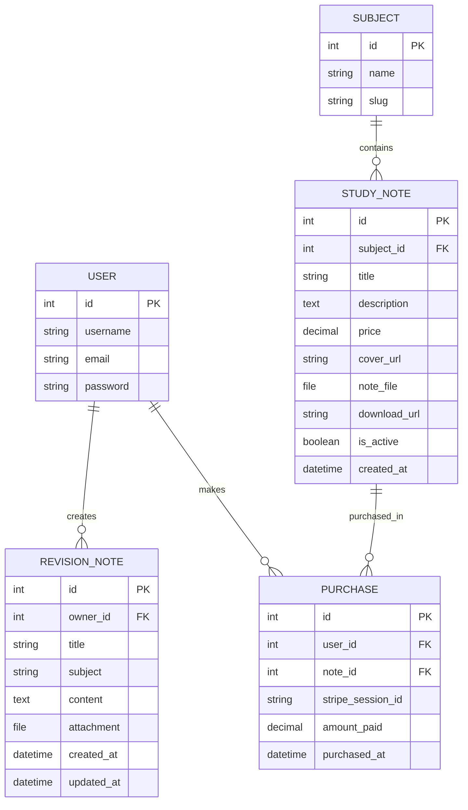

# Project planning

[Back to UniNotes README](../README.md#documentation)

[II. Scope](#jump-ii-scope) · [III. Structure](#jump-iii-structure)

---

## I. Strategy

The strategy for **UniNotes** focuses on creating a clear and useful university revision platform that combines access to digital study resources with personal revision management.

The project strategy was developed from the identified user needs, business goals, user stories and research findings. The aim is to ensure that each feature included within the application has a clear purpose and solves a genuine problem for the target audience.

The strategy prioritises the most important functionality first, including resource discovery, user authentication, purchasing, access to purchased material and personal revision-note management.

Rather than trying to include too many features in the first version of the application, development focuses on a realistic **Minimum Viable Product (MVP)** that provides the core functionality required for UniNotes to operate successfully.


### Project Goals

The main goal of UniNotes is to create a reliable and easy-to-use platform where university students can find revision resources, purchase study notes and organise their own revision material.

The project goals are:

| Project Goal | Purpose |
|---|---|
| **Provide easy access to study resources** | Allow students to browse a centralised collection of university revision notes without needing to search across several different websites or folders. |
| **Improve resource discovery** | Use keyword searching and subject filtering to help students find relevant revision material more efficiently. |
| **Provide clear resource information** | Give users enough information about each study note before they decide whether it is relevant or worth purchasing. |
| **Support secure online purchasing** | Allow authenticated users to purchase digital study resources using Stripe Checkout. |
| **Provide persistent access to purchases** | Allow users to return to resources they have already purchased through My Purchases. |
| **Support personal revision** | Give registered users a private area where they can create and manage their own revision notes. |
| **Provide meaningful CRUD functionality** | Allow users to create, read, update and delete their personal revision notes. |
| **Protect user-specific content** | Ensure personal revision notes and purchases remain associated with the correct authenticated user. |
| **Provide responsive usability** | Make the application usable across different screen sizes and devices. |
| **Provide clear user feedback** | Inform users when important actions such as registration, saving, editing or deleting content have been completed. |
| **Maintain a scalable structure** | Organise study notes by subject so additional resources can be introduced without changing the overall structure of the website. |
| **Create a realistic full-stack application** | Combine a database, authentication, CRUD functionality, external payment processing, file handling and responsive front-end design within one project. |

These goals support both the needs of the users and the potential business purpose of UniNotes as a digital study-resource platform.


### User Problems and Solutions

The development strategy is based around solving specific problems experienced by the target users.

| User Problem | UniNotes Solution |
|---|---|
| Students may store revision resources across several different locations | UniNotes provides a centralised platform for accessing study resources and personal revision material. |
| Students may find it difficult to locate resources relevant to a specific topic | Keyword searching allows users to search the study-note library. |
| Users may only want resources relating to a particular subject | Subject filtering allows the available notes to be narrowed down. |
| Users need to understand a resource before purchasing it | Individual study-note pages provide details including the title, subject, description and price. |
| New visitors may not want to register immediately | Visitors can explore public areas of the platform before using account-specific features. |
| Students need a secure way of purchasing digital resources | Stripe Checkout is used to handle the payment process. |
| Students may need purchased resources more than once | Completed purchases are stored against the user's account and made available through My Purchases. |
| Users may accidentally attempt to purchase the same resource again | The application checks existing purchase records within the normal purchase journey. |
| Students create their own revision material as well as using prepared resources | Registered users are provided with a private Revision area. |
| Revision notes may need to be changed as the student learns more | Users can edit previously created revision notes. |
| Old revision material may no longer be useful | Users can delete their own revision notes. |
| Students may need to store supporting documents with their notes | Revision notes support optional file attachments. |
| Personal revision material should not be accessible to other users | Authentication and ownership checks are used when accessing account-specific revision-note functionality. |
| Users may not know whether an action has completed successfully | Feedback messages are provided following important actions. |
| Students may access the platform from different screen sizes | Responsive layouts and navigation are used within the interface. |

By linking development decisions directly to user problems, the features within UniNotes have a clear reason for being included rather than being added only to increase the size of the project.


### Minimum Viable Product (MVP)

The **Minimum Viable Product (MVP)** represents the minimum set of features required for UniNotes to fulfil its main purpose.

The MVP focuses on the complete user journey rather than including advanced functionality that is not essential to the first working version of the platform.

The core MVP requirements are:

| MVP Requirement | Reason Required |
|---|---|
| **Homepage and navigation** | Users need a clear entry point and a way of moving between the main areas of the application. |
| **User registration** | Users need accounts before personalised features can be associated with them. |
| **User login and logout** | Users need a secure way to access and leave their personal account. |
| **Study-note library** | The application requires a central area where available digital resources can be browsed. |
| **Subject organisation** | Study resources need to be grouped logically so users can locate relevant content. |
| **Keyword search** | Users need a faster method of finding relevant study notes. |
| **Subject filtering** | Users need to narrow the available study notes by subject. |
| **Individual study-note pages** | Users need information about a resource before purchasing it. |
| **Stripe Checkout integration** | The application needs a realistic way for registered users to purchase digital study resources. |
| **Purchase recording** | Successful purchases need to be stored against the correct authenticated user. |
| **My Purchases** | Users need a way to return to resources they have already purchased. |
| **Purchased-file access** | Users need to be able to access and download resources they own. |
| **Personal revision area** | Registered users need a location for managing their own revision material. |
| **Create revision note** | Users need to add new revision material. |
| **Read revision note** | Users need to view saved revision content. |
| **Update revision note** | Users need to modify revision material as their knowledge develops. |
| **Delete revision note** | Users need control over removing content they no longer require. |
| **Optional revision attachment** | Users may need to keep supporting files alongside their revision notes. |
| **Authentication and ownership protection** | Private and account-specific functionality needs to remain associated with the correct user. |
| **Responsive design** | The application needs to remain usable across different screen sizes. |
| **User feedback messages** | Users need confirmation after completing important actions. |

The MVP therefore provides a complete basic journey where a user can:

1. Visit UniNotes.
2. Browse available study notes.
3. Search or filter resources.
4. View the details of a study note.
5. Register or log into an account.
6. Purchase a resource through Stripe Checkout.
7. Access the purchased resource through My Purchases.
8. Create their own personal revision notes.
9. Edit or delete their personal revision material.
10. Return later and continue using their saved content.

This ensures that the first working version of UniNotes already provides meaningful functionality before additional features are considered.


### Features

The features implemented within UniNotes support the goals of the MVP and the requirements identified during UX planning and research.

| Feature | Description | User Benefit |
|---|---|---|
| **User Registration** | Allows new users to create an account. | Provides access to personalised features. |
| **Login and Logout** | Allows registered users to securely access and leave their account. | Protects user-specific functionality. |
| **Study-Note Library** | Displays the available revision resources. | Gives students a central location for finding study material. |
| **Keyword Search** | Allows users to search for study notes using text. | Reduces the time required to find relevant resources. |
| **Subject Filtering** | Allows the study-note library to be filtered by subject. | Helps users focus on resources relevant to their studies. |
| **Study-Note Detail Pages** | Displays information about an individual study note. | Helps users decide whether the resource is suitable before purchasing. |
| **Stripe Checkout** | Provides the hosted payment process for study-note purchases. | Allows users to purchase resources without UniNotes directly handling payment-card information. |
| **Purchase Verification** | Checks completed Stripe Checkout information before storing the purchase. | Helps ensure purchases are only recorded after successful payment. |
| **My Purchases** | Displays resources previously purchased by the authenticated user. | Gives users a convenient location for returning to purchased material. |
| **Purchased Resource Download** | Allows eligible users to access the file associated with a completed purchase. | Provides continued access to purchased digital resources. |
| **Personal Revision Area** | Provides authenticated users with their own revision-note section. | Gives students a private space for managing revision material. |
| **Create Revision Note** | Allows users to create a new revision note. | Enables users to add their own study content. |
| **View Revision Note** | Allows users to access previously created revision notes. | Makes personal revision material reusable. |
| **Edit Revision Note** | Allows users to update revision-note content. | Supports ongoing learning and corrections. |
| **Delete Revision Note** | Allows users to remove revision notes they no longer need. | Helps keep the revision area organised. |
| **Revision Attachments** | Allows an optional supporting file to be added to a revision note. | Helps users keep related revision resources together. |
| **Ownership Checks** | Ensures users can only modify personal revision notes belonging to their own account. | Protects private user content. |
| **Responsive Navigation** | Adjusts navigation behaviour for smaller screens. | Improves usability across different devices. |
| **Accessibility Features** | Includes features such as labels, alternative text, skip links and accessible navigation attributes. | Makes the interface easier to understand and interact with. |
| **Feedback Messages** | Provides confirmation following important actions. | Reassures users that their action has been completed. |
| **Empty-State Messages** | Explains when no content or matching search result is available. | Prevents users from being confused by an empty page. |


### Future Features

The first version of UniNotes focuses on the functionality required for the MVP. Additional features could be introduced in future development if the platform were expanded.

Future features would only be added where they provide clear value to users and do not unnecessarily complicate the existing experience.

| Future Feature | Description | Potential Benefit |
|---|---|---|
| **Ratings and Reviews** | Allow users who have purchased a study note to leave a rating or written review. | Could help other students decide whether a resource is useful. |
| **Wish List / Saved Resources** | Allow users to save study notes they are interested in purchasing later. | Would make it easier for users to return to resources they have discovered. |
| **Advanced Search** | Add additional filters such as price range, topic or recently added resources. | Would improve resource discovery if the study-note library becomes larger. |
| **Recently Viewed Resources** | Show study notes that a logged-in user has recently viewed. | Would make it easier to return to previously explored resources. |
| **Revision Categories or Tags** | Allow users to add additional categories or tags to personal revision notes. | Would make larger collections of personal notes easier to organise. |
| **Revision Search** | Allow users to search within their own personal revision notes. | Would help users find specific revision content as their collection grows. |
| **Favourites** | Allow users to mark important revision notes or purchased resources as favourites. | Would provide faster access to frequently used material. |
| **Study Progress Tracking** | Allow users to mark topics or revision notes as complete or still requiring revision. | Could help students manage their revision progress. |
| **Resource Preview** | Provide a limited preview of a study resource before purchase where appropriate. | Could give users additional information before deciding to purchase. |
| **Email Purchase Confirmation** | Send users an email confirming a successful purchase. | Would provide an additional record of completed transactions. |
| **Password Reset by Email** | Allow users to securely recover access to their account through an email-based password reset. | Would improve account recovery and usability. |
| **User Profile Settings** | Allow users to manage additional account preferences. | Would provide greater personalisation. |
| **Improved Resource Recommendations** | Suggest resources based on subjects previously viewed or purchased. | Could help users discover relevant study material more quickly. |
| **Additional Accessibility Improvements** | Continue testing and improving keyboard navigation, contrast and screen-reader support. | Would make UniNotes more accessible to a wider range of users. |
| **Expanded Automated Testing** | Add further automated tests covering edge cases and additional user journeys. | Would help improve reliability as the application grows. |

These features are considered **future developments rather than MVP requirements** because the existing application can fulfil its main purpose without them.

Prioritising the MVP first helps keep development manageable and ensures that the most important user journeys are completed and tested before more advanced functionality is introduced.


### User Problems and Solutions

The development of **UniNotes** is based on solving clear problems faced by the target audience. Each feature within the application has been designed to address a specific user need identified during the UX and research stages.

The table below shows the main problems identified and how UniNotes provides a practical solution.

| User Problem | UniNotes Solution | Benefit to the User |
|---|---|---|
| Students may store revision resources across different websites, folders and devices | UniNotes provides one central platform for accessing study resources and personal revision notes | Makes revision material easier to organise and reduces the need to search across multiple locations |
| Students may struggle to find resources related to a specific topic | Keyword search allows users to search the study-note library | Helps users locate relevant resources more quickly |
| Users may only want revision material for a particular subject | Subject filtering allows users to narrow the available resources | Reduces irrelevant results and improves resource discovery |
| A large study-note library could become difficult to navigate | Resources are organised by subject and displayed in a structured format | Makes the library easier to browse as more resources are added |
| Students need to understand a resource before purchasing it | Individual study-note pages display information such as the title, subject, description and price | Allows users to make a more informed decision before purchasing |
| First-time visitors may not want to create an account immediately | Visitors can browse study resources and explore the platform before using account-specific features | Reduces barriers for new users and allows them to understand the value of the platform first |
| Students need a secure way to purchase digital revision resources | Stripe Checkout is used to handle the payment process | Provides a recognised external payment process without UniNotes directly handling card details |
| Users may accidentally attempt to purchase the same resource again | Existing purchases are checked during the normal purchasing process | Reduces unnecessary repeat purchases |
| Students need continued access to resources after buying them | Purchased resources are stored against the user's account and displayed in **My Purchases** | Allows users to return to purchased material during future revision sessions |
| Students may forget where they downloaded purchased resources | My Purchases provides a central location for previously purchased study notes | Keeps purchased materials organised and easy to access |
| Students create their own revision material as well as using prepared resources | Registered users have access to a private Revision area | Allows students to manage personal study material within the same application |
| Students need to create new revision content | Users can create their own revision notes | Allows revision material to be tailored to the student's own studies |
| Revision material may need to change as the student learns more | Existing revision notes can be edited | Allows users to correct, expand or update their notes without creating a new note |
| Old revision material may become unnecessary | Users can delete revision notes they no longer require | Helps keep the personal revision area organised |
| Students may have supporting documents linked to their revision | Revision notes support optional file attachments | Allows related revision materials to be stored together |
| Personal revision notes should remain private | Revision notes are associated with the authenticated user and ownership checks are applied | Helps prevent users from editing or deleting another user's private content |
| Users need to know whether actions have been completed successfully | Feedback messages are displayed after important actions | Gives users confirmation and reduces uncertainty |
| Users may become confused when a search returns no results | Clear empty-state messages explain when no matching content is available | Prevents users from assuming the website has failed |
| Students may use UniNotes on different screen sizes | Responsive layouts and navigation are used throughout the interface | Improves usability across desktop, tablet and mobile-sized screens |
| First-time users may not understand how to move around the website | Clear and consistent navigation is used across the main pages | Makes the application easier to learn and reduces confusion |
| Users need personalised areas to be clearly separated from public content | Features such as **Revision** and **My Purchases** are linked to authenticated users | Makes it clear which features belong to the user's account |
| Users may try to access protected features without being logged in | Authentication is required for account-specific functionality | Protects private data and ensures personalised actions are linked to the correct account |

These solutions demonstrate that the functionality within UniNotes has been developed around identified user needs rather than being added without purpose.

By connecting each problem to a specific solution, the project can demonstrate a clear relationship between **research, user requirements, UX planning and technical implementation**.


<a name="jump-ii-scope"></a>

## II. Scope

The scope of **UniNotes** defines the functionality that will be included within the current version of the application and establishes clear boundaries around features that are not required for the initial release.

The scope was determined using the project goals, user research, user stories and competitor research. Priority was given to functionality that directly supports the main purpose of the application: allowing university students to discover study resources, purchase digital notes and manage their own revision material.

Defining the scope helps prevent unnecessary features from increasing the complexity of the project before the core user journeys have been successfully developed and tested.


### Minimum Viable Product (MVP)

The **Minimum Viable Product (MVP)** represents the smallest complete version of UniNotes that can successfully meet the main needs of the target users.

The MVP must allow a user to move through the complete journey from discovering a resource to accessing purchased content, while also providing registered users with personal revision functionality.

| MVP Requirement | Purpose |
|---|---|
| **Homepage** | Provides users with a clear introduction to UniNotes and access to the main areas of the website |
| **Navigation** | Allows users to move easily between the important sections of the application |
| **User Registration** | Allows new users to create an account |
| **User Login and Logout** | Allows registered users to securely access account-specific functionality |
| **Study-Note Library** | Provides a central location where available revision resources can be browsed |
| **Subject Organisation** | Groups study resources into relevant subjects |
| **Keyword Search** | Allows users to locate resources using search terms |
| **Subject Filtering** | Allows users to narrow the study-note library by subject |
| **Study-Note Detail Pages** | Provides information about individual resources before purchase |
| **Stripe Checkout** | Allows authenticated users to complete a digital study-note purchase |
| **Purchase Verification** | Ensures a purchase is only recorded following a successful Stripe payment |
| **My Purchases** | Provides users with access to resources they have previously purchased |
| **Purchased Resource Downloads** | Allows eligible users to access their purchased digital files |
| **Personal Revision Area** | Provides registered users with a private area for their own revision material |
| **Create Revision Notes** | Allows users to add personal revision content |
| **Read Revision Notes** | Allows users to view previously created revision material |
| **Update Revision Notes** | Allows revision material to be changed |
| **Delete Revision Notes** | Gives users control over removing unnecessary revision content |
| **Optional File Attachments** | Allows additional files to be stored alongside personal revision notes |
| **Ownership Protection** | Prevents one user from modifying another user's private revision material |
| **Responsive Design** | Keeps the application usable across different screen sizes |
| **Accessibility Features** | Improves usability for users interacting with the application in different ways |
| **Feedback Messages** | Confirms when important actions have been completed |


### Features

The features within UniNotes are divided into several main areas.

| Feature Area | Purpose |
|---|---|
| **Resource Discovery** | Helps users find study resources through browsing, searching and filtering |
| **Authentication** | Provides secure access to personalised functionality |
| **Digital Purchases** | Allows study notes to be purchased through Stripe Checkout |
| **Purchase Management** | Allows purchased resources to remain associated with the correct user |
| **Personal Revision** | Allows users to create and manage their own revision content |
| **File Handling** | Supports purchased study-note files and optional revision-note attachments |
| **Responsive UX** | Ensures the application remains usable across different devices |
| **Accessibility** | Provides clearer interaction through labels, alternative text and accessible navigation |
| **Security and Permissions** | Protects private content and account-specific functionality |


### Features Included

The following features are included within the current scope of UniNotes.

| Included Feature | Description |
|---|---|
| **Homepage** | Introduces users to the application and provides navigation to important functionality |
| **User Registration** | Allows new users to create an account |
| **Login** | Allows registered users to access their account |
| **Logout** | Allows authenticated users to securely end their session |
| **Study-Note Browsing** | Displays the available digital revision resources |
| **Keyword Search** | Allows study notes to be searched using keywords |
| **Subject Filtering** | Allows users to view notes associated with a selected subject |
| **Study-Note Details** | Displays information about individual resources |
| **Price Display** | Shows the price of a study note before checkout |
| **Stripe Checkout** | Provides the payment process for digital resources |
| **Purchase Verification** | Checks successful payment information before recording ownership |
| **Duplicate Purchase Protection** | Checks whether the authenticated user already owns the selected resource |
| **My Purchases** | Displays purchased study resources associated with the logged-in account |
| **Purchased File Access** | Allows authorised users to download purchased digital resources |
| **Revision Dashboard** | Provides users with access to their personal revision material |
| **Create Revision Note** | Allows users to create new revision content |
| **View Revision Note** | Allows users to read previously stored revision content |
| **Edit Revision Note** | Allows users to update their personal revision material |
| **Delete Revision Note** | Allows users to remove revision notes |
| **Revision Attachments** | Allows an optional file to be associated with a revision note |
| **Ownership Checks** | Prevents users from editing or deleting revision notes owned by another account |
| **Responsive Navigation** | Provides navigation suitable for smaller screens |
| **Feedback Messages** | Provides confirmation following important user actions |
| **Empty States** | Provides information when no relevant content is available |


### Features Outside the Current Scope

Some potentially useful features are intentionally excluded from the current scope because they are not required for the MVP.

| Feature Outside Scope | Reason |
|---|---|
| **Public User Upload Marketplace** | The current platform does not allow users to upload and sell their own commercial study notes |
| **Seller Accounts** | Separate seller functionality is not required for the current user journey |
| **Admin / Staff Dashboard** | The current application is focused on student-facing functionality and does not require a custom staff dashboard |
| **Ratings and Reviews** | Useful for a larger marketplace but not necessary for the core purchasing journey |
| **Subscriptions** | UniNotes currently uses individual study-note purchases rather than recurring payments |
| **Shopping Basket** | Resources are purchased individually through the existing checkout process |
| **Discount Codes** | Promotional pricing is not required for the MVP |
| **User-to-User Messaging** | Communication between users is outside the purpose of the current application |
| **Social Features** | Following users, commenting and public profiles are not required |
| **Advanced Recommendations** | Personalised recommendation algorithms would add unnecessary complexity to the MVP |
| **Email Notifications** | Automated purchase and account emails are not part of the current core functionality |
| **Mobile Application** | UniNotes is currently developed as a responsive web application rather than a native mobile app |


### Future Features

Once the MVP has been successfully completed, tested and deployed, UniNotes could be expanded with additional functionality.

| Future Feature | Potential Benefit |
|---|---|
| **Ratings and Reviews** | Could help students evaluate study resources before purchasing |
| **Saved Resources / Wishlist** | Would allow users to return to resources they are considering purchasing |
| **Advanced Search Filters** | Could allow filtering by additional criteria such as price or topic |
| **Revision Search** | Would help users search within larger collections of personal revision notes |
| **Revision Tags** | Could provide additional organisation for personal revision material |
| **Favourites** | Would provide faster access to frequently used resources |
| **Recently Viewed Notes** | Would help users return to resources they recently explored |
| **Study Progress Tracking** | Could allow students to track completed and incomplete revision topics |
| **Resource Previews** | Could allow users to preview part of a resource before purchasing |
| **Email Purchase Confirmations** | Could provide users with an additional record of completed purchases |
| **Password Reset by Email** | Would improve account recovery |
| **User Profile Settings** | Could provide additional account personalisation |
| **Resource Recommendations** | Could suggest relevant resources based on subjects viewed or purchased |
| **Expanded Accessibility Testing** | Could further improve keyboard, screen-reader and visual accessibility |
| **Expanded Automated Tests** | Could provide greater protection against regressions as the platform grows |


### Functional Requirements

Functional requirements define what the UniNotes application must allow users to do.

| Functional Requirement |
|---|
| Users must be able to browse available study notes |
| Users must be able to search the study-note library |
| Users must be able to filter resources by subject |
| Users must be able to view information about an individual study note |
| New users must be able to register for an account |
| Registered users must be able to log in |
| Authenticated users must be able to log out |
| Authenticated users must be able to purchase eligible study notes |
| Stripe Checkout must be used for the payment process |
| Successful purchases must be associated with the authenticated user |
| Users must be able to view their previous purchases |
| Purchased resources must only be available where the appropriate purchase exists |
| Authenticated users must be able to create personal revision notes |
| Users must be able to view their revision notes |
| Users must be able to update their revision notes |
| Users must be able to delete their revision notes |
| Users must be able to optionally add a file attachment to a revision note |
| Users must not be able to edit or delete another user's revision notes |
| Appropriate feedback must be shown after important actions |
| The interface must provide understandable navigation between key areas |


### Non-Functional Requirements

Non-functional requirements describe how UniNotes should perform rather than defining individual user actions.

| Requirement | Description |
|---|---|
| **Usability** | Navigation and page layouts should be clear and understandable without specialist instructions |
| **Performance** | Normal pages and database queries should load within a reasonable time |
| **Reliability** | Core functionality should behave consistently and handle invalid requests appropriately |
| **Security** | Authentication, permissions and ownership checks should protect private functionality |
| **Maintainability** | Code should be organised logically across Django applications, models, views, forms and templates |
| **Scalability** | The database structure should allow additional subjects and study resources to be introduced |
| **Accessibility** | Interfaces should include appropriate labels, alternative text and keyboard-friendly functionality |
| **Responsiveness** | Pages should adapt appropriately to desktop, tablet and mobile-sized screens |
| **Consistency** | Navigation, forms, buttons and content presentation should remain visually and functionally consistent |
| **Data Integrity** | Purchases, revision notes and resources should remain associated with the correct database records |
| **Error Handling** | Invalid requests and unavailable content should be handled without exposing sensitive application information |


### Content Requirements

UniNotes requires appropriate content to allow users to understand and interact with the application.

| Content | Requirement |
|---|---|
| **Study-Note Title** | Each resource requires a clear title |
| **Subject** | Study notes should be associated with an appropriate subject |
| **Description** | Resources should include enough information for users to understand what they contain |
| **Price** | Paid resources must display a clear price |
| **Study-Note File** | Purchasable digital resources require an associated file where appropriate |
| **Revision Note Title** | Personal notes require a title so users can identify them |
| **Revision Subject** | Users should be able to identify the subject of their personal revision note |
| **Revision Content** | Users require an area for entering their own revision material |
| **Revision Attachment** | Supporting files may optionally be added |
| **Navigation Labels** | Navigation text must clearly explain where links lead |
| **Form Labels** | Form fields must provide understandable labels |
| **Feedback Messages** | Appropriate confirmation and error messages must be available |
| **Empty-State Content** | Users must receive clear information when no relevant data is available |


### User Requirements

The application must support the requirements of both primary and secondary target users.

| User Requirement | How UniNotes Addresses It |
|---|---|
| Find revision material quickly | Keyword search |
| Browse by subject | Subject filtering |
| Explore before registering | Public browsing functionality |
| Understand a resource before purchasing | Study-note detail pages |
| Create an account | Registration functionality |
| Securely access personalised features | Login and authentication |
| Purchase digital resources | Stripe Checkout |
| Return to purchased resources | My Purchases |
| Download owned resources | Purchase-based resource access |
| Create personal revision content | Revision-note creation |
| Update revision material | Revision-note editing |
| Remove unwanted content | Revision-note deletion |
| Add supporting material | Optional attachments |
| Keep personal content private | User ownership checks |
| Receive feedback | Confirmation and error messages |
| Use the website on different devices | Responsive design |


### Technical Requirements

The application requires a suitable full-stack technical structure to support the planned functionality.

| Technical Requirement | Implementation |
|---|---|
| **Back-End Language** | Python |
| **Web Framework** | Django |
| **Front-End Structure** | HTML and Django templates |
| **Styling** | Custom CSS |
| **Client-Side Interaction** | JavaScript |
| **Database Interaction** | Django ORM |
| **Local Database** | SQLite |
| **Production Database Support** | PostgreSQL |
| **Authentication** | Django authentication system |
| **Payment Processing** | Stripe Python library and Stripe API |
| **Static Files** | Django static files with WhiteNoise production support |
| **Environment Configuration** | Environment variables and python-dotenv |
| **Production Server** | Gunicorn |
| **Deployment Configuration** | Heroku-compatible project configuration |
| **Version Control** | Git and GitHub |
| **Automated Testing** | Django testing framework |


### CRUD Requirements

CRUD functionality is provided through the personal revision-note system.

CRUD stands for **Create, Read, Update and Delete** and gives users full control over revision content associated with their account.


#### Create

Authenticated users must be able to create new revision notes.

The Create functionality must:

- Require the user to be authenticated
- Allow a title to be entered
- Allow a subject to be selected or associated
- Allow written revision content to be entered
- Allow an optional supporting attachment
- Associate the revision note with the currently authenticated user
- Save valid information to the database
- Provide feedback after successful creation


#### Read

Authenticated users must be able to view their saved revision notes.

The Read functionality must:

- Display revision notes belonging to the user
- Allow an individual revision note to be viewed
- Display the stored title
- Display the associated subject
- Display the revision content
- Provide access to an attachment where one exists
- Protect private content from inappropriate access


#### Update

Authenticated users must be able to modify revision notes they previously created.

The Update functionality must:

- Require authentication
- Retrieve the existing revision note
- Confirm that the revision note belongs to the authenticated user
- Display existing information for editing
- Allow valid information to be changed
- Save updated information to the database
- Display the updated content
- Prevent another user from updating the note


#### Delete

Authenticated users must be able to remove revision notes they no longer require.

The Delete functionality must:

- Require authentication
- Confirm that the revision note belongs to the authenticated user
- Allow the selected revision note to be deleted
- Remove the database record when deletion is completed
- Prevent another user from deleting the note
- Provide appropriate feedback after successful deletion


### Authentication Requirements

Authentication is required to separate public functionality from personalised user functionality.

UniNotes uses Django's authentication system to identify users and control access to protected areas.


#### Anonymous User Permissions

Users who are not logged in should be able to:

- Visit the homepage
- Navigate public areas of the website
- Browse the available study-note library
- Search for study resources
- Filter resources by subject
- View individual study-note information
- Access registration
- Access login

Anonymous users should not be able to:

- Access private revision-note functionality
- Create revision notes
- Edit revision notes
- Delete revision notes
- Access another user's purchases
- Download resources that require a valid purchase
- Complete account-specific functionality without authentication


#### Registered User Permissions

Authenticated users should be able to:

- Access public functionality
- Browse study resources
- Search and filter study notes
- View resource details
- Begin eligible purchases
- Complete Stripe Checkout
- Access their own My Purchases area
- Access resources they have purchased
- Create personal revision notes
- View their revision notes
- Edit their revision notes
- Delete their revision notes
- Add optional revision-note attachments
- Log out of their account


#### Ownership Requirements

Ownership requirements are necessary to protect personalised information.

The application must ensure that:

- Revision notes are associated with the user who created them
- Users can only modify revision notes belonging to their own account
- Users cannot delete another user's revision notes
- Purchase records are associated with the authenticated purchaser
- Purchased-resource access depends on the appropriate purchase record
- Account-specific database queries use the authenticated user when retrieving private information

These checks help prevent insecure direct access to another user's private content.


### E-Commerce Requirements

The e-commerce functionality within UniNotes focuses on the sale and distribution of digital study resources.

The application does not sell physical products and therefore does not require functionality such as delivery addresses, shipping calculations or physical stock management.


#### Products / Services / Purchases

Within UniNotes, the digital **study notes** act as the products available for purchase.

Each purchasable study note requires information including:

- A title
- A subject
- A description
- A price
- An associated digital resource

Purchase records must:

- Be associated with the authenticated user
- Identify the purchased study note
- Represent successful access to the resource
- Allow previously purchased material to appear in My Purchases

The application should also check for an existing purchase during the normal purchase journey to reduce unnecessary duplicate transactions.


#### Checkout Requirements

The checkout process must:

1. Require an authenticated user.
2. Identify the study note selected for purchase.
3. Retrieve the correct price from server-controlled data.
4. Create a Stripe Checkout Session.
5. Direct the user to Stripe's hosted checkout.
6. Return the user to the appropriate success or cancellation route.
7. Retrieve the relevant Stripe Checkout Session following successful checkout.
8. Verify the session information.
9. Confirm that Stripe reports the payment as successfully completed.
10. Confirm that the payment relates to the expected study note and user.
11. Create or confirm the appropriate purchase record.
12. Provide access to the resource through My Purchases.


#### Payment Requirements

The payment system must:

- Use Stripe Checkout
- Use server-side Stripe integration
- Avoid storing payment-card information within the UniNotes database
- Store Stripe API credentials securely using environment variables
- Use test-mode credentials during development and assessment
- Verify successful payment before granting resource ownership
- Use the server-side price rather than trusting a value supplied by the browser
- Prevent purchase access from being granted solely because a user reaches a success URL


### API Requirements

UniNotes uses the **Stripe API** as its main external API.

The API integration must:

- Use the official Stripe Python library
- Authenticate using a Stripe secret key stored outside the source code
- Create Checkout Sessions on the server
- Pass the appropriate study-note and payment information
- Retrieve completed Checkout Sessions
- Check the Stripe payment status
- Verify relevant session metadata or associated information
- Handle unsuccessful or invalid checkout responses appropriately

UniNotes should not rely on API responses supplied directly by the browser when determining whether a user owns a purchased resource.


### Accessibility Requirements

Accessibility is considered throughout the UniNotes interface so that the website is easier to use for a wider range of users.

The application should:

- Use semantic HTML where appropriate
- Provide descriptive page headings
- Maintain a logical heading hierarchy
- Provide labels for form fields
- Provide alternative text for meaningful images
- Avoid relying entirely on colour to communicate information
- Provide clear button and link text
- Include keyboard-accessible navigation
- Provide a skip-to-content option
- Use appropriate `aria` attributes where required
- Maintain suitable text/background contrast
- Provide visible focus states for interactive elements
- Keep form errors and feedback understandable
- Ensure navigation can be operated on smaller screens
- Use responsive layouts without making content unreadable

Accessibility should continue to be reviewed during testing rather than being treated as a single development task.


### Responsive Design Requirements

UniNotes must remain usable across common screen sizes.

Responsive design requirements include:

- Content should adapt to desktop, tablet and mobile-sized screens
- Navigation should remain usable when horizontal space is limited
- The responsive navigation menu should be operable using keyboard and pointer interaction
- Cards and content sections should resize appropriately
- Forms should remain readable without unnecessary horizontal scrolling
- Buttons and links should remain usable on smaller displays
- Text should remain readable without requiring excessive zoom
- Images and media should not overflow their containers
- Important functionality should remain available regardless of screen size
- Layout changes should preserve a clear visual hierarchy


### Security Requirements

Security is particularly important because UniNotes includes authentication, private revision material, file access and payment functionality.

The application must include appropriate protection for each area.

| Security Requirement | Purpose |
|---|---|
| **Authentication Protection** | Restricts personalised functionality to logged-in users |
| **Ownership Validation** | Prevents users from modifying revision notes belonging to another account |
| **Purchase Validation** | Ensures digital resources are only provided where an appropriate purchase exists |
| **Stripe Payment Verification** | Prevents access being granted solely from a client-side redirect |
| **Server-Side Pricing** | Prevents users from changing the resource price through browser-supplied data |
| **Environment Variables** | Keeps secrets and API credentials outside the main source code |
| **Django Password Handling** | Uses Django's authentication system rather than storing plain-text passwords |
| **CSRF Protection** | Protects forms that modify application data from cross-site request forgery |
| **Form Validation** | Prevents invalid information from being stored without appropriate checks |
| **Secure Database Queries** | Django ORM reduces the need for manually constructed SQL queries |
| **Protected File Access** | Purchased and private content should only be provided to authorised users |
| **Production Debug Configuration** | Debug information should not be exposed in a production environment |
| **Allowed Hosts Configuration** | Production hosts should be explicitly configured |
| **Secret Key Protection** | Django's secret key must not be publicly committed |
| **Error Handling** | Errors should not reveal sensitive server or configuration information |

Security requirements are considered alongside functionality rather than being added only after development.

This is particularly important for UniNotes because the application combines **user accounts, private user-generated content, database records, downloadable files and external payment processing**. Protecting these areas helps maintain user trust and ensures that account-specific functionality behaves as intended.


<a name="jump-iii-structure"></a>

## III. Structure

The **Structure Plane** defines how the information, pages, database records and application functionality within **UniNotes** are organised.

The structure of UniNotes was designed to provide clear navigation for users while keeping the Django code organised into logical areas of responsibility.

The application is divided into two main Django apps:

- **Notes** – manages study resources, searching, filtering, purchases, downloads, registration and personal revision notes.
- **Checkout** – manages Stripe Checkout sessions and payment confirmation.

The project follows Django's **Model-View-Template (MVT)** architecture, which separates database structure, application logic and presentation. This makes the codebase easier to understand, test and maintain.


### Information Architecture

The information architecture of UniNotes determines how content is organised and how users move between different areas of the platform.

The application has been structured around the main tasks users are expected to complete:

| Area | Purpose |
|---|---|
| **Home** | Introduces UniNotes and provides access to featured study notes and subjects |
| **Browse Notes** | Allows users to browse, search and filter available study resources |
| **Study Note Detail** | Provides detailed information about an individual study resource |
| **Authentication** | Allows users to register, log in and log out |
| **Checkout** | Handles the purchasing journey through Stripe |
| **My Purchases** | Provides authenticated users with access to previously purchased resources |
| **Revision** | Provides authenticated users with their private revision notes |
| **Revision Detail** | Displays an individual personal revision note |
| **Revision Create** | Allows users to create new revision content |
| **Revision Edit** | Allows users to update existing revision material |
| **Revision Delete** | Allows users to remove revision notes they no longer require |

The structure separates **public functionality** from **account-specific functionality**.

Public users can browse and investigate study resources, while authenticated users gain access to purchasing, downloads and personal revision functionality.


### Site Structure

The overall site structure follows a relatively shallow hierarchy so that important pages can be reached without unnecessary navigation.

```text
UniNotes
│
├── Home
│
├── Browse Notes
│   ├── Search Results
│   ├── Subject Filter
│   └── Study Note Detail
│       └── Buy Study Note
│           ├── Stripe Checkout
│           ├── Payment Success
│           └── Payment Cancelled
│
├── Account
│   ├── Register
│   ├── Login
│   └── Logout
│
├── My Purchases
│   └── Download Purchased Note
│
└── Revision
    ├── Revision List
    ├── Add Revision Note
    └── Revision Note Detail
        ├── Edit Revision Note
        └── Delete Revision Note
```

This structure keeps the main user journeys separate while still allowing them to connect naturally.

For example, a user can move from browsing a study note to purchasing it and then later access it through **My Purchases**.


### Page Hierarchy

The page hierarchy prioritises the areas users are most likely to need.

| Hierarchy Level | Pages | Purpose |
|---|---|---|
| **Primary Level** | Home, Browse, Revision, My Purchases | Main areas of the application |
| **Secondary Level** | Study Note Detail, Revision Detail | Provides detailed information about selected content |
| **Action Level** | Add Revision Note, Edit Revision Note, Delete Revision Note | Allows users to perform CRUD actions |
| **Authentication Level** | Register, Login, Logout | Controls user-account access |
| **Transaction Level** | Checkout, Success, Cancel | Handles the study-note purchasing process |
| **Resource Level** | Purchased Note Download | Provides controlled access to purchased files |


### User Flow

The structure of UniNotes supports several important user journeys.

#### First-Time Visitor Flow

```text
Home
↓
Browse Study Notes
↓
Search / Filter by Subject
↓
View Study Note
↓
Register
↓
Login / Authenticated Session
↓
Purchase or Use Revision Features
```

#### Study Resource Purchase Flow

```text
Browse
↓
Study Note Detail
↓
Buy
↓
Stripe Checkout
↓
Payment Verification
↓
Purchase Recorded
↓
My Purchases
↓
Download Resource
```

#### Revision Note Flow

```text
Login
↓
Revision
↓
Create Revision Note
↓
View Revision Note
↓
Edit Revision Note
↓
Save Changes
```

Users can also choose to delete revision material they no longer require.

#### Returning User Flow

```text
Login
↓
My Purchases or Revision
↓
Access Existing Content
↓
Continue Revision
```


### Navigation Structure

The navigation system provides access to the main areas of UniNotes.

The navigation changes depending on whether the user is authenticated.

Public users can access areas such as:

- Home
- Browse
- Register
- Login

Authenticated users can additionally access:

- Revision
- My Purchases
- Logout

This prevents users from being presented with private account functionality that they cannot use.

The project also contains responsive JavaScript navigation behaviour for smaller screen sizes.

The responsive navigation allows users to:

- Open the menu
- Close the menu
- Close it after selecting a navigation option
- Close it by clicking outside the menu
- Close it using the Escape key

Accessibility attributes such as `aria-expanded` are updated to reflect the navigation state.


### URL Structure

Django URL routing is used to connect browser URLs to the correct views.

UniNotes uses named URLs so that templates and Python code can refer to routes by name rather than repeatedly hard-coding URL strings.


#### URL Naming Conventions

The project follows predictable URL naming conventions.

| Type | Example | Purpose |
|---|---|---|
| Collection | `/notes/` | Displays multiple study notes |
| Detail | `/notes/<id>/` | Displays one study note |
| Collection | `/revision/` | Displays the user's revision notes |
| Create | `/revision/add/` | Creates a new revision note |
| Detail | `/revision/<id>/` | Displays one revision note |
| Update | `/revision/<id>/edit/` | Edits an existing revision note |
| Delete | `/revision/<id>/delete/` | Deletes an existing revision note |
| User Area | `/purchases/` | Displays the current user's purchases |
| File Action | `/download/<id>/` | Downloads an authorised purchased resource |
| Checkout | `/checkout/buy/<id>/` | Starts a purchase |
| Authentication | `/accounts/login/` | Logs a user into the application |


#### App URLs

The main URL routes within UniNotes are:

| URL | View / Action | Named URL |
|---|---|---|
| `/` | Homepage | `notes:home` |
| `/notes/` | Browse study notes | `notes:browse` |
| `/notes/<int:pk>/` | Study-note details | `notes:detail` |
| `/revision/` | Revision-note list | `notes:revision_list` |
| `/revision/add/` | Create revision note | `notes:revision_create` |
| `/revision/<int:pk>/` | View revision note | `notes:revision_detail` |
| `/revision/<int:pk>/edit/` | Edit revision note | `notes:revision_edit` |
| `/revision/<int:pk>/delete/` | Delete revision note | `notes:revision_delete` |
| `/purchases/` | My Purchases | `notes:purchases` |
| `/download/<int:pk>/` | Download purchased note | `notes:download` |
| `/checkout/buy/<int:pk>/` | Create Stripe Checkout Session | `checkout:buy` |
| `/checkout/success/` | Verify successful checkout | `checkout:success` |
| `/checkout/cancel/<int:pk>/` | Handle cancelled checkout | `checkout:cancel` |
| `/accounts/register/` | User registration | `register` |
| `/accounts/login/` | User login | `login` |
| `/accounts/logout/` | User logout | `logout` |


#### Dynamic URLs

Dynamic URLs are used when the application needs to identify a particular database record.

Examples include:

```text
/notes/<int:pk>/
/revision/<int:pk>/
/revision/<int:pk>/edit/
/revision/<int:pk>/delete/
/download/<int:pk>/
/checkout/buy/<int:pk>/
```

The `<int:pk>` section represents the integer primary key of the required object.

For example:

```text
/notes/3/
```

requests the study note with a primary key of `3`.

When working with private content, the application does not rely on the primary key alone. It also checks ownership.

For example:

```python
pk=pk
owner=request.user
```

This prevents a logged-in user from simply changing an ID in the URL to access another user's revision note.


### Django Application Structure

The project is organised into the main Django project configuration and two custom Django applications.

```text
uninotes/
│
├── uninotes/
│   ├── settings.py
│   ├── urls.py
│   ├── asgi.py
│   └── wsgi.py
│
├── notes/
│   ├── models.py
│   ├── views.py
│   ├── urls.py
│   ├── forms.py
│   ├── decorators.py
│   ├── tests.py
│   ├── migrations/
│   └── management/
│
├── checkout/
│   ├── views.py
│   ├── urls.py
│   ├── tests.py
│   └── migrations/
│
├── templates/
│   ├── notes/
│   ├── checkout/
│   └── registration/
│
├── static/
│   ├── css/
│   ├── js/
│   └── images/
│
├── media/
│   └── study_notes/
│
├── manage.py
├── requirements.txt
└── Procfile
```


### Django Apps

UniNotes contains two custom Django apps.

Each app has a defined responsibility within the wider project.


#### App 1

The **`notes`** application contains most of the core UniNotes functionality.

It is responsible for:

- Homepage content
- Subjects
- Study notes
- Study-note browsing
- Keyword searching
- Subject filtering
- Study-note detail pages
- User registration
- Personal revision notes
- Revision-note CRUD functionality
- Purchase history
- Purchased-resource downloads
- Ownership checks

The main models located within this application are:

- `Subject`
- `StudyNote`
- `RevisionNote`
- `Purchase`


#### App 2

The **`checkout`** application is responsible specifically for the payment process.

It manages:

- Starting Stripe Checkout
- Creating Stripe Checkout Sessions
- Redirecting users to Stripe
- Handling successful checkout returns
- Retrieving Stripe Checkout Session information
- Verifying payment status
- Checking Stripe metadata
- Recording completed purchases
- Handling cancelled payments


#### Why the Project Was Split Into Multiple Apps

The project was separated into multiple Django apps to provide a clearer **separation of concerns**.

The `notes` application focuses on educational content and user study functionality, while the `checkout` application focuses on external payment processing.

| Benefit | Explanation |
|---|---|
| **Maintainability** | Relevant functionality can be located more easily |
| **Separation of Concerns** | Study functionality and payment processing remain logically separated |
| **Testing** | Notes and checkout functionality can be tested separately |
| **Readability** | Views and URL files remain easier to understand |
| **Scalability** | Additional specialised apps could be introduced later if required |
| **Security Review** | Payment-specific functionality can be reviewed separately from normal content functionality |


### Django MVT Architecture

UniNotes follows Django's **Model-View-Template (MVT)** architectural pattern.

```text
User
↓
URL
↓
View
↓
Model / Database
↓
View
↓
Template
↓
Rendered Response
```


#### Models

Models define the structure of information stored within the database.

The main custom models are:

- `Subject`
- `StudyNote`
- `RevisionNote`
- `Purchase`

Django's built-in `User` model is used for account information.

Models define:

- Database fields
- Data types
- Relationships
- Validation rules
- Ordering
- Database constraints


#### Views

Views contain the server-side application logic.

Views are responsible for:

- Receiving HTTP requests
- Retrieving database objects
- Processing forms
- Applying authentication checks
- Applying ownership checks
- Searching and filtering data
- Creating Stripe Checkout Sessions
- Verifying payments
- Redirecting users
- Providing context to templates

Examples include:

```python
browse_notes
note_detail
revision_create
revision_edit
revision_delete
create_checkout_session
payment_success
```


#### Templates

Templates control how information is presented to the user.

The project uses Django templates combined with HTML.

```text
templates/
│
├── base.html
│
├── notes/
│   ├── home.html
│   ├── browse.html
│   ├── detail.html
│   ├── my_purchases.html
│   ├── revision_list.html
│   ├── revision_detail.html
│   ├── revision_form.html
│   ├── revision_confirm_delete.html
│   └── partials_note_card.html
│
├── checkout/
│   ├── success.html
│   └── cancel.html
│
└── registration/
    ├── login.html
    └── register.html
```

`base.html` provides shared page structure so repeated elements such as navigation do not need to be recreated in every template.


#### URLs

URL configuration connects each browser request with the correct Django view.

The project-level `uninotes/urls.py` handles:

- Registration
- Login
- Logout
- Checkout app inclusion
- Notes app inclusion

The routing process is:

```text
Browser Request
↓
Project URL Configuration
↓
Application URL Configuration
↓
View
↓
Response
```


### Database Structure

UniNotes uses a relational database structure through Django's ORM.

The core data structure consists of:

- Django `User`
- `Subject`
- `StudyNote`
- `RevisionNote`
- `Purchase`

| Model | Purpose |
|---|---|
| **User** | Stores account and authentication information using Django's built-in user model |
| **Subject** | Stores study subject categories |
| **StudyNote** | Stores purchasable study-resource information |
| **RevisionNote** | Stores private revision content created by users |
| **Purchase** | Records which user has successfully purchased which study note |


### Entity Relationship Diagram (ERD)

The ERD below represents the database relationships used by UniNotes.




### Data Schema

The main database fields are shown below.

| Model | Field | Type | Purpose |
|---|---|---|---|
| **Subject** | `name` | CharField | Stores the subject name |
| **Subject** | `slug` | SlugField | Stores a URL-friendly unique subject identifier |
| **StudyNote** | `subject` | ForeignKey | Connects the note to a Subject |
| **StudyNote** | `title` | CharField | Stores the study-note title |
| **StudyNote** | `description` | TextField | Stores information about the resource |
| **StudyNote** | `price` | DecimalField | Stores the study-note price |
| **StudyNote** | `cover_url` | URLField | Stores an optional cover image URL |
| **StudyNote** | `note_file` | FileField | Stores an optional study-note file |
| **StudyNote** | `download_url` | URLField | Stores an optional external download URL |
| **StudyNote** | `is_active` | BooleanField | Controls whether the resource is available |
| **StudyNote** | `created_at` | DateTimeField | Records when the resource was created |
| **RevisionNote** | `owner` | ForeignKey | Associates the note with a user |
| **RevisionNote** | `title` | CharField | Stores the revision-note title |
| **RevisionNote** | `subject` | CharField | Stores the revision subject |
| **RevisionNote** | `content` | TextField | Stores personal revision content |
| **RevisionNote** | `attachment` | FileField | Stores an optional attachment |
| **RevisionNote** | `created_at` | DateTimeField | Records creation time |
| **RevisionNote** | `updated_at` | DateTimeField | Records the most recent update |
| **Purchase** | `user` | ForeignKey | Identifies the purchaser |
| **Purchase** | `note` | ForeignKey | Identifies the purchased study note |
| **Purchase** | `stripe_session_id` | CharField | Stores the Stripe Checkout Session ID |
| **Purchase** | `amount_paid` | DecimalField | Records the amount paid |
| **Purchase** | `purchased_at` | DateTimeField | Records the purchase date |


### Planned Database Models

The database models were planned around the information required to support the main user journeys.


#### Model 1

The `StudyNote` model represents a digital study resource available through UniNotes.

It stores:

- Subject
- Title
- Description
- Price
- Cover URL
- Study-note file
- Optional download URL
- Active status
- Creation date


#### Model 2

The `RevisionNote` model represents personal revision content created by an authenticated user.

It stores:

- Owner
- Title
- Subject
- Revision content
- Optional attachment
- Creation date
- Last updated date


#### Additional Models

Additional models required by UniNotes include:

**Subject**

The `Subject` model provides categories for study notes.

It stores:

- Subject name
- Unique URL-friendly slug

**Purchase**

The `Purchase` model connects a user with a successfully purchased study note.

It stores:

- User
- Study note
- Stripe Checkout Session ID
- Amount paid
- Purchase date

**User**

UniNotes uses Django's built-in `User` model rather than creating a custom user model.

It provides:

- Username
- Email
- Password management
- Authentication
- Sessions


### Database Relationships

The database uses relationships to connect related information and reduce duplication.


#### One-to-One Relationships

The current version of UniNotes does **not require any one-to-one database relationships**.

No custom model needs to have exactly one corresponding record in another model.


#### One-to-Many Relationships

UniNotes uses several one-to-many relationships.

| One | Many | Relationship |
|---|---|---|
| **Subject** | StudyNote | One subject can contain many study notes |
| **User** | RevisionNote | One user can create many revision notes |
| **User** | Purchase | One user can make many purchases |
| **StudyNote** | Purchase | One study note can appear in many purchase records |

These relationships are implemented using Django `ForeignKey` fields.


#### Many-to-Many Relationships

There are no direct Django `ManyToManyField` relationships within the current database.

Conceptually, users and study notes have a many-to-many relationship because:

- One user can purchase many study notes.
- One study note can be purchased by many users.

However, this relationship is implemented through the `Purchase` model because additional transaction information must be stored.

This includes:

- Stripe Session ID
- Amount paid
- Purchase date

Therefore, the `Purchase` model acts as the intermediary between users and study notes.


### Relationship Rationale

The database relationships were selected according to how the information behaves within the application.

| Relationship | Rationale |
|---|---|
| **Subject → StudyNote** | A subject may contain several study resources while each study note belongs to one subject |
| **User → RevisionNote** | A user may create many private revision notes while every note requires one owner |
| **User → Purchase** | A user may purchase several resources over time |
| **StudyNote → Purchase** | The same digital resource may be purchased by multiple users |
| **User ↔ StudyNote through Purchase** | Purchase information requires additional transaction fields, so an intermediary model is appropriate |

The relationships also support security.

For example, querying a revision note using both its primary key and owner helps ensure that the authenticated user owns the requested content.


### Data Flow

The general UniNotes data flow is:

```text
User Interaction
↓
HTML Form / Link
↓
Django URL
↓
Django View
↓
Validation / Business Logic
↓
Django Model / ORM
↓
Database
↓
View
↓
Template
↓
User Response
```


#### Front-End to Back-End Data Flow

When a user submits information, data travels from the browser to Django.

For example, when creating a revision note:

```text
Revision Form
↓
POST Request
↓
revision_create View
↓
RevisionNoteForm
↓
Form Validation
↓
Current User Assigned as Owner
↓
RevisionNote Saved
↓
Redirect to Revision Detail
```

The owner is assigned on the server:

```python
note.owner = request.user
```

This means ownership is not trusted to information supplied by the browser.


#### Database Query Flow

When browsing study notes:

```text
Request /notes/
↓
browse_notes View
↓
StudyNote.objects.filter(is_active=True)
↓
Optional Keyword Search
↓
Optional Subject Filter
↓
Database Query
↓
Matching StudyNotes
↓
browse.html
```

Search terms can match information such as:

- Study-note title
- Study-note description
- Subject name


#### CRUD Data Flow

The personal revision-note system provides the main CRUD workflow.

**Create**

```text
User
↓
Revision Form
↓
POST Data + Optional File
↓
Form Validation
↓
Owner Assigned
↓
Database INSERT
↓
Success Message
↓
Revision Detail
```

**Read**

```text
User
↓
Revision URL
↓
Authentication Check
↓
Primary Key + Owner Check
↓
Database SELECT
↓
Revision Detail Template
```

**Update**

```text
User
↓
Edit Revision Note
↓
Existing Record Retrieved
↓
Ownership Verified
↓
Updated Form Submitted
↓
Validation
↓
Database UPDATE
↓
Success Message
```

**Delete**

```text
User
↓
Delete Revision Note
↓
Existing Record Retrieved
↓
Ownership Verified
↓
Confirmation
↓
POST Request
↓
Database DELETE
↓
Success Message
↓
Revision List
```


### Payment User Flow

The payment structure connects UniNotes with Stripe Checkout.

```text
Authenticated User
↓
Study Note Detail
↓
Select Buy
↓
StudyNote Retrieved
↓
Existing Purchase Checked
↓
Stripe Checkout Session Created
↓
Redirect to Stripe
↓
User Completes Payment
↓
Stripe Redirects to Success URL
↓
UniNotes Retrieves Stripe Session
↓
Payment Status Checked
↓
User Metadata Checked
↓
Study Note Metadata Checked
↓
Purchase Record Created
↓
Success Page
↓
My Purchases
↓
Download Resource
```

The detailed payment flow is:

1. The user must be authenticated.
2. The selected study note is retrieved.
3. UniNotes checks whether the user already owns the resource.
4. The price is retrieved from the server-side `StudyNote` record.
5. A Stripe Checkout Session is created.
6. The user ID and study-note ID are included in Stripe metadata.
7. Stripe hosts the payment interface.
8. After payment, Stripe redirects the user back to UniNotes.
9. UniNotes retrieves the Checkout Session directly from Stripe.
10. The application verifies that Stripe reports the payment as successful.
11. The user information is checked against the authenticated user.
12. The study-note information is verified.
13. The amount paid is retrieved.
14. A `Purchase` record is created if an appropriate record does not already exist.
15. The purchased resource becomes accessible through **My Purchases**.


### API Data Flow

The **Stripe API** is the main external API used by UniNotes.

```text
UniNotes Server
↓
Stripe Python Library
↓
Stripe API
↓
Checkout Session
↓
Stripe Hosted Payment Page
↓
Payment
↓
Stripe API
↓
Session Retrieval
↓
UniNotes Server Verification
↓
Purchase Database Record
```

When creating a Checkout Session, UniNotes sends Stripe information including:

- Currency
- Study-note title
- Price
- Quantity
- User ID metadata
- Study-note ID metadata
- Success URL
- Cancel URL

The price is retrieved from the server-side database rather than being accepted from browser-submitted information.

After checkout, UniNotes retrieves the Checkout Session directly from Stripe and verifies:

- The session exists
- Stripe reports the payment as paid
- The metadata user ID matches the authenticated user
- A study-note ID exists
- The relevant StudyNote exists

Only after these checks can the appropriate purchase record be created.

This keeps important payment verification within the Django back end and reduces reliance on client-side information.
