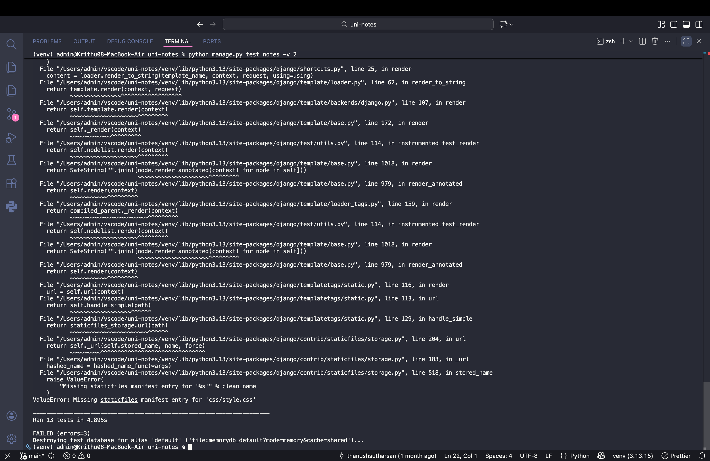
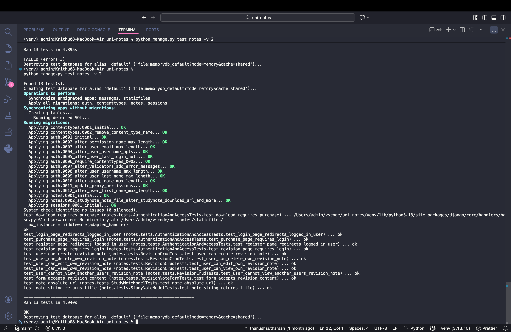
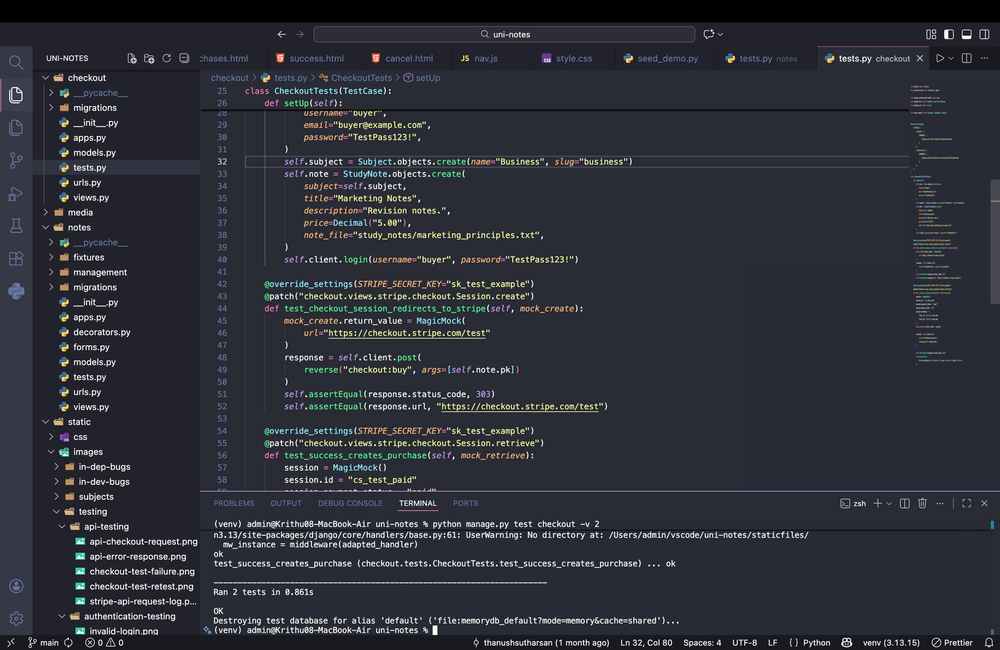
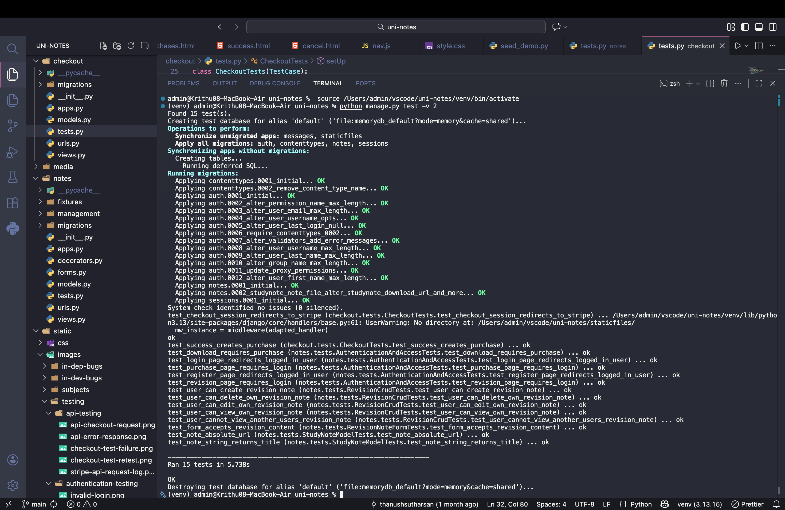

# Testing and evidence

[Back to UniNotes README](../README.md#documentation)

[Automated Django Tests](#jump-automated-django-tests)

---

### Testing Strategy

Testing was an important part of developing UniNotes because I needed to make sure the application worked correctly and that users could access its features without unexpected errors.

UniNotes contains several important features, including user authentication, personal revision notes, file uploads, study resources and Stripe payment integration.

These features involve user information, database records and payments, so it was important to test them throughout development.

I used a combination of automated and manual testing to check the functionality of the application.

The main areas I considered during testing were:

- Database models and relationships.
- Form validation.
- User registration and authentication.
- Authorisation and ownership permissions.
- Revision note CRUD functionality.
- Protected study resource downloads.
- Stripe Checkout integration.
- Error handling.
- Page navigation.
- Responsive design.
- Browser compatibility.
- Accessibility.
- HTML, CSS, JavaScript and Python validation.

Automated Django testing is documented in this section, while manual testing, browser compatibility and validation are documented separately.

#### Automated Testing

Automated testing involves writing code that checks whether specific parts of an application behave as expected.

I used Django's built-in testing framework, which is based on Python's `unittest` framework.

This allowed me to write tests for database models, forms, authentication, permissions, CRUD operations and Stripe Checkout functionality.

Automated tests are useful because they can be executed repeatedly after changes are made to the application.

This helps identify regressions, where previously working functionality stops behaving as expected after a code change.

I organised the tests into separate classes to make them easier to understand and maintain.

#### Manual Testing

Manual testing involves interacting with the application through a browser to check whether features work correctly.

For example, I manually tested actions such as registering an account, logging in, creating revision notes and navigating between pages.

Manual testing is also important for checking the appearance and usability of the website.

Unlike automated tests, manual testing allows me to observe the application from the perspective of an actual user.

The detailed manual testing results are documented separately in the Manual Testing section.

#### Test-Driven Development (TDD)

Test-driven development is an approach where automated tests are written before the functionality they are intended to test.

The process normally follows three stages:

1. **Red:** Write a test that fails because the required functionality has not yet been implemented.
2. **Green:** Write the code required to make the test pass.
3. **Refactor:** Improve the code while keeping the tests passing.

This approach can help developers identify expected behaviour before writing the implementation.

Although UniNotes contains automated tests, I did not consistently follow a strict test-first approach throughout the project.

I therefore cannot claim that all functionality was developed using TDD.

Instead, the automated tests were used to check important application functionality and identify problems during development.

For example, automated testing identified issues with the Stripe redirect response and the static file storage configuration.

These problems required investigation and changes to the code.

This demonstrated the value of automated testing, even when a project has not followed a complete test-driven development process.

In future projects, I would like to apply TDD more consistently.

---

<a name="jump-automated-django-tests"></a>

### Automated Django Tests

#### Automated Testing Overview

I used Django's `TestCase` class to test important parts of UniNotes.

The automated tests are stored in two files:

```text
notes/tests.py
checkout/tests.py
```

The current test suite contains 15 test methods divided between the two Django applications.

The tests are organised into the following classes:

| Test Class | Application | Number of Tests |
|---|---|---:|
| `StudyNoteModelTests` | notes | 2 |
| `RevisionNoteFormTests` | notes | 1 |
| `AuthenticationAndAccessTests` | notes | 5 |
| `RevisionCrudTests` | notes | 5 |
| `CheckoutTests` | checkout | 2 |
| **Total** | | **15** |

Organising tests into separate classes helped me keep related functionality together.

For example, the `RevisionCrudTests` class focuses on creating, reading, updating and deleting personal revision notes.

The `CheckoutTests` class focuses on the Stripe payment workflow.

#### Django Test Environment

Django provides a separate test environment so that automated tests do not permanently change the application's normal development database.

When tests are executed, Django creates a temporary test database and applies the required database migrations.

This allows tests to create temporary users, subjects, study resources and purchase records.

The test database is removed after the tests finish.

Django also provides a test client that can simulate HTTP requests.

For example:

```python
response = self.client.get(
    reverse("notes:revision_list")
)
```

This sends a request to the revision notes list view.

The response can then be checked using an assertion.

```python
self.assertEqual(response.status_code, 302)
```

This checks whether the view returns an HTTP 302 redirect.

If the returned status code does not match the expected value, the test fails.

#### Model Tests

The model tests are stored in:

```text
notes/tests.py
```

The `StudyNoteModelTests` class contains two tests.

##### Study Note String Representation

The first test checks whether converting a study resource into a string returns its title.

```python
def test_note_string_returns_title(self):
    self.assertEqual(
        str(self.note),
        self.note.title
    )
```

This is useful because Django uses string representations in areas such as the administration interface.

##### Study Note Absolute URL

The second test checks whether the study resource generates the correct detail page URL.

```python
def test_note_absolute_url(self):
    self.assertEqual(
        self.note.get_absolute_url(),
        reverse(
            "notes:detail",
            args=[self.note.pk]
        ),
    )
```

This verifies that the model's `get_absolute_url()` method returns the expected named URL.

These tests check two important behaviours of the `StudyNote` model.

#### Form Validation Tests

The `RevisionNoteFormTests` class contains a test that checks whether valid revision note information is accepted.

```python
def test_form_accepts_revision_content(self):
    form = RevisionNoteForm(
        data={
            "title": "Python Functions",
            "subject": "Computer Science",
            "content": (
                "Functions group reusable instructions."
            ),
        }
    )

    self.assertTrue(form.is_valid())
```

This test supplies valid information and checks whether the form passes validation.

The test is important because creating personal revision notes is one of the main features of UniNotes.

Additional automated tests could be introduced for missing fields, invalid attachments and file size restrictions.

#### Authentication and Access Tests

The `AuthenticationAndAccessTests` class contains five tests.

These check whether users are redirected correctly and whether protected features require appropriate access.

##### Purchase History Requires Login

The first test checks that anonymous users cannot directly access purchase history.

```python
def test_purchase_page_requires_login(self):
    response = self.client.get(
        reverse("notes:purchases")
    )

    self.assertEqual(response.status_code, 302)
```

The expected response is HTTP 302 because anonymous users should be redirected to the login page.

##### Revision Notes Require Login

The second test checks that anonymous users are redirected when trying to access the personal revision notes list.

```python
def test_revision_page_requires_login(self):
    response = self.client.get(
        reverse("notes:revision_list")
    )

    self.assertEqual(response.status_code, 302)
```

This helps verify that personal revision notes are protected by authentication.

##### Registration Redirects Logged-In Users

The third test checks that a user who is already authenticated is redirected away from the registration page.

```python
def test_register_page_redirects_logged_in_user(self):
    self.client.login(
        username="student",
        password="TestPass123!",
    )

    response = self.client.get(
        reverse("register")
    )

    self.assertRedirects(
        response,
        reverse("notes:home")
    )
```

This tests the behaviour implemented using the custom `anonymous_required` decorator.

##### Login Redirects Logged-In Users

The fourth test checks that users who are already logged in are redirected away from the login page.

```python
def test_login_page_redirects_logged_in_user(self):
    self.client.login(
        username="student",
        password="TestPass123!",
    )

    response = self.client.get(
        reverse("login")
    )

    self.assertRedirects(
        response,
        reverse("notes:home")
    )
```

This verifies the expected navigation behaviour for authenticated users.

##### Download Requires a Purchase

The fifth test checks that a logged-in user cannot download a paid study resource without a matching purchase record.

```python
def test_download_requires_purchase(self):
    self.client.login(
        username="student",
        password="TestPass123!",
    )

    response = self.client.get(
        reverse(
            "notes:download",
            args=[self.note.pk]
        )
    )

    self.assertEqual(
        response.status_code,
        404
    )
```

The expected response is HTTP 404 because the user does not have a matching purchase record.

This tests an important access restriction within the application.

#### Revision Note CRUD Tests

The `RevisionCrudTests` class contains five tests.

These check the main CRUD operations and ownership protection for personal revision notes.

##### Create Revision Note

The creation test sends a POST request containing revision note information.

It then checks that a record has been created, the response is a redirect and the new note belongs to the authenticated user.

```python
self.assertEqual(
    RevisionNote.objects.count(),
    1
)

self.assertEqual(
    response.status_code,
    302
)

self.assertEqual(
    RevisionNote.objects.first().owner,
    self.user
)
```

This helps verify that the view saves the revision note and assigns ownership correctly.

##### Read Revision Note

The read test creates a revision note belonging to the authenticated user.

It then requests the note detail page.

```python
response = self.client.get(
    reverse(
        "notes:revision_detail",
        args=[note.pk]
    )
)

self.assertEqual(
    response.status_code,
    200
)
```

This checks that the user can access their own revision note.

##### Update Revision Note

The update test creates a revision note and submits new information through the edit view.

The test refreshes the object from the database and checks whether the changes were saved.

```python
note.refresh_from_db()

self.assertEqual(
    note.title,
    "Updated title"
)
```

This confirms that the submitted title was updated in the database.

##### Delete Revision Note

The deletion test creates a revision note and sends a POST request to the deletion view.

It then checks that the record no longer exists.

```python
self.assertFalse(
    RevisionNote.objects.filter(
        pk=note.pk
    ).exists()
)
```

This verifies that the deletion operation removes the expected record.

##### Ownership Protection

The final CRUD test checks that one user cannot access another user's revision note.

The test creates a revision note belonging to a second user.

It then attempts to access that note while authenticated as the first user.

```python
response = self.client.get(
    reverse(
        "notes:revision_detail",
        args=[note.pk]
    )
)

self.assertEqual(
    response.status_code,
    404
)
```

The expected response is HTTP 404 because the note does not belong to the authenticated user.

This tests the ownership protection implemented in the revision note views.

#### Stripe Checkout Tests

The checkout tests are stored in:

```text
checkout/tests.py
```

The `CheckoutTests` class contains two tests.

These use Python's `unittest.mock` functionality to simulate Stripe API responses.

This allows the application to be tested without making real payments.

##### Checkout Session Redirect Test

The first test is:

```text
test_checkout_session_redirects_to_stripe
```

This test checks whether the application redirects the user to the expected Stripe Checkout URL.

The Stripe session creation method is mocked, allowing the test to control the URL returned.

The test expects HTTP 303 and the mocked checkout URL.

The important assertions are:

```python
self.assertEqual(
    response.status_code,
    303
)

self.assertEqual(
    response.url,
    "https://checkout.stripe.com/test"
)
```

This checks that the checkout view returns the correct redirect response.

##### Successful Payment Creates Purchase

The second test is:

```text
test_success_creates_purchase
```

This test simulates a Stripe Checkout session with a paid payment status.

The mocked session contains information such as:

- Stripe session identifier.
- Payment status.
- Total payment amount.
- User ID.
- Study resource ID.

The test checks whether a matching Purchase record is created.

```python
self.assertTrue(
    Purchase.objects.filter(
        user=self.user,
        note=self.note
    ).exists()
)
```

This tests the purchase creation process using mocked Stripe information.

It does not represent a real Stripe transaction.

#### Previously Identified Automated Test Problems

During development, automated testing helped me identify unexpected behaviour and configuration problems.

Some problems were related to the application code, while others involved the test environment.

I investigated the errors by reading the terminal output and reviewing the affected Python files.

##### Bug 1: Missing Static File Manifest During Notes Testing

When I ran the notes application tests, I encountered three errors.

The command I used was:

```bash
python manage.py test notes -v 2
```

Django discovered 13 tests and successfully created a temporary test database.

The system check identified no issues.

However, the results showed that 10 tests passed and three encountered errors.

The affected tests were:

- `test_login_page_redirects_logged_in_user`
- `test_register_page_redirects_logged_in_user`
- `test_user_can_view_own_revision_note`

All three errors were caused by the same problem:

```text
ValueError: Missing staticfiles manifest entry for 'css/style.css'
```

The original test result was:

```text
Ran 13 tests in 4.895s

FAILED (errors=3)
```

###### Original Error Screenshot



*Picture 46: The original automated notes test run reported three errors caused by a missing static file manifest entry for css/style.css. The remaining 10 tests passed.*

###### Why the Error Occurred

After reviewing the traceback, I identified that the errors were related to the static file storage configuration.

UniNotes uses WhiteNoise with Django's manifest-based static file storage.

This configuration uses a generated manifest to locate static assets such as CSS and JavaScript files.

However, the automated tests were running without the required static file manifest.

As a result, Django could not resolve the stylesheet reference when certain HTML templates were rendered.

The registration and login redirect tests encountered this error because `assertRedirects()` follows the redirect destination by default.

The tests redirected authenticated users to the home page.

When Django attempted to render the home page, it encountered the missing static file manifest entry.

The revision note detail test encountered the same error because it attempted to render an HTML template using the static file configuration.

This showed that the three errors were related to the test environment rather than failed permission assertions.

###### How I Fixed the Error

To resolve the problem, I updated:

```text
notes/tests.py
```

I used Django's `override_settings()` decorator to change the storage configuration temporarily during automated testing.

**Step 1: Updating the Import**

Firstly, I changed the existing Django test import.

Before:

```python
from django.test import TestCase
```

After:

```python
from django.test import TestCase, override_settings
```

This allowed me to override Django settings for selected test classes.

**Step 2: Creating TEST_STORAGES**

Next, I created a `TEST_STORAGES` dictionary near the beginning of the file.

```python
# use standard file storage during automated tests
TEST_STORAGES = {
    "default": {
        "BACKEND": "django.core.files.storage.FileSystemStorage",
    },
    "staticfiles": {
        "BACKEND": (
            "django.contrib.staticfiles.storage.StaticFilesStorage"
        ),
    },
}
```

This configuration defines two storage backends.

The default backend uses Django's standard filesystem storage.

The staticfiles backend uses Django's standard static file storage instead of the production manifest-based storage.

This prevents the affected tests from requiring a generated static file manifest when rendering templates.

**Step 3: Updating AuthenticationAndAccessTests**

I then added the decorator above the authentication test class.

```python
@override_settings(STORAGES=TEST_STORAGES)
class AuthenticationAndAccessTests(TestCase):
```

This applies the test storage configuration while the authentication and access tests are executed.

It addresses the manifest errors associated with the registration and login redirect tests.

**Step 4: Updating RevisionCrudTests**

I also added the decorator above the revision note CRUD test class.

```python
@override_settings(STORAGES=TEST_STORAGES)
class RevisionCrudTests(TestCase):
```

This applies the same configuration while testing revision note CRUD functionality.

It addresses the manifest error encountered when rendering the revision note detail page.

I did not change the existing test methods because their intended functionality remained the same.

###### Why I Chose This Solution

I chose `override_settings()` because I wanted to solve the testing problem without changing how UniNotes serves static files in production.

The original WhiteNoise configuration is used for the deployed application.

Removing WhiteNoise or changing the production settings to make the tests run would not have been a suitable approach.

Instead, `override_settings()` temporarily changes the storage configuration while the decorated tests execute.

Once the tests finish, Django restores the original settings.

This means the fix is limited to the test environment.

It also avoids unnecessary changes to the application's views, models and templates.

###### Retesting the Notes Application

After updating `notes/tests.py`, the relevant command for retesting is:

```bash
python manage.py test notes -v 2
```

The purpose of retesting is to confirm that the new configuration resolves the three static file manifest errors.

The changes have been made to the test code.

The final retest result must be recorded using the actual output from the new test run.

###### Notes Automated Tests After Fix



*Picture 47: The notes application automated tests were rerun after updating the storage configuration. The terminal output provides evidence of the actual retest results.*

###### What I Learned

This bug helped me understand the difference between production settings and automated testing settings.

Initially, the errors appeared in authentication and revision note tests.

However, after reviewing the traceback, I realised that the same static file storage problem was affecting all three tests.

This demonstrated the importance of reading the full error message rather than assuming the test method itself contained the problem.

I also learned how Django's `override_settings()` decorator can be used to create a suitable test environment without changing the production configuration.

##### Bug 2: Stripe Checkout Redirect Status

During an earlier checkout test run, the following test failed:

```text
test_checkout_session_redirects_to_stripe
```

The test expected HTTP 303, but the application returned HTTP 302.

The reported error was:

```text
AssertionError: 302 != 303
```

The checkout view was intended to redirect the user to Stripe Checkout using HTTP 303.

However, the previous redirect implementation did not return the expected status code.

To address this, the checkout view was updated to use an explicit redirect response.

```python
return HttpResponseRedirect(
    session.url,
    status=303
)
```

This change was intended to return the correct HTTP 303 response.

The test checks both the redirect status and the destination URL.

A successful retest is required to verify that the updated implementation behaves as expected.

##### Bug 3: Static File Manifest During Checkout Tests

The earlier checkout tests also encountered a missing static file manifest error.

The error occurred while rendering an HTML template during payment success testing.

The problem was similar to the issue identified in the notes application tests.

To address it, the checkout test class was configured to use Django's standard storage backends during automated testing.

This was achieved using `override_settings()`.

The test-specific configuration prevents manifest-based static file storage from interfering with the checkout tests.

The production WhiteNoise configuration remains separate.

#### Automated Test Results

##### Notes Application Test Results

The initial notes application test run produced the following confirmed results:

| Result | Number |
|---|---:|
| Tests discovered | 13 |
| Passed | 10 |
| Failed assertions | 0 |
| Errors | 3 |
| Overall result | FAILED |

The execution time was 4.895 seconds.

The three errors were caused by the missing static file manifest entry.

The test configuration was subsequently updated using `override_settings()`.

The final outcome will be confirmed using a fresh test run.

##### Checkout Application Test Results

The earlier checkout test run identified:

- One failed redirect assertion.
- One static file manifest error.

Changes were made to address these issues.

The final results must be confirmed by rerunning:

```bash
python manage.py test checkout -v 2
```

###### Checkout Automated Testing Screenshot



*Picture 48: The checkout application automated tests were executed to evaluate Stripe Checkout redirection and purchase creation. The terminal output shows the recorded test outcomes.*

##### Full Django Test Suite

The complete test suite can be executed using:

```bash
python manage.py test -v 2
```

This command runs the Django tests discovered across the project.

The current repository contains 15 defined automated test methods.

The command is useful for checking whether changes to one part of the application have affected other functionality.

The overall result will be recorded after the complete test suite has been executed and the terminal output has been reviewed.

###### Full Automated Test Suite Screenshot



*Picture 49: The full Django automated test suite was executed to check the application's test cases together. The terminal output provides evidence of the overall results.*

#### Automated Testing Limitations

Although UniNotes contains tests for important features, the automated test suite does not cover every possible situation.

Additional tests could be introduced for:

- Duplicate email registration.
- Invalid registration information.
- Missing required form fields.
- Oversized file attachments.
- Unsupported file extensions.
- Search and filtering functionality.
- Unauthorised revision note editing.
- Unauthorised revision note deletion.
- Duplicate purchases.
- Invalid Stripe session identifiers.
- Unpaid Stripe sessions.
- Incorrect session metadata.
- Incorrect payment amounts and currencies.
- Missing purchased resource files.

These tests would improve coverage and help identify more problems during development.

#### Automated Testing Evaluation

Overall, automated testing helped me evaluate important functionality within UniNotes.

The model tests check basic study resource behaviour.

The form tests check whether valid revision note information is accepted.

Authentication and access tests check redirects and restricted functionality.

The CRUD tests check the main operations for managing personal revision notes.

The ownership protection test checks that users cannot access another person's revision notes.

The Stripe tests check checkout redirection and purchase creation using mocked API responses.

Automated testing also helped me identify configuration problems that affected several tests.

The missing static file manifest error demonstrated how a problem in the testing environment can cause multiple tests to encounter errors even when the affected application logic is not necessarily incorrect.

Investigating and updating the test storage configuration improved my understanding of Django testing and WhiteNoise.

However, the tests have limitations.

The suite does not cover every possible input or failure condition, and mocked Stripe tests do not replace real integration testing.

I would like to improve the automated test coverage in future development.

Overall, the current automated tests provide a useful foundation for checking UniNotes functionality and identifying regressions when changes are made.
