# Testing and evidence

[Back to UniNotes README](../README.md#documentation)

## Contents

- [Testing Strategy](#testing-strategy)
  - [Automated Testing](#automated-testing)
  - [Manual Testing](#manual-testing)
  - [Test-Driven Development (TDD)](#test-driven-development-tdd)
- [Automated Django Tests](#jump-automated-django-tests)
  - [Automated Testing Overview](#automated-testing-overview)
  - [Django Test Environment](#django-test-environment)
  - [Model Tests](#model-tests)
  - [Form Validation Tests](#form-validation-tests)
  - [Authentication and Access Tests](#authentication-and-access-tests)
  - [Revision Note CRUD Tests](#revision-note-crud-tests)
  - [Stripe Checkout Tests](#stripe-checkout-tests)
  - [Previously Identified Automated Test Problems](#previously-identified-automated-test-problems)
  - [Automated Test Results](#automated-test-results)
  - [Automated Testing Limitations](#automated-testing-limitations)
  - [Automated Testing Evaluation](#automated-testing-evaluation)
- [Manual Testing Results](#manual-testing-results)
- [Deployment Verification](#deployment-verification)
- [HTML Validation](#html-validation)
  - [HTML Validation Results](#html-validation-results)
  - [Issues and Retests](#issues-and-retests)
  - [HTML Validation Summary](#html-validation-summary)
---

### Testing Strategy

Testing was an important part of developing UniNotes because I needed to make sure the application worked correctly and that users could access its features without unexpected errors.

UniNotes contains several important features, including user authentication, personal revision notes, file uploads, study resources and Stripe payment integration.

These features involve user information, database records and payments, so it was important to test them throughout development.

I used a combination of automated and manual testing to check the functionality of the application.

The main areas I considered during testing were:

- Database models and relationships.
- Form validation.
- User registration and authentication.
- Authorisation and ownership permissions.
- Revision note CRUD functionality.
- Protected study resource downloads.
- Stripe Checkout integration.
- Error handling.
- Page navigation.
- Responsive design.
- Browser compatibility.
- Accessibility.
- HTML, CSS, JavaScript and Python validation.

Automated Django testing is documented in this section, while manual testing, browser compatibility and validation are documented separately.

#### Automated Testing

Automated testing involves writing code that checks whether specific parts of an application behave as expected.

I used Django's built-in testing framework, which is based on Python's `unittest` framework.

This allowed me to write tests for database models, forms, authentication, permissions, CRUD operations and Stripe Checkout functionality.

Automated tests are useful because they can be executed repeatedly after changes are made to the application.

This helps identify regressions, where previously working functionality stops behaving as expected after a code change.

I organised the tests into separate classes to make them easier to understand and maintain.

#### Manual Testing

Manual testing involves interacting with the application through a browser to check whether features work correctly.

For example, I manually tested actions such as registering an account, logging in, creating revision notes and navigating between pages.

Manual testing is also important for checking the appearance and usability of the website.

Unlike automated tests, manual testing allows me to observe the application from the perspective of an actual user.

The detailed manual testing results are documented separately in the Manual Testing section.

#### Test-Driven Development (TDD)

Test-driven development is an approach where automated tests are written before the functionality they are intended to test.

The process normally follows three stages:

1. **Red:** Write a test that fails because the required functionality has not yet been implemented.
2. **Green:** Write the code required to make the test pass.
3. **Refactor:** Improve the code while keeping the tests passing.

This approach can help developers identify expected behaviour before writing the implementation.

Although UniNotes contains automated tests, I did not consistently follow a strict test-first approach throughout the project.

I therefore cannot claim that all functionality was developed using TDD.

Instead, the automated tests were used to check important application functionality and identify problems during development.

For example, automated testing identified issues with the Stripe redirect response and the static file storage configuration.

These problems required investigation and changes to the code.

This demonstrated the value of automated testing, even when a project has not followed a complete test-driven development process.

In future projects, I would like to apply TDD more consistently.

---

<a name="jump-automated-django-tests"></a>

### Automated Django Tests

#### Automated Testing Overview

I used Django's `TestCase` class to test important parts of UniNotes.

The automated tests are stored in two files:

```text
notes/tests.py
checkout/tests.py
```

The current test suite contains 15 test methods divided between the two Django applications.

The tests are organised into the following classes:

| Test Class | Application | Number of Tests |
|---|---|---:|
| `StudyNoteModelTests` | notes | 2 |
| `RevisionNoteFormTests` | notes | 1 |
| `AuthenticationAndAccessTests` | notes | 5 |
| `RevisionCrudTests` | notes | 5 |
| `CheckoutTests` | checkout | 2 |
| **Total** | | **15** |

Organising tests into separate classes helped me keep related functionality together.

For example, the `RevisionCrudTests` class focuses on creating, reading, updating and deleting personal revision notes.

The `CheckoutTests` class focuses on the Stripe payment workflow.

#### Django Test Environment

Django provides a separate test environment so that automated tests do not permanently change the application's normal development database.

When tests are executed, Django creates a temporary test database and applies the required database migrations.

This allows tests to create temporary users, subjects, study resources and purchase records.

The test database is removed after the tests finish.

Django also provides a test client that can simulate HTTP requests.

For example:

```python
response = self.client.get(
    reverse("notes:revision_list")
)
```

This sends a request to the revision notes list view.

The response can then be checked using an assertion.

```python
self.assertEqual(response.status_code, 302)
```

This checks whether the view returns an HTTP 302 redirect.

If the returned status code does not match the expected value, the test fails.

#### Model Tests

The model tests are stored in:

```text
notes/tests.py
```

The `StudyNoteModelTests` class contains two tests.

##### Study Note String Representation

The first test checks whether converting a study resource into a string returns its title.

```python
def test_note_string_returns_title(self):
    self.assertEqual(
        str(self.note),
        self.note.title
    )
```

This is useful because Django uses string representations in areas such as the administration interface.

##### Study Note Absolute URL

The second test checks whether the study resource generates the correct detail page URL.

```python
def test_note_absolute_url(self):
    self.assertEqual(
        self.note.get_absolute_url(),
        reverse(
            "notes:detail",
            args=[self.note.pk]
        ),
    )
```

This verifies that the model's `get_absolute_url()` method returns the expected named URL.

These tests check two important behaviours of the `StudyNote` model.

#### Form Validation Tests

The `RevisionNoteFormTests` class contains a test that checks whether valid revision note information is accepted.

```python
def test_form_accepts_revision_content(self):
    form = RevisionNoteForm(
        data={
            "title": "Python Functions",
            "subject": "Computer Science",
            "content": (
                "Functions group reusable instructions."
            ),
        }
    )

    self.assertTrue(form.is_valid())
```

This test supplies valid information and checks whether the form passes validation.

The test is important because creating personal revision notes is one of the main features of UniNotes.

Additional automated tests could be introduced for missing fields, invalid attachments and file size restrictions.

#### Authentication and Access Tests

The `AuthenticationAndAccessTests` class contains five tests.

These check whether users are redirected correctly and whether protected features require appropriate access.

##### Purchase History Requires Login

The first test checks that anonymous users cannot directly access purchase history.

```python
def test_purchase_page_requires_login(self):
    response = self.client.get(
        reverse("notes:purchases")
    )

    self.assertEqual(response.status_code, 302)
```

The expected response is HTTP 302 because anonymous users should be redirected to the login page.

##### Revision Notes Require Login

The second test checks that anonymous users are redirected when trying to access the personal revision notes list.

```python
def test_revision_page_requires_login(self):
    response = self.client.get(
        reverse("notes:revision_list")
    )

    self.assertEqual(response.status_code, 302)
```

This helps verify that personal revision notes are protected by authentication.

##### Registration Redirects Logged-In Users

The third test checks that a user who is already authenticated is redirected away from the registration page.

```python
def test_register_page_redirects_logged_in_user(self):
    self.client.login(
        username="student",
        password="TestPass123!",
    )

    response = self.client.get(
        reverse("register")
    )

    self.assertRedirects(
        response,
        reverse("notes:home")
    )
```

This tests the behaviour implemented using the custom `anonymous_required` decorator.

##### Login Redirects Logged-In Users

The fourth test checks that users who are already logged in are redirected away from the login page.

```python
def test_login_page_redirects_logged_in_user(self):
    self.client.login(
        username="student",
        password="TestPass123!",
    )

    response = self.client.get(
        reverse("login")
    )

    self.assertRedirects(
        response,
        reverse("notes:home")
    )
```

This verifies the expected navigation behaviour for authenticated users.

##### Download Requires a Purchase

The fifth test checks that a logged-in user cannot download a paid study resource without a matching purchase record.

```python
def test_download_requires_purchase(self):
    self.client.login(
        username="student",
        password="TestPass123!",
    )

    response = self.client.get(
        reverse(
            "notes:download",
            args=[self.note.pk]
        )
    )

    self.assertEqual(
        response.status_code,
        404
    )
```

The expected response is HTTP 404 because the user does not have a matching purchase record.

This tests an important access restriction within the application.

#### Revision Note CRUD Tests

The `RevisionCrudTests` class contains five tests.

These check the main CRUD operations and ownership protection for personal revision notes.

##### Create Revision Note

The creation test sends a POST request containing revision note information.

It then checks that a record has been created, the response is a redirect and the new note belongs to the authenticated user.

```python
self.assertEqual(
    RevisionNote.objects.count(),
    1
)

self.assertEqual(
    response.status_code,
    302
)

self.assertEqual(
    RevisionNote.objects.first().owner,
    self.user
)
```

This helps verify that the view saves the revision note and assigns ownership correctly.

##### Read Revision Note

The read test creates a revision note belonging to the authenticated user.

It then requests the note detail page.

```python
response = self.client.get(
    reverse(
        "notes:revision_detail",
        args=[note.pk]
    )
)

self.assertEqual(
    response.status_code,
    200
)
```

This checks that the user can access their own revision note.

##### Update Revision Note

The update test creates a revision note and submits new information through the edit view.

The test refreshes the object from the database and checks whether the changes were saved.

```python
note.refresh_from_db()

self.assertEqual(
    note.title,
    "Updated title"
)
```

This confirms that the submitted title was updated in the database.

##### Delete Revision Note

The deletion test creates a revision note and sends a POST request to the deletion view.

It then checks that the record no longer exists.

```python
self.assertFalse(
    RevisionNote.objects.filter(
        pk=note.pk
    ).exists()
)
```

This verifies that the deletion operation removes the expected record.

##### Ownership Protection

The final CRUD test checks that one user cannot access another user's revision note.

The test creates a revision note belonging to a second user.

It then attempts to access that note while authenticated as the first user.

```python
response = self.client.get(
    reverse(
        "notes:revision_detail",
        args=[note.pk]
    )
)

self.assertEqual(
    response.status_code,
    404
)
```

The expected response is HTTP 404 because the note does not belong to the authenticated user.

This tests the ownership protection implemented in the revision note views.

#### Stripe Checkout Tests

The checkout tests are stored in:

```text
checkout/tests.py
```

The `CheckoutTests` class contains two tests.

These use Python's `unittest.mock` functionality to simulate Stripe API responses.

This allows the application to be tested without making real payments.

##### Checkout Session Redirect Test

The first test is:

```text
test_checkout_session_redirects_to_stripe
```

This test checks whether the application redirects the user to the expected Stripe Checkout URL.

The Stripe session creation method is mocked, allowing the test to control the URL returned.

The test expects HTTP 303 and the mocked checkout URL.

The important assertions are:

```python
self.assertEqual(
    response.status_code,
    303
)

self.assertEqual(
    response.url,
    "https://checkout.stripe.com/test"
)
```

This checks that the checkout view returns the correct redirect response.

##### Successful Payment Creates Purchase

The second test is:

```text
test_success_creates_purchase
```

This test simulates a Stripe Checkout session with a paid payment status.

The mocked session contains information such as:

- Stripe session identifier.
- Payment status.
- Total payment amount.
- User ID.
- Study resource ID.

The test checks whether a matching Purchase record is created.

```python
self.assertTrue(
    Purchase.objects.filter(
        user=self.user,
        note=self.note
    ).exists()
)
```

This tests the purchase creation process using mocked Stripe information.

It does not represent a real Stripe transaction.

#### Previously Identified Automated Test Problems

During development, automated testing helped me identify unexpected behaviour and configuration problems.

Some problems were related to the application code, while others involved the test environment.

I investigated the errors by reading the terminal output and reviewing the affected Python files.

##### Bug 1: Missing Static File Manifest During Notes Testing

When I ran the notes application tests, I encountered three errors.

The command I used was:

```bash
python manage.py test notes -v 2
```

Django discovered 13 tests and successfully created a temporary test database.

The system check identified no issues.

However, the results showed that 10 tests passed and three encountered errors.

The affected tests were:

- `test_login_page_redirects_logged_in_user`
- `test_register_page_redirects_logged_in_user`
- `test_user_can_view_own_revision_note`

All three errors were caused by the same problem:

```text
ValueError: Missing staticfiles manifest entry for 'css/style.css'
```

The original test result was:

```text
Ran 13 tests in 4.895s

FAILED (errors=3)
```

###### Original Error Screenshot


*Picture 46: The original automated notes test run reported three errors caused by a missing static file manifest entry for css/style.css. The remaining 10 tests passed.*

###### Why the Error Occurred

After reviewing the traceback, I identified that the errors were related to the static file storage configuration.

UniNotes uses WhiteNoise with Django's manifest-based static file storage.

This configuration uses a generated manifest to locate static assets such as CSS and JavaScript files.

However, the automated tests were running without the required static file manifest.

As a result, Django could not resolve the stylesheet reference when certain HTML templates were rendered.

The registration and login redirect tests encountered this error because `assertRedirects()` follows the redirect destination by default.

The tests redirected authenticated users to the home page.

When Django attempted to render the home page, it encountered the missing static file manifest entry.

The revision note detail test encountered the same error because it attempted to render an HTML template using the static file configuration.

This showed that the three errors were related to the test environment rather than failed permission assertions.

###### How I Fixed the Error

To resolve the problem, I updated:

```text
notes/tests.py
```

I used Django's `override_settings()` decorator to change the storage configuration temporarily during automated testing.

**Step 1: Updating the Import**

Firstly, I changed the existing Django test import.

Before:

```python
from django.test import TestCase
```

After:

```python
from django.test import TestCase, override_settings
```

This allowed me to override Django settings for selected test classes.

**Step 2: Creating TEST_STORAGES**

Next, I created a `TEST_STORAGES` dictionary near the beginning of the file.

```python
# use standard file storage during automated tests
TEST_STORAGES = {
    "default": {
        "BACKEND": "django.core.files.storage.FileSystemStorage",
    },
    "staticfiles": {
        "BACKEND": (
            "django.contrib.staticfiles.storage.StaticFilesStorage"
        ),
    },
}
```

This configuration defines two storage backends.

The default backend uses Django's standard filesystem storage.

The staticfiles backend uses Django's standard static file storage instead of the production manifest-based storage.

This prevents the affected tests from requiring a generated static file manifest when rendering templates.

**Step 3: Updating AuthenticationAndAccessTests**

I then added the decorator above the authentication test class.

```python
@override_settings(STORAGES=TEST_STORAGES)
class AuthenticationAndAccessTests(TestCase):
```

This applies the test storage configuration while the authentication and access tests are executed.

It addresses the manifest errors associated with the registration and login redirect tests.

**Step 4: Updating RevisionCrudTests**

I also added the decorator above the revision note CRUD test class.

```python
@override_settings(STORAGES=TEST_STORAGES)
class RevisionCrudTests(TestCase):
```

This applies the same configuration while testing revision note CRUD functionality.

It addresses the manifest error encountered when rendering the revision note detail page.

I did not change the existing test methods because their intended functionality remained the same.

###### Why I Chose This Solution

I chose `override_settings()` because I wanted to solve the testing problem without changing how UniNotes serves static files in production.

The original WhiteNoise configuration is used for the deployed application.

Removing WhiteNoise or changing the production settings to make the tests run would not have been a suitable approach.

Instead, `override_settings()` temporarily changes the storage configuration while the decorated tests execute.

Once the tests finish, Django restores the original settings.

This means the fix is limited to the test environment.

It also avoids unnecessary changes to the application's views, models and templates.

###### Retesting the Notes Application

After updating `notes/tests.py`, the relevant command for retesting is:

```bash
python manage.py test notes -v 2
```

The purpose of retesting is to confirm that the new configuration resolves the three static file manifest errors.

The changes have been made to the test code.

The final retest result must be recorded using the actual output from the new test run.

###### Notes Automated Tests After Fix


*Picture 47: The notes application automated tests were rerun after updating the storage configuration. The terminal output provides evidence of the actual retest results.*

###### What I Learned

This bug helped me understand the difference between production settings and automated testing settings.

Initially, the errors appeared in authentication and revision note tests.

However, after reviewing the traceback, I realised that the same static file storage problem was affecting all three tests.

This demonstrated the importance of reading the full error message rather than assuming the test method itself contained the problem.

I also learned how Django's `override_settings()` decorator can be used to create a suitable test environment without changing the production configuration.

##### Bug 2: Stripe Checkout Redirect Status

During an earlier checkout test run, the following test failed:

```text
test_checkout_session_redirects_to_stripe
```

The test expected HTTP 303, but the application returned HTTP 302.

The reported error was:

```text
AssertionError: 302 != 303
```

The checkout view was intended to redirect the user to Stripe Checkout using HTTP 303.

However, the previous redirect implementation did not return the expected status code.

To address this, the checkout view was updated to use an explicit redirect response.

```python
return HttpResponseRedirect(
    session.url,
    status=303
)
```

This change was intended to return the correct HTTP 303 response.

The test checks both the redirect status and the destination URL.

A successful retest is required to verify that the updated implementation behaves as expected.

##### Bug 3: Static File Manifest During Checkout Tests

The earlier checkout tests also encountered a missing static file manifest error.

The error occurred while rendering an HTML template during payment success testing.

The problem was similar to the issue identified in the notes application tests.

To address it, the checkout test class was configured to use Django's standard storage backends during automated testing.

This was achieved using `override_settings()`.

The test-specific configuration prevents manifest-based static file storage from interfering with the checkout tests.

The production WhiteNoise configuration remains separate.

#### Automated Test Results

##### Confirmed full-suite result

I ran `python manage.py test -v 2` after correcting the checkout redirect and test static-file configuration.

| Tests run | Passed | Failures | Errors | Overall result |
| --- | --- | --- | --- | --- |
| 15 | 15 | 0 | 0 | PASS |

The terminal output is shown in Picture 49 under Full Django Test Suite.

##### Notes Application Test Results

The initial notes application test run produced the following confirmed results:

| Result | Number |
|---|---:|
| Tests discovered | 13 |
| Passed | 10 |
| Failed assertions | 0 |
| Errors | 3 |
| Overall result | FAILED |

The execution time was 4.895 seconds.

The three errors were caused by the missing static file manifest entry.

The test configuration was subsequently updated using `override_settings()`.

The final outcome will be confirmed using a fresh test run.

##### Checkout Application Test Results

The earlier checkout test run identified:

- One failed redirect assertion.
- One static file manifest error.

Changes were made to address these issues.

The final results must be confirmed by rerunning:

```bash
python manage.py test checkout -v 2
```

###### Checkout Automated Testing Screenshot


*Picture 48: The checkout application automated tests were executed to evaluate Stripe Checkout redirection and purchase creation. The terminal output shows the recorded test outcomes.*

##### Full Django Test Suite

The complete test suite can be executed using:

```bash
python manage.py test -v 2
```

This command runs the Django tests discovered across the project.

The current repository contains 15 defined automated test methods.

The command is useful for checking whether changes to one part of the application have affected other functionality.

The overall result will be recorded after the complete test suite has been executed and the terminal output has been reviewed.

###### Full Automated Test Suite Screenshot


*Picture 49: The full Django automated test suite was executed to check the application's test cases together. The terminal output provides evidence of the overall results.*

#### Automated Testing Limitations

Although UniNotes contains tests for important features, the automated test suite does not cover every possible situation.

Additional tests could be introduced for:

- Duplicate email registration.
- Invalid registration information.
- Missing required form fields.
- Oversized file attachments.
- Unsupported file extensions.
- Search and filtering functionality.
- Unauthorised revision note editing.
- Unauthorised revision note deletion.
- Duplicate purchases.
- Invalid Stripe session identifiers.
- Unpaid Stripe sessions.
- Incorrect session metadata.
- Incorrect payment amounts and currencies.
- Missing purchased resource files.

These tests would improve coverage and help identify more problems during development.

#### Automated Testing Evaluation

Overall, automated testing helped me evaluate important functionality within UniNotes.

The model tests check basic study resource behaviour.

The form tests check whether valid revision note information is accepted.

Authentication and access tests check redirects and restricted functionality.

The CRUD tests check the main operations for managing personal revision notes.

The ownership protection test checks that users cannot access another person's revision notes.

The Stripe tests check checkout redirection and purchase creation using mocked API responses.

Automated testing also helped me identify configuration problems that affected several tests.

The missing static file manifest error demonstrated how a problem in the testing environment can cause multiple tests to encounter errors even when the affected application logic is not necessarily incorrect.

Investigating and updating the test storage configuration improved my understanding of Django testing and WhiteNoise.

However, the tests have limitations.

The suite does not cover every possible input or failure condition, and mocked Stripe tests do not replace real integration testing.

I would like to improve the automated test coverage in future development.

Overall, the current automated tests provide a useful foundation for checking UniNotes functionality and identifying regressions when changes are made.

## Manual Testing Results

I manually tested UniNotes against its [user stories and acceptance criteria](user-stories.md#jump-user-story-acceptance-criteria). The tests covered browsing, account registration, revision notes, file uploads, Stripe Checkout, and access to purchased resources. I also checked form validation, keyboard navigation, mobile layout, and error handling.

### Test Setup

I used a private browser window for guest checks and two test accounts for signed-in checks. Account A owned the revision notes and purchased study resource. I used Account B to check whether a different user could access the same notes or download the purchased file. All payment checks used Stripe test mode.

### How I Captured the Screenshots

I took the screenshots on my Mac using **Command + Shift + 4**. After completing a test, I dragged around the part of the screen that showed the result, such as a saved note, a checkout message, or an access-denied page. For the mobile layout check, I used Chrome Developer Tools to set the viewport width and included the width in the screenshot.

I saved each image as a PNG with the test ID in its filename. The images are stored in `static/images/testing/manual-testing/` and linked from the corresponding rows below.

### Why I Included Screenshots for Selected Tests

I included screenshots for seven tests where an image helps show a specific result: search results (MT03), a purchase in My Purchases (MT07), a saved revision note (MT09), denied access to a private note (MT12), an opened download (MT18), checkout cancellation feedback (MT21), and the mobile layout (MT24).

A dash in the **Screenshot** column means I recorded the outcome in the **Actual result** column. I used written evidence for these checks:

- **MT01 – Browse Study Notes:** The result covers both the Browse list and the detail page reached by selecting a note.
- **MT02 – Explore Before Registering:** The result records which pages I could access while signed out.
- **MT04 – Filter by Subject:** The result describes how the note list changed when I switched subjects.
- **MT05 – View Study Note Information:** The result lists the four fields I checked: title, subject, description, and price.
- **MT06 – Clear Navigation:** The result covers opening and closing the mobile menu and following links. MT24 shows the mobile layout separately.
- **MT08 – Register for an Account:** The result records the rejected submission, successful registration, and sign-in in order.
- **MT10 – Access Personalised Features:** The result compares access to two pages while signed in and signed out.
- **MT11 – Upload a Supporting File:** The result compares two saved notes and identifies which note held the attachment.
- **MT13 – View Previous Purchases:** MT07 shows the purchase in My Purchases. The written result records what happened after signing back in and switching accounts.
- **MT14 – Return and Continue Browsing:** The result records a fresh guest session. MT03 already shows the search interface.
- **MT15 – Edit a Revision Note:** The result records that the changes persisted after I saved and reopened the note.
- **MT16 – Delete a Revision Note:** The result records what happened after cancelling deletion and after confirming it.
- **MT17 – Consistent Experience for Returning Visitors:** The result compares navigation across pages and screen sizes. MT24 provides a mobile layout example.
- **MT19 – Duplicate Email Validation:** The result records the rejection while keeping the test email address out of the evidence.
- **MT20 – Revision Note Validation:** The result covers two separate checks, one for missing information and one for an unsupported attachment.
- **MT22 – Declined Payment:** The result records the decline in Stripe and the absence of a purchase in UniNotes.
- **MT23 – Keyboard Navigation:** The result records focus moving between controls and the controls responding to key presses.
- **MT25 – Missing Resource:** The result records the 404 page and how I returned to a working page.
- **MT26 – Browser Back and Forward:** The result records which page opened after each browser action.

### User Story Acceptance Testing

| Test | User story | Steps taken | Expected result | Actual result | Status | Screenshot |
| --- | --- | --- | --- | --- | --- | --- |
| MT01 | US1 – Browse Study Notes | Opened Browse, reviewed the available notes, and selected one. | The notes are easy to identify and can be opened individually. | The notes appeared in Browse, and selecting one opened its detail page. | Pass | — |
| MT02 | US2 – Explore Before Registering | As a guest, opened the homepage, browsed subjects, and viewed a note. | Guests can explore the catalogue without registering. | The homepage, subjects, and note details were accessible while signed out. | Pass | — |
| MT03 | US3 – Search for Study Notes | Searched for a known note, then entered a term with no matches. | A matching search returns relevant notes. A search with no matches shows an empty-state message. | The matching note appeared, and the second search displayed an empty-state message. | Pass | 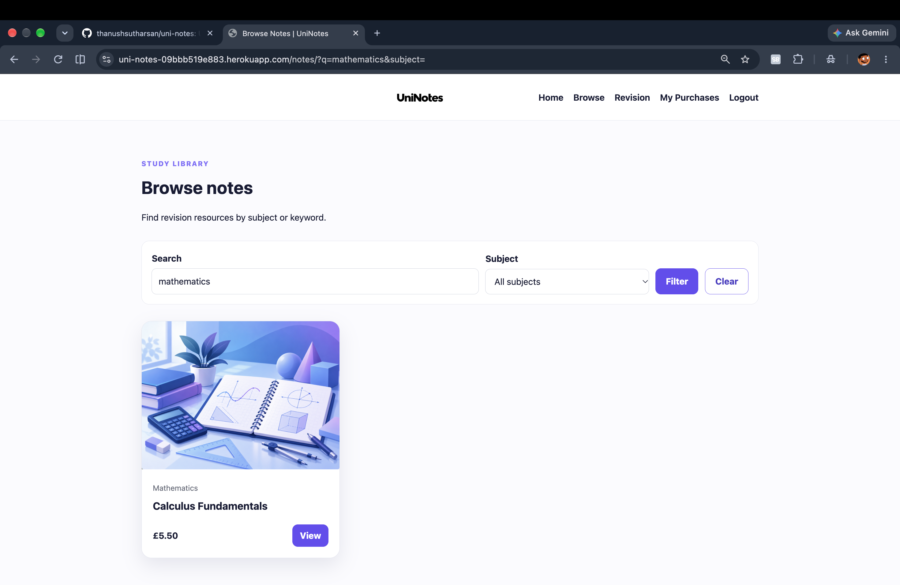 |
| MT04 | US4 – Filter by Subject | Selected one subject in Browse, checked the results, and switched to another subject. | Only notes from the selected subject are shown. | The results updated when I switched subjects and matched the selected subject. | Pass | — |
| MT05 | US5 – View Study Note Information | Opened a study note from Browse and checked its details before checkout. | The title, subject, description, and price are visible. | All four details were displayed on the note page. | Pass | — |
| MT06 | US6 – Clear Navigation | Followed the main navigation links on desktop and repeated the checks using the mobile menu. | The links go to the pages they describe, and the menu works at both widths. | The links opened the expected pages, and the mobile menu opened and closed correctly. | Pass | — |
| MT07 | US7 – Purchase a Study Note | Tried starting a purchase as a guest. Signed in as Account A, checked the price, completed Stripe test checkout, and opened My Purchases. | A guest must sign in. A signed-in user can pay the displayed price in test mode and access the purchase from their account. | Guest checkout required sign-in. Account A completed the test payment at the displayed price, saw success feedback, and found the note in My Purchases. | Pass | 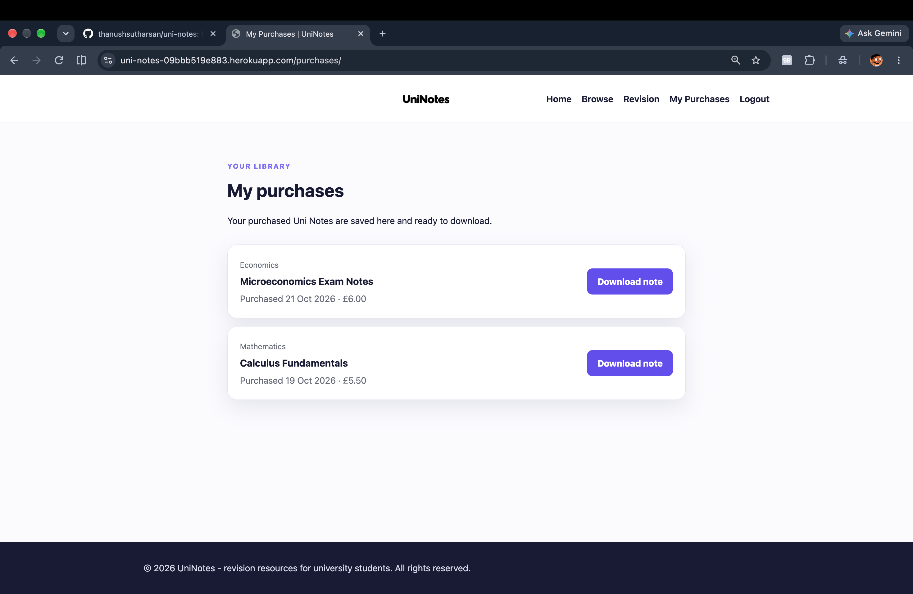 |
| MT08 | US8 – Register for an Account | Submitted invalid registration details, then registered with valid details and signed in. | Invalid details are rejected with feedback. Valid details create an account that can sign in. | Invalid details triggered validation feedback. Registration and sign-in succeeded with valid details. | Pass | — |
| MT09 | US9 – Create a Revision Note | Tried the creation page as a guest. Signed in as Account A and saved a note with a title, subject, and content. | Guests must sign in. A signed-in user can save and view their own note. | The guest was asked to sign in. Account A saved the note and found it in the revision list. | Pass | 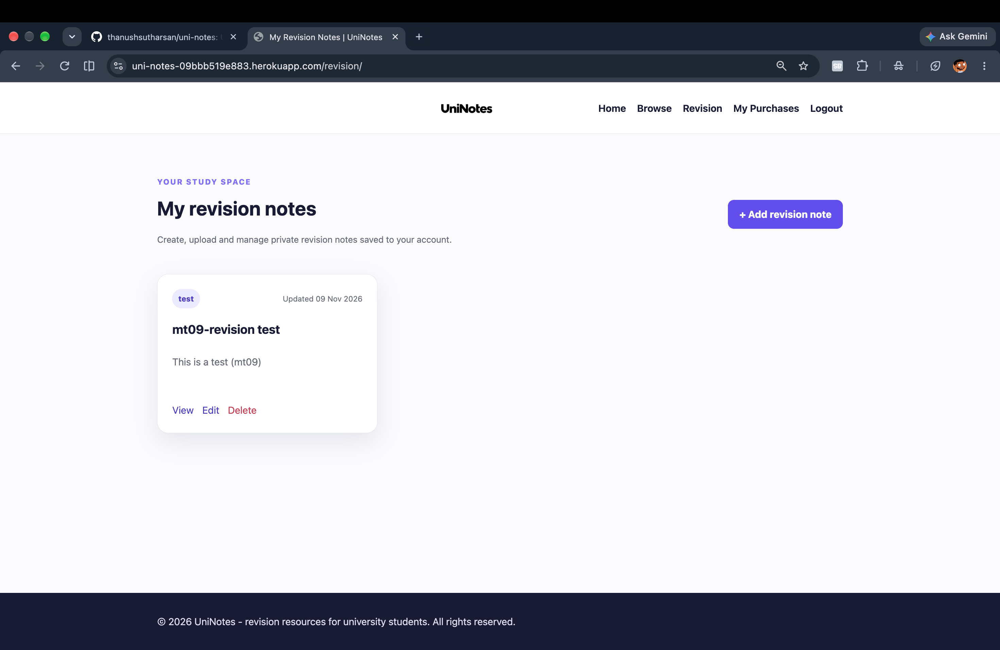 |
| MT10 | US10 – Access Personalised Features | Opened Revision and My Purchases while signed in. Signed out and tried both URLs again. | Both areas are clearly labelled and require authentication. | Both pages opened while signed in. Opening either URL as a guest required sign-in. | Pass | — |
| MT11 | US11 – Upload a Supporting File | Created one note with a valid attachment and another without one. Opened both notes. | Both notes save, and the attachment belongs only to the first note. | Both notes saved, and the attachment was linked to the correct note. | Pass | — |
| MT12 | US12 – Protect Private Revision Notes | As Account B, opened the detail, edit, and delete URLs for Account A's note. Checked the original note as Account A. | Account B cannot view, edit, or delete the note. Account A retains access. | Account B was denied access on all three routes. Account A could still open the unchanged note. | Pass | 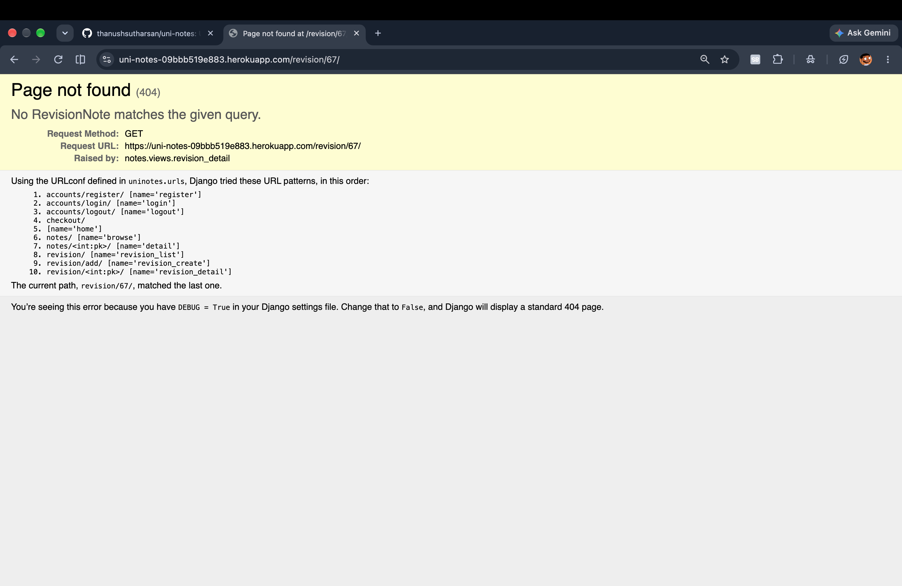 |
| MT13 | US13 – View Previous Purchases | Signed out after the test purchase, signed back in as Account A, and opened My Purchases. Repeated the check as Account B. | The purchase persists for Account A and is private to that account. | The purchase was still visible to Account A after signing back in. Account B could not see it. | Pass | — |
| MT14 | US14 – Return and Continue Browsing | Started a fresh guest session, searched, filtered by subject, and opened a note. | A returning guest can use the catalogue without signing in or buying a note. | Searching, filtering, and viewing the note worked while signed out. | Pass | — |
| MT15 | US15 – Edit a Revision Note | Opened a note as Account A, changed its title and content, saved it, and reopened it. | The edit form shows existing details and saves valid changes. | The form displayed the existing details. The updated title and content were still present after reopening the note. | Pass | — |
| MT16 | US16 – Delete a Revision Note | Opened the delete confirmation for a test note. Cancelled once, then repeated the action and confirmed deletion. | Cancelling keeps the note. Confirming removes it and provides feedback. | The note remained after cancellation. After confirmation, it disappeared from the revision list and deletion feedback appeared. | Pass | — |
| MT17 | US17 – Consistent Experience for Returning Visitors | Compared the homepage, Browse, and note detail pages at desktop and mobile widths. Returned to Browse from each page. | Navigation is consistent and Browse is easy to reach on both layouts. | The main labels stayed consistent, and Browse was accessible from each page at both widths. | Pass | — |
| MT18 | US18 – Access a Previously Purchased Resource | Downloaded the purchased resource as Account A, then tried the same download URL as Account B. | Account A can download the file without buying it again. Account B is denied access. | Account A downloaded and opened the file without paying again. Account B could not download it. | Pass | 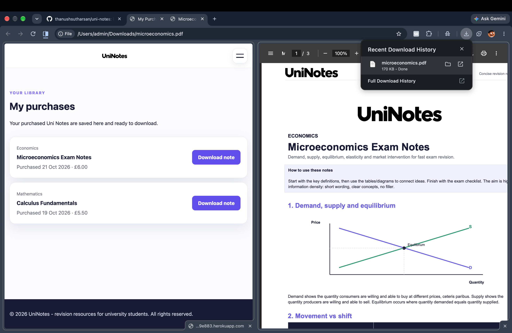 |

### Additional Validation, Accessibility, and Error Tests

| Test | Area | Steps taken | Expected result | Actual result | Status | Screenshot |
| --- | --- | --- | --- | --- | --- | --- |
| MT19 | Duplicate email validation | Tried registering with an email address already used by Account A. | The form rejects the duplicate email with helpful feedback. | The form displayed a validation message and did not create a duplicate account. | Pass | — |
| MT20 | Revision note validation | Submitted a note with a required field missing, then tried an unsupported attachment type. | The form identifies invalid input and prevents it from being saved. | Both submissions were rejected with validation feedback. | Pass | — |
| MT21 | Cancelled checkout | Started Stripe test checkout for an unpurchased note, cancelled, and checked My Purchases. | The app provides cancellation feedback and records no purchase. | The cancellation message appeared, and the note did not appear in My Purchases. | Pass | 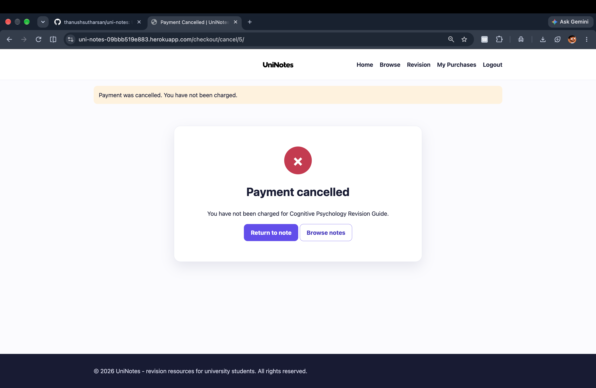 |
| MT22 | Declined payment | Used a Stripe test payment method configured to decline, then checked My Purchases. | Checkout reports the decline and records no purchase. | Stripe displayed a decline message, and no purchase appeared in My Purchases. | Pass | — |
| MT23 | Keyboard navigation | Used Tab and Shift+Tab to move through links and form controls. Activated controls with Enter or Space where appropriate. | Focus is visible and the main controls can be operated without a mouse. | Focus was visible, and the controls I checked could be reached and operated with the keyboard. | Pass | — |
| MT24 | Small-screen layout | Checked the homepage, Browse, note details, and revision form at the mobile width recorded above. | Text and controls remain readable and usable without horizontal scrolling. | The tested pages stayed readable and usable at the mobile width without horizontal scrolling. | Pass | 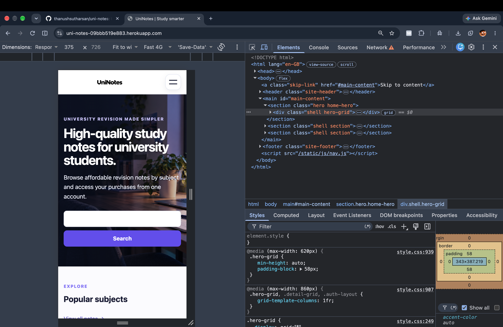 |
| MT25 | Missing resource | Opened a study-note URL using an ID that did not exist. | The app shows a 404 page with a way back to a working page. | A 404 page appeared, and I could return to a working page. | Pass | — |
| MT26 | Browser back and forward | Opened a note from Browse, then used the browser Back and Forward buttons. | Both pages remain usable and load without an application error. | Back returned to Browse, and Forward reopened the note detail page without an error. | Pass | — |

### Manual Testing Summary

All 18 user story acceptance tests and all 8 additional manual checks passed. The two-account checks confirmed that each user could access their own revision notes and purchased resources. The Stripe checks covered a successful test purchase, a cancellation, and a declined payment.

| Result | Count |
| --- | ---: |
| Passed | 26 |
| Failed | 0 |
| Blocked | 0 |
| Pending | 0 |
| Total | 26 |

## Deployment Verification

I verified UniNotes on Heroku on 9 November 2026. I checked the production database connection and debug setting from the Django shell, then tested the main user journeys on the live site. The full test cases are in [Manual Testing Results](docs/testing.md#manual-testing-results).

### Release and Configuration

| Item | Verified result |
| --- | --- |
| Live application | [UniNotes on Heroku](https://uni-notes-09bbb519e883.herokuapp.com/) |
| Date verified | 9 November 2026 |
| Heroku release verified | `v51` |
| Git commit | `28d29e1e` |
| Production database | PostgreSQL connection verified |
| Production debug setting | `DEBUG=False` verified |

Heroku deployed commit `28d29e1e` in release `v50` at 10:01 pm UK time. My initial check showed that PostgreSQL was connected and Django was running with `DEBUG=True`. I updated the Heroku config variable at 10:21 pm UK time, which created release `v51`. I reran the check and confirmed that Django was using `DEBUG=False` and could still connect to PostgreSQL.

### Live Application Checks

| Check | Actual result | Status |
| --- | --- | --- |
| Homepage and styling | The homepage loaded with its styling and images, and Browse opened the catalogue. | Pass |
| Search and subject filtering | Searching returned the expected note, and filtering showed notes from the selected subject. | Pass |
| Registration and sign-in | A new test account could register, sign out, and sign back in. | Pass |
| Create, edit, and delete a revision note | The note saved, the edited title persisted after reopening, and the note disappeared from the revision list after deletion. | Pass |
| Private revision note access | A second test account was denied access when opening the first account's private revision note URL. | Pass |
| Stripe Checkout | A successful Stripe test payment added the study note to My Purchases. | Pass |
| Purchased resource download | The purchaser downloaded the correct file from My Purchases and opened it successfully. | Pass |

### Configuration Evidence

I captured the VS Code terminal output after running the Django verification command on Heroku release `v51`. The output showed `DEBUG: False` and `Database connected: postgresql`.

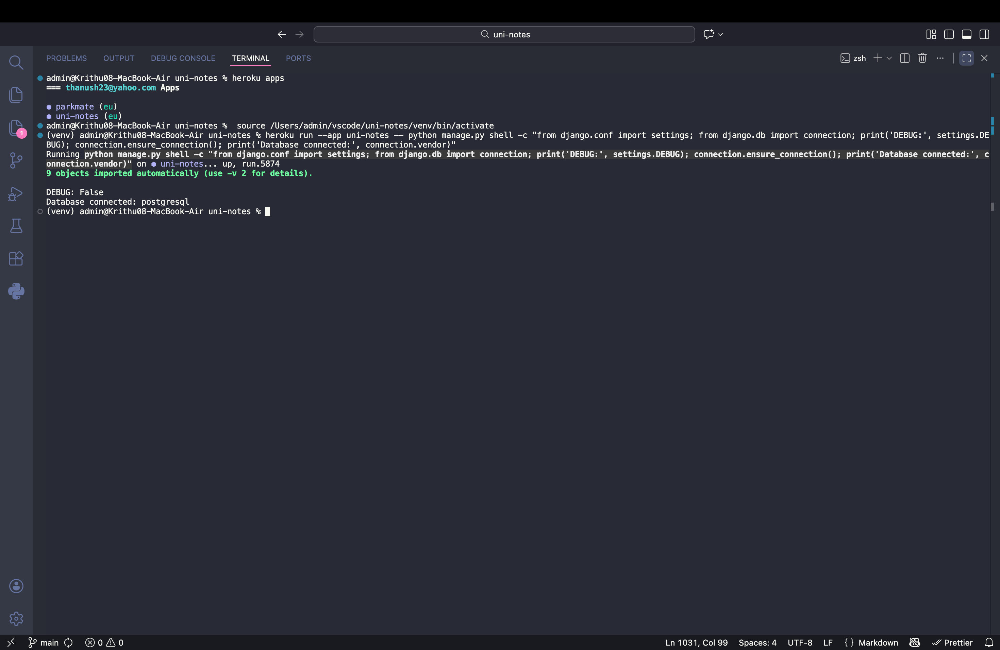

## HTML Validation

To validate my HTML, I opened the deployed UniNotes website on Heroku. For each page I checked, I right-clicked and selected **View Page Source**. I copied the HTML into the **Text Input** field of the [W3C Nu HTML Checker](https://validator.w3.org/nu/) and clicked **Check**. This let me validate the final HTML that Django generated for the browser.

### Validation Setup

| Item | Details |
| --- | --- |
| Application | [UniNotes on Heroku](https://uni-notes-09bbb519e883.herokuapp.com/) |
| Validator | W3C Nu HTML Checker |


### HTML Validation Results

| ID | Django template | Page checked | Result or action taken | Screenshot |
| --- | --- | --- | --- | --- |
| HTML01 | `base.html` | Deployed homepage | Pass. The results page reported no HTML errors or warnings. | 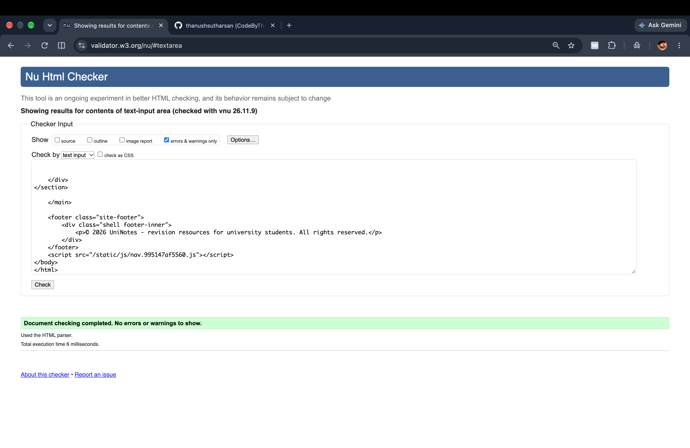 |
| HTML02 | `browse.html` and `partials_note_card.html` | Deployed Browse page | Pass on retest. I restored the Browse page's `h1` and added an `h2` above the note cards, so their `h3` headings follow the correct order. | **Before:** 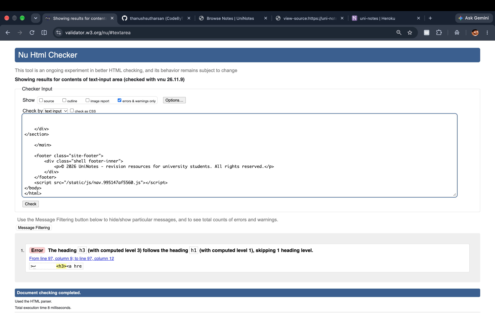 **After:** 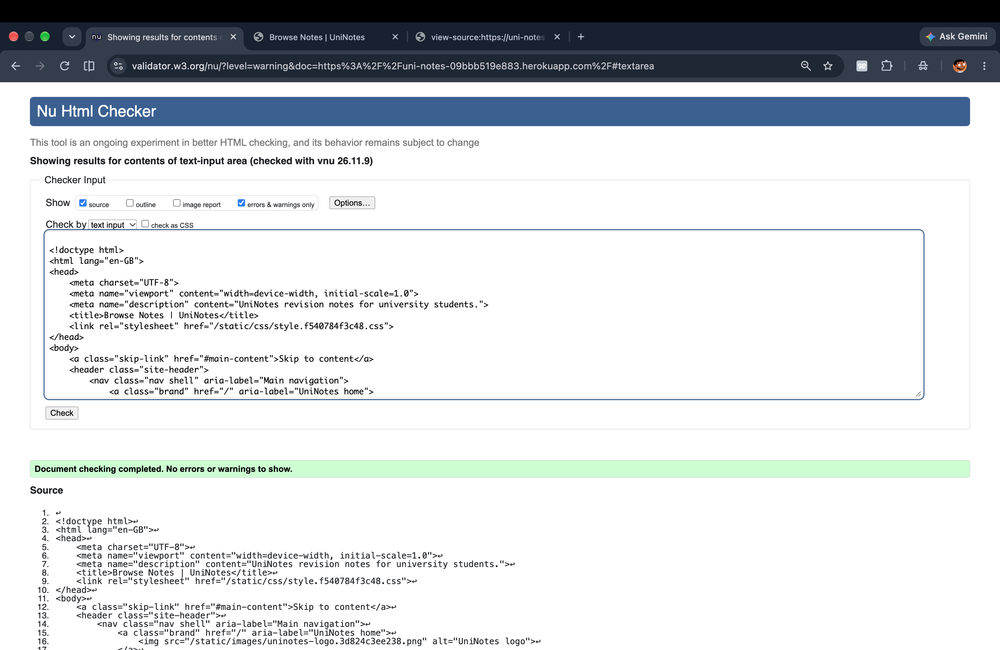 |
| HTML03 | `browse.html` | Deployed Browse page with a subject selected | Pass. The results page reported no HTML errors or warnings. | 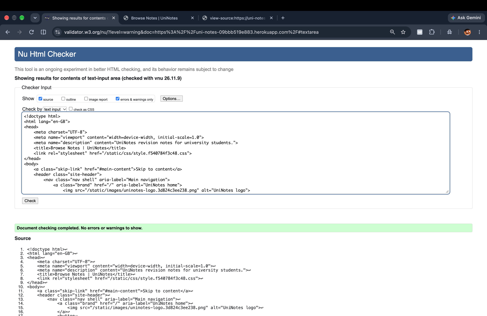 |
| HTML04 | `detail.html` | Deployed study note detail page | Pass. The results page reported no HTML errors or warnings. | 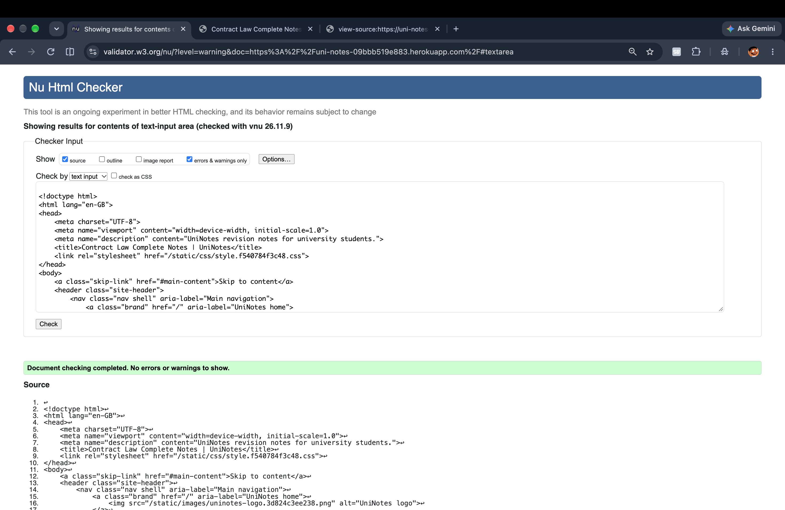 |
| HTML05 | `register.html` | Deployed registration page | Pass. The results page reported no HTML errors or warnings. |  |
| HTML06 | `login.html` | Deployed sign-in page | Pass. The results page reported no HTML errors or warnings. | 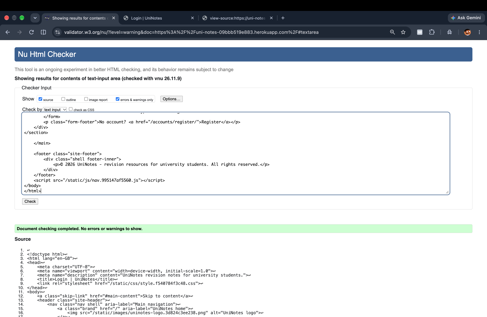 |
| HTML07 | `revision_list.html` | Deployed My revision notes page | Pass. The results page reported no HTML errors or warnings. |  |
| HTML08 | `revision_form.html` | Deployed create revision note page | Pass. The results page reported no HTML errors or warnings. | 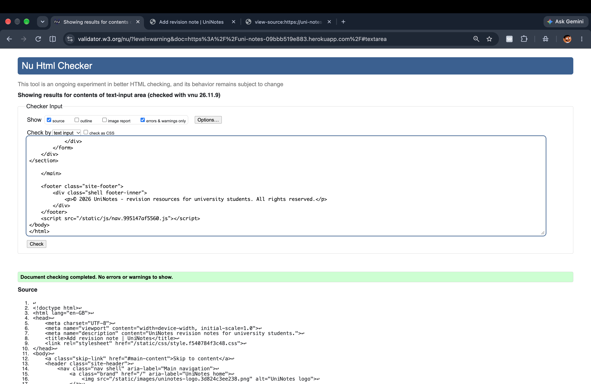 |
| HTML09 | `revision_detail.html` | Deployed revision note detail page | Pass on retest. The initial check reported two heading warnings, which cleared after the fix. | 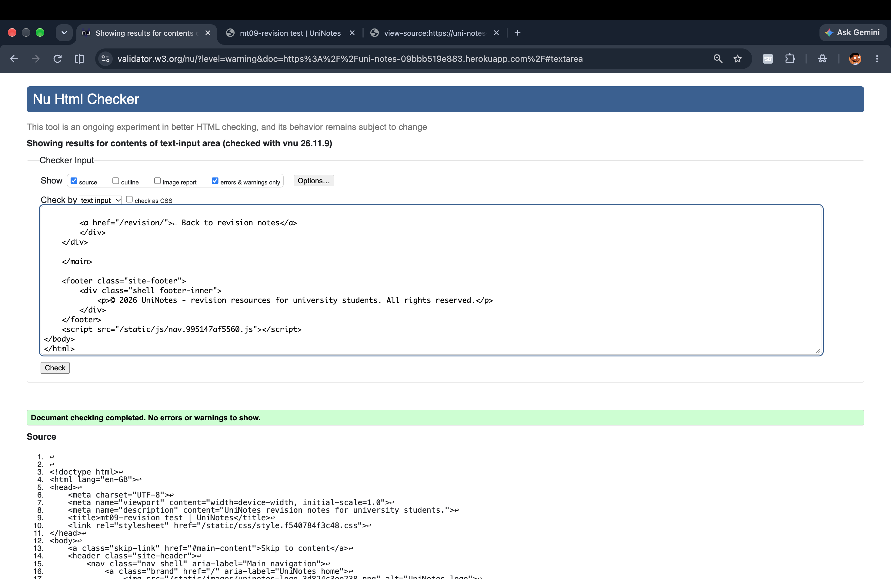 |
| HTML10 | `revision_form.html` | Deployed edit revision note page | Pass. The results page reported no HTML errors or warnings. | 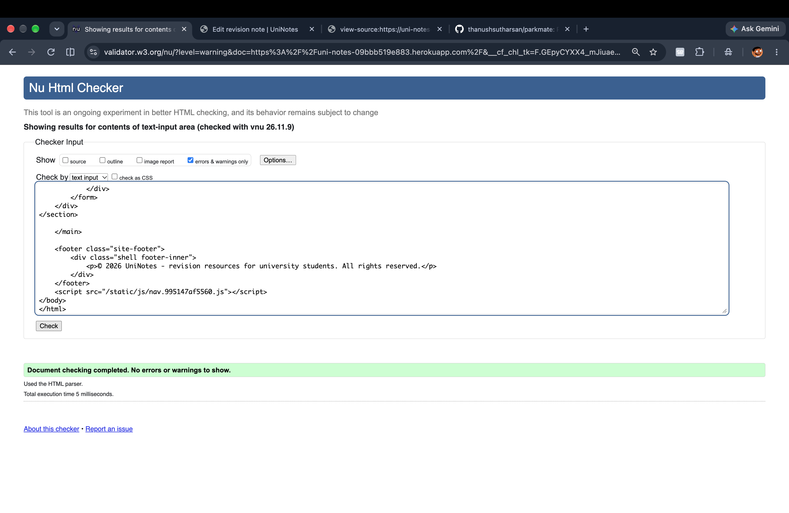 |
| HTML11 | `revision_confirm_delete.html` | Deployed delete revision note confirmation page | Pass. The results page reported no HTML errors or warnings. |  |
| HTML12 | `my_purchases.html` | Deployed My Purchases page | Pass. The results page reported no HTML errors or warnings. | 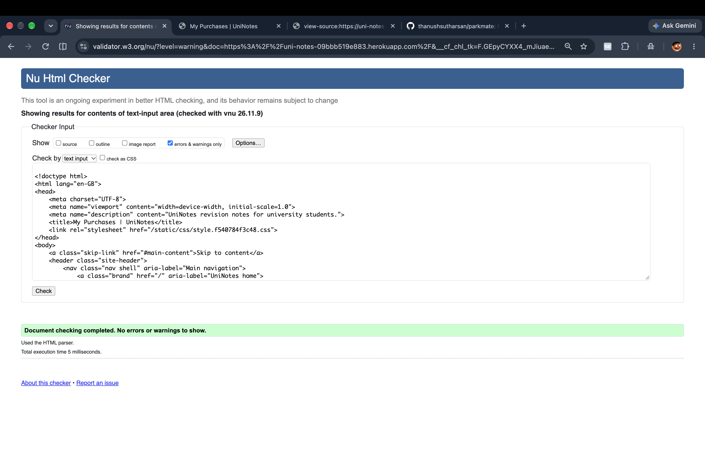 |
| HTML13 | Django 404 response | Deployed Page Not Found page | Pass. The results page reported no HTML errors or warnings. | 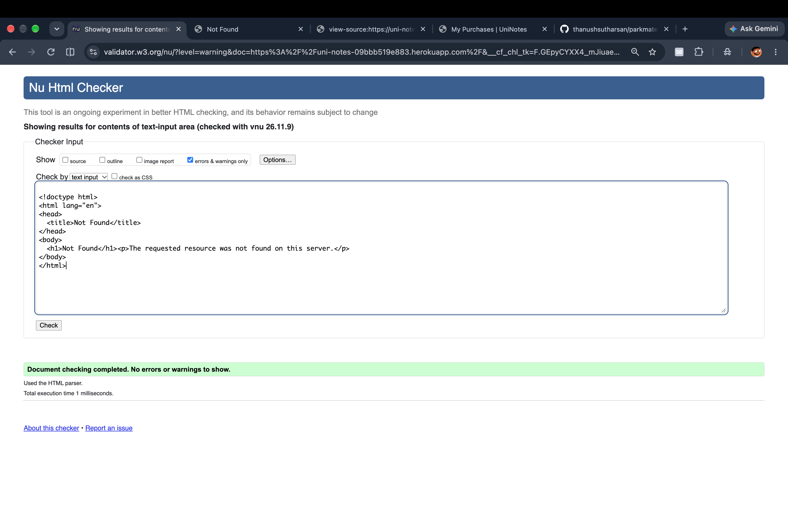 |
### Issues and Re-Tests

#### HTML02 – Browse Heading Hierarchy

The W3C Nu HTML Checker reported that the Browse page skipped a heading level. The page title was an `h1`, and the note titles rendered by `partials_note_card.html` were `h3` headings. There was no `h2` between them.

I first changed the Browse title to an `h2`. The next check warned that the page had no level-one heading, so I restored `Browse notes` to an `h1` in `browse.html`. I then added an `h2` labelled `Study note results` immediately above the note grid. I used the project's existing `sr-only` class so the heading is available to screen readers without changing the visible layout.

The note titles stayed as `h3` headings because the shared card template is also used on the homepage, where the cards already sit under the `Latest study notes` heading. The Browse page now follows the order `h1` (Browse notes), `h2` (Study note results), then `h3` (individual note titles).

After deploying the fix, I copied the live Browse page source again and reran the checker. The heading error cleared and the final check reported **0 HTML errors**.

#### HTML09 – Revision Detail Heading Warnings

I forgot to take a screenshot of the initial check, so I recorded the two warnings in writing:

- The checker advised using `h1` as a top-level heading because the note title was inside nested `section` and `article` elements.
- The checker reported that the outer `section` lacked a heading.

I replaced both layout wrappers with `div` elements in `revision_detail.html`, keeping their CSS classes and the note title as the page's `h1`.

After deploying the fix, I copied the live page source again and reran the checker. It reported **0 errors and 0 warnings**. The screenshot in the HTML09 row shows the retest result.

### HTML Validation Summary

I completed 13 HTML validation checks on the deployed UniNotes site using the W3C Nu HTML Checker. All 13 checks finished with no HTML errors.

The initial checks identified heading issues on the Browse and revision note detail pages. I corrected the heading structure on both pages, deployed the changes, and validated their page source again. Both retests returned zero errors and zero warnings.

The results table links to the screenshots for each check. I recorded the two initial revision detail warnings in writing because I only captured a screenshot of the retest.